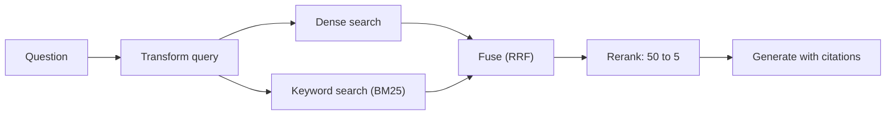
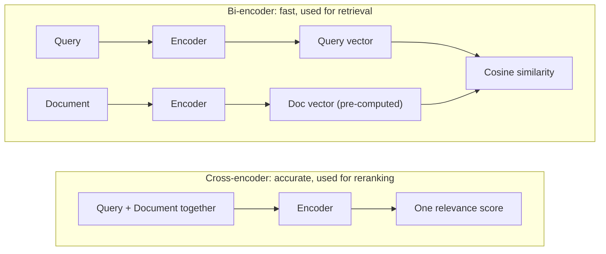
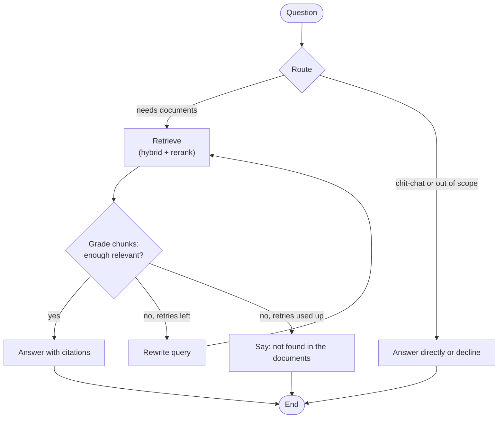

> [!summary] Basic RAG fails in a handful of known ways. Each advanced technique fixes one of them: hybrid search for exact terms, reranking for precision, query transformation for badly worded questions, enrichment for chunks that lost their context, and an agentic loop for when one search is not enough. Add them one at a time, cheapest first, and keep only what your evals say helped.

## Why this matters

A demo RAG works on five hand-picked questions. A production RAG must work on thousands of messy ones. The gap is closed by the techniques in this post, and interviewers know it: "your retrieval misses error codes, what do you do?", "bi-encoder vs cross-encoder?", "what is RRF?", "when would you make RAG agentic?".

## The idea in plain words

Think of a good librarian. A new assistant takes your question, walks to one shelf, and hands you the first five books. The experienced librarian does more:

- asks what you really mean (query transformation),
- checks both the subject catalogue and the title index (hybrid search),
- pulls thirty candidates and then picks the best five by reading the blurbs (reranking),
- knows that a torn-out page needs its chapter title to make sense (chunk enrichment),
- glances at what was found and, if it is off, searches again with different words (agentic RAG).

None of these replace the basic pipeline in [RAG Fundamentals](/blog/rag-fundamentals). They are stages you add around it.



## How it works

### Hybrid search and Reciprocal Rank Fusion

**Problem it fixes:** dense search misses exact tokens. Embeddings capture meaning, so `E-4012` and `E-4021` look almost the same to them. The same goes for order ids, people's names, function names, product codes and rare jargon the embedding model never saw.

**BM25** is the classic keyword scoring formula. A document scores high when it contains the query words, more so when those words are rare in the collection (inverse document frequency) and when the document is not just long. **Hybrid search** runs BM25 and dense search side by side and merges the two result lists.

The merge has a catch: BM25 scores and cosine scores are on different scales, so you cannot add them. **Reciprocal Rank Fusion (RRF)** avoids the issue by using only the position of each document in each list:

```
RRF_score(d) = sum over each list of  1 / (k + rank_of_d_in_that_list)
```

`rank` starts at 1 for the best result. `k` is a constant that softens the gap between top positions. The original paper used `k = 60` and most systems keep it. A document missing from a list adds nothing for that list.

> [!example] Dense returns A, B, C. BM25 returns C, A, D. With k = 60: A = 1/61 + 1/62 = 0.03252. C = 1/63 + 1/61 = 0.03227. B = 1/62 = 0.01613. D = 1/63 = 0.01587. Fused order: A, C, B, D. Documents found by both lists rise above documents found by one.

### Reranking with cross-encoders

**Problem it fixes:** the right chunk is retrieved, but at position 23, and you only pass 5 to the LLM.

The embedding model is a **bi-encoder**: it encodes the query and each document separately, so document vectors can be computed ahead of time. That is fast, but the model never sees the query and the document together. A **cross-encoder** reads the query and one document together in a single pass and outputs one relevance score. It is far more accurate and far slower, because nothing can be pre-computed.



So you use both in two stages: retrieve a wide net (say 50 candidates) with the cheap method, then rerank those 50 with the cross-encoder and keep the best 5. The first stage is tuned for recall, the second for precision. Rerankers come as open models you host or as hosted APIs. Reranking adds latency that grows with the number and length of candidates, so measure it.

### Query transformation

**Problem it fixes:** the user's words are a poor search query. All of these use an LLM call before retrieval.

| Technique | What it does | Use when |
|---|---|---|
| **Rewriting** | Turns a chatty or follow-up message into a clean standalone query | Chat with history ("and for contractors?"). Almost always worth it |
| **Multi-query** | Generates several phrasings, searches each, fuses with RRF | Recall is low because wording varies |
| **HyDE** | Asks the LLM to write a hypothetical answer, then embeds that instead of the question | Questions and documents look very different. Risky when the fake answer is wrong for your domain |
| **Decomposition** | Splits one complex question into sub-questions, retrieves for each | Comparisons and multi-part questions |
| **Step-back** | Also asks a more general question to fetch background | Very specific questions that need a principle or definition |

Each adds an LLM call, so latency and cost go up. Use a small, cheap model for this step.

### Metadata filtering and self-query

**Problem it fixes:** "What changed in the leave policy in 2026?" should not search 2019 documents. Similarity alone does not understand dates, authors or document types.

In **self-query** retrieval, the LLM turns the question into two parts: a search string and a structured filter, for example `{"doc_type": "policy", "year": 2026}`. Use structured output with a Pydantic model (see [Structured Outputs and Tool Calling](/blog/structured-outputs-and-tool-calling)), allow only known fields and values, and drop the filter if it does not validate. A wrong filter is worse than no filter, because it silently hides the right document.

### Contextual chunk enrichment

**Problem it fixes:** a chunk that says "Revenue grew 3% over the previous quarter" does not say which company or which quarter. The chunk lost its context when it was cut out.

The fix, described by Anthropic as **contextual retrieval**: at indexing time, give an LLM the whole document plus one chunk and ask for a short context (a sentence or two) that places the chunk in the document. Prepend that context to the chunk, then embed it and also index it for BM25. Anthropic reported clear drops in failed retrievals from this, more when combined with hybrid search and reranking. It costs one LLM call per chunk at indexing time. Provider prompt caching makes this much cheaper because the same document is sent with every one of its chunks. The cheaper cousin is to prepend the document title and heading path, with no LLM at all.

### Parent-document (small-to-big) retrieval

**Problem it fixes:** small chunks match precisely but give the LLM too little to answer from. Large chunks do the opposite.

Index small child chunks, each storing the id of its parent section. Search over the children, then hand the LLM the parents, with duplicates removed. A variation is the "sentence window": retrieve one sentence and return it with its neighbours.

### Agentic RAG

**Problem it fixes:** a fixed pipeline searches exactly once and answers with whatever came back, even if it is junk. Some questions need no search, some need two, some need a different source.

**Agentic RAG** puts decisions into the flow (see [Agent Fundamentals](/blog/agent-fundamentals)):

- **Router**: decides where the question goes. No retrieval for "hello", the vector store for policy questions, perhaps SQL or web search for others.
- **Relevance grader**: an LLM call that looks at each retrieved chunk and answers "relevant to the question, yes or no".
- **Rewrite and retry**: if too little is relevant, rewrite the query and search again, up to a fixed limit.
- **Answer checks** (optional): is the answer supported by the chunks, and does it address the question?

Two papers gave these ideas their names. **Corrective RAG (CRAG)** adds a retrieval evaluator and takes a corrective action, such as web search, when the retrieved documents look poor. **Self-RAG** trains the model itself to decide when to retrieve and to critique its own output. In practice, most teams implement the ideas with ordinary LLM calls arranged as a graph. Here is that flow for a document Q&A assistant, built with LangGraph (see [LangChain and LangGraph](/blog/langchain-and-langgraph)):



The cost is real: every grade and rewrite is an LLM call, so latency and spend rise, and a loop without a hard limit can run forever. Use it when your evals show multi-step or badly worded questions failing, not by default.

### GraphRAG in a paragraph

**GraphRAG** uses an LLM at indexing time to extract entities (people, products, systems) and the relationships between them into a knowledge graph. Microsoft's version then groups the graph into communities and writes a summary for each. It helps with questions that no single chunk answers: "what are the main themes across these reports?" or multi-hop questions such as "which teams depend on the service that Priya's team owns?". It is worth it when your questions are about connections or the whole corpus. It is not worth it for ordinary "find the passage" questions: indexing needs many LLM calls, updates are harder, and extraction errors end up in the graph.

### Tables and images in brief

Tables: keep them whole in one chunk, store them as Markdown or HTML, and embed an LLM-written summary of the table while passing the full table to the generator. For questions that need arithmetic over many rows, load the table into a database and use text-to-SQL instead (see [Multi-Agent Systems and Human-in-the-Loop](/blog/multi-agent-and-human-in-the-loop) for a text-to-SQL agent with human approval). Images and charts: either have a vision model write a description and index that text, or use a multimodal embedding model. Keep a link to the original image so the answer can show it.

### Caching

- **Embedding cache**: key by content hash and model name, so unchanged chunks are never re-embedded.
- **Retrieval cache**: same normalised query and filters give the same chunk ids.
- **Answer cache**: return a stored answer for a repeated question. A **semantic cache** matches similar questions by embedding, which risks serving the wrong answer for a question that only looks similar.
- **Prompt caching** by the provider: cheaper repeated prompt prefixes.

Cache keys must include the tenant or permission scope and an index version, or you will leak data or serve stale answers. See [Cost, Latency and Reliability](/blog/cost-latency-and-reliability).

### Freshness and incremental re-indexing

Store a content hash and a last-modified time per document. A scheduled job or a change event compares hashes, re-chunks and re-embeds only changed documents, and deletes chunks of removed documents. Deletion is the step people forget, and it is how a bot ends up citing a policy that no longer exists. Put a date or version in the metadata so you can prefer newer sources and show the date in citations.

### Access control per document

Each chunk carries who may see it (tenant id, groups, or an access list copied from the source system). Every search filters on the caller's identity, taken from the authenticated session in backend code. Filter before or during retrieval, never after generation. Permissions change, so sync them as part of incremental indexing. Row-level security in Postgres is a good second layer. More in [Guardrails and Security](/blog/guardrails-and-security).

### The RAG improvement ladder

Climb one step at a time. After each step, re-run the same eval set ([Evals: Measuring LLM Apps](/blog/evals)). Keep the change only if the number moved.

| Step | What to do | Cost |
|---|---|---|
| 0 | Build a golden set, measure the baseline, read 20 failures by hand | An afternoon |
| 1 | Fix parsing and chunking. Add title and headings to each chunk | Re-index |
| 2 | Tune top-k and the answer prompt | Minutes |
| 3 | Add hybrid search with RRF | One more index |
| 4 | Add a reranker (retrieve 50, keep 5) | Extra latency per query |
| 5 | Query rewriting for chat history, then multi-query or decomposition | One or more LLM calls per query |
| 6 | Contextual chunk enrichment or parent-child retrieval | LLM calls at indexing, re-index |
| 7 | Agentic loop: route, grade, rewrite | Several LLM calls per query |
| 8 | Fine-tuned embeddings or GraphRAG | Days of work, ongoing upkeep |

The order is a rule of thumb. Your failure analysis in step 0 decides what to try. If most failures are error codes, go straight to hybrid search.

## Code you should be able to write

BM25 from scratch. The interviewer wants the three ideas: term frequency, inverse document frequency, length normalisation.

```python
import math
import re
from collections import Counter


def tokenize(text: str) -> list[str]:
    return re.findall(r"[a-z0-9_\-]+", text.lower())


class BM25:
    def __init__(self, docs: list[str], k1: float = 1.5, b: float = 0.75) -> None:
        self.k1, self.b = k1, b
        self.doc_tokens = [tokenize(d) for d in docs]
        self.doc_freqs = [Counter(tokens) for tokens in self.doc_tokens]
        self.avg_len = sum(len(t) for t in self.doc_tokens) / len(docs)
        n = len(docs)
        df = Counter(term for tokens in self.doc_tokens for term in set(tokens))
        # rare words get a high idf, common words a low one
        self.idf = {t: math.log(1 + (n - d + 0.5) / (d + 0.5)) for t, d in df.items()}

    def score(self, query: str, i: int) -> float:
        freqs, length = self.doc_freqs[i], len(self.doc_tokens[i])
        total = 0.0
        for term in tokenize(query):
            tf = freqs.get(term, 0)
            if tf == 0:
                continue
            norm = 1 - self.b + self.b * length / self.avg_len  # long docs are penalised
            total += self.idf[term] * tf * (self.k1 + 1) / (tf + self.k1 * norm)
        return total

    def search(self, query: str, k: int = 5) -> list[tuple[int, float]]:
        scored = [(i, self.score(query, i)) for i in range(len(self.doc_tokens))]
        scored = [(i, s) for i, s in scored if s > 0]
        return sorted(scored, key=lambda pair: pair[1], reverse=True)[:k]


docs = [
    "Error E-4012 means the SIP trunk rejected the call.",
    "Calls can fail when the network is congested.",
    "To reset your password open the account settings page.",
]
print(BM25(docs).search("what is error E-4012"))  # doc 0 first, thanks to the exact code
```

Document 1 also gets a small score because it shares the word "is". Real systems remove such stop words or rely on idf to keep their weight low.

RRF fusion:

```python
def rrf(rankings: list[list[str]], k: int = 60, top_n: int = 5) -> list[tuple[str, float]]:
    """Fuse several ranked lists of ids. Only positions matter, not raw scores."""
    scores: dict[str, float] = {}
    for ranking in rankings:
        for rank, doc_id in enumerate(ranking, start=1):  # rank starts at 1
            scores[doc_id] = scores.get(doc_id, 0.0) + 1.0 / (k + rank)
    return sorted(scores.items(), key=lambda pair: pair[1], reverse=True)[:top_n]


dense = ["A", "B", "C"]   # best first, from vector search
sparse = ["C", "A", "D"]  # best first, from BM25
print(rrf([dense, sparse]))  # A, C, B, D
```

Reranking with a cross-encoder from `sentence-transformers` (`uv add sentence-transformers`). The default below is a small English model. Pick one that fits your language.

```python
import os

from sentence_transformers import CrossEncoder

reranker = CrossEncoder(os.getenv("RERANK_MODEL", "cross-encoder/ms-marco-MiniLM-L6-v2"))


def rerank(query: str, chunks: list[dict], top_k: int = 5) -> list[dict]:
    """chunks: [{"id": ..., "text": ...}], e.g. the 50 candidates from hybrid search."""
    results = reranker.rank(query, [c["text"] for c in chunks], top_k=top_k)
    # each result is {"corpus_id": index into the list we passed, "score": float}
    return [chunks[r["corpus_id"]] | {"rerank_score": float(r["score"])} for r in results]
```

`reranker.predict([(query, text), ...])` returns the raw scores if you want to sort yourself. Use the scores for ordering only. Their scale differs between models.

The grade, rewrite and retry loop in plain Python. The four functions passed in are each one retrieval call or one LLM call.

```python
from dataclasses import dataclass
from typing import Callable


@dataclass
class RagResult:
    answer: str
    sources: list[str]
    attempts: int


def agentic_rag(
    question: str,
    retrieve: Callable[[str], list[dict]],        # query -> [{"id": ..., "text": ...}]
    grade: Callable[[str, dict], bool],           # (question, chunk) -> relevant?
    rewrite: Callable[[str, list[str]], str],     # (question, queries tried) -> new query
    generate: Callable[[str, list[dict]], str],   # (question, chunks) -> answer
    max_attempts: int = 3,
    min_relevant: int = 1,
) -> RagResult:
    query = question
    tried: list[str] = []
    for attempt in range(1, max_attempts + 1):
        tried.append(query)
        chunks = retrieve(query)
        # always grade against the ORIGINAL question, not the rewritten query
        relevant = [c for c in chunks if grade(question, c)]
        if len(relevant) >= min_relevant:
            answer = generate(question, relevant)
            return RagResult(answer, [c["id"] for c in relevant], attempt)
        if attempt < max_attempts:
            query = rewrite(question, tried)  # try different words next time
    # the loop must end: give an honest fallback, never an invented answer
    return RagResult("I could not find this in the documents.", [], max_attempts)
```

In LangGraph, `retrieve`, `grade`, `rewrite` and `generate` become nodes, the `if` becomes a conditional edge, and `attempt` lives in the graph state.

## In production

- **Every stage needs its own number.** Recall@50 for retrieval, precision or nDCG@5 after reranking, faithfulness for the answer. Otherwise a gain in one stage hides a loss in another.
- **Latency adds up.** Rewrite, two searches, rerank, grade and generate are five or more steps. Run dense and BM25 in parallel, grade chunks in parallel, use small models for rewriting and grading, and stream the final answer.
- **BM25 needs the same care as embeddings**: tokenisation, stemming and language matter. In Postgres, built-in full-text search (`tsvector`, `ts_rank`) is a keyword ranker but not true BM25. It is often good enough as the keyword half. Extensions and search engines such as Elasticsearch or OpenSearch give real BM25.
- **Rerankers have an input length limit.** Long chunks get cut off silently. Check the model card.
- **Graders can be wrong.** A strict grader throws away good chunks and causes pointless retries. Evaluate the grader itself on a small labelled set.
- **Cap the loop** and log why it ended. Track how often the fallback fires. A rising rate means retrieval got worse or users are asking about things you have not indexed.
- **HyDE and multi-query can drift.** Generated text can pull the search toward the model's guess. Keep the original question in the fused set.
- **More machinery is more to maintain.** Report results honestly: if v2 with five extra stages is not better than v1 on the eval, say so and remove the stages.

## Interview questions

**Q: Why does keyword search still matter when we have embeddings?**
Embeddings capture meaning but blur exact tokens. Ids, error codes, names and rare terms are matched far better by keyword scoring such as BM25. Hybrid search uses both so that paraphrases and exact terms are each covered.

**Q: What is Reciprocal Rank Fusion and why use it instead of adding scores?**
RRF gives each document the sum of `1 / (k + rank)` over the result lists, with k usually 60. It uses only ranks, so it does not matter that BM25 and cosine scores are on different scales. It needs no tuning and rewards documents that appear in several lists.

**Q: Bi-encoder vs cross-encoder?**
A bi-encoder embeds query and document separately, so document vectors are pre-computed and search is fast. A cross-encoder reads the pair together and gives a more accurate relevance score, but must run once per pair at query time. So we retrieve with the bi-encoder and rerank a short list with the cross-encoder.

**Q: Why not use the cross-encoder for everything?**
It would need one model pass per document per query. For a million chunks that is a million passes for each question. It is only practical on a few dozen candidates.

**Q: What is HyDE and when does it fail?**
The LLM writes a hypothetical answer and we embed that instead of the question, because an answer looks more like the stored passages than a question does. It fails when the model's guess is wrong or off-domain, since the search then follows the wrong text. It also adds an LLM call.

**Q: Users ask "compare plan A and plan B" and get half an answer. Fix?**
One query retrieves chunks about only one plan. Decompose the question into sub-questions, retrieve for each, and merge the chunks before generating. In an agentic setup, the model plans the sub-queries itself.

**Q: What is contextual retrieval?**
At indexing time, an LLM writes a short context for each chunk that places it in its document, and that context is prepended before embedding and keyword indexing. It fixes chunks that are ambiguous on their own. The cost is one LLM call per chunk, reduced by prompt caching.

**Q: What makes RAG "agentic", and what does it cost?**
The model makes decisions inside the flow: whether to retrieve, whether the results are relevant, whether to rewrite and try again. It handles vague and multi-step questions better. It costs more LLM calls, more latency, and needs a retry limit and a fallback.

**Q: When would you use GraphRAG?**
When questions are about relationships between entities or about the corpus as a whole, which no single chunk can answer. I would not use it for ordinary lookup questions, because building and updating the graph takes many LLM calls and adds upkeep.

**Q: Retrieval recall@50 is high but answers are still wrong. Where do you look?**
The right chunk is among the candidates but is not reaching the model or is being ignored. I check where it ranks after fusion and reranking, how many chunks I pass, whether they are truncated, and then the prompt. Adding or tuning the reranker is the usual fix.

**Q: How do you enforce document-level permissions in RAG?**
Each chunk stores its access scope. The retrieval query filters on the authenticated user's identity before or during search, and caches are keyed by that scope. I never filter after generation, because by then the model has already read the text.

**Q: How do you keep the index fresh without re-embedding everything?**
Hash each document's content. A scheduled or event-driven job re-chunks and re-embeds only documents whose hash changed and deletes chunks of removed documents. Metadata carries a version or date.

**Q: You have a basic RAG at 60% answer accuracy. What is your plan?**
Read failures and sort them into retrieval or generation problems. Then climb the ladder cheapest first: parsing and chunking, hybrid search, reranking, query rewriting, enrichment, and only then an agentic loop. One change at a time, each measured on the same eval set.

**Q: Design the retrieval layer for a support bot over 2 million tickets and docs.**
Postgres with pgvector HNSW for dense search and a keyword index beside it, both filtered by tenant and product. Run both in parallel, fuse with RRF, rerank the top 50 to 5 with a cross-encoder, and cache query embeddings. An incremental indexer keeps it fresh. Recall, latency and cost are tracked per stage.


## Go deeper

- [Anthropic: Introducing Contextual Retrieval](https://www.anthropic.com/news/contextual-retrieval): contextual chunks, hybrid search and reranking measured together. The best single read on this topic.
- [Pinecone Learn: Rerankers and Two-Stage Retrieval](https://www.pinecone.io/learn/series/rag/rerankers/): bi-encoder vs cross-encoder with diagrams.
- [LangGraph docs: Build a custom RAG agent](https://docs.langchain.com/oss/python/langgraph/agentic-rag): the grade and rewrite loop as a real graph.
- [Sentence Transformers: Cross-Encoder usage](https://sbert.net/docs/cross_encoder/usage/usage.html): the official docs for `CrossEncoder.rank` and `predict`.
- [RRF paper (Cormack, Clarke, Buettcher)](https://cormack.uwaterloo.ca/cormacksigir09-rrf.pdf): two pages, the source of the formula and of k = 60.
- [HyDE paper](https://arxiv.org/abs/2212.10496): "Precise Zero-Shot Dense Retrieval without Relevance Labels".
- [Corrective RAG paper](https://arxiv.org/abs/2401.15884) and [Self-RAG paper](https://arxiv.org/abs/2310.11511): where the grading and self-critique ideas come from.
- [GraphRAG documentation](https://microsoft.github.io/graphrag/): Microsoft's implementation, with the paper at [arxiv.org/abs/2404.16130](https://arxiv.org/abs/2404.16130).
