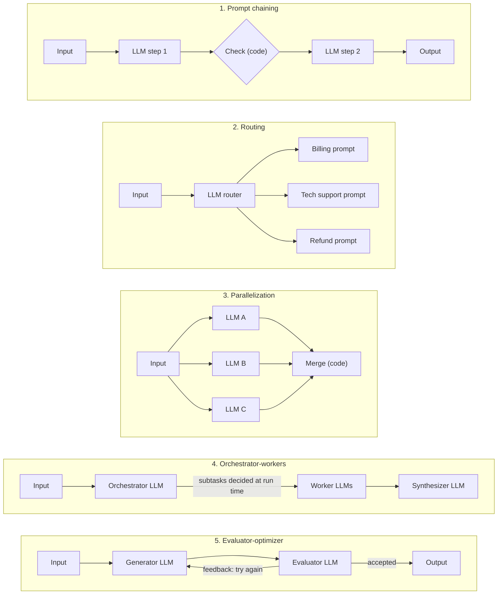
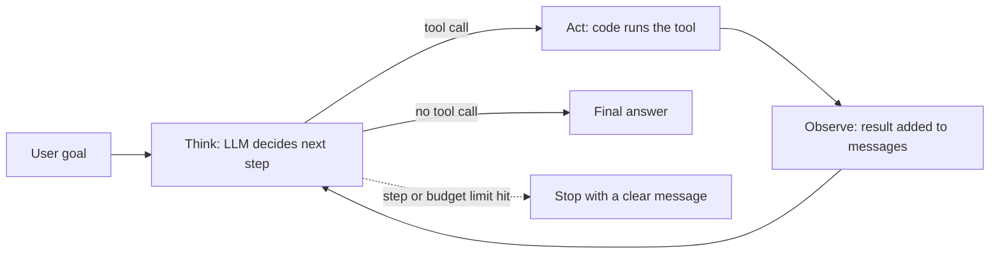

> [!summary] An agent is an LLM that calls tools in a loop until a goal is met. Most production systems should be a single call or a fixed workflow first, and become an agent only when the steps cannot be known in advance.

## Why this matters

Almost every AI engineer interview asks "what is an agent?" and "when would you not use one?". Many also ask you to write the agent loop on a whiteboard or in a shared editor. In production, the hard part is not making an agent run. It is making it stop, stay cheap, and fail safely. This post gives you the vocabulary, the loop, and the failure maths.

## The idea in plain words

Think of two ways to get a parcel delivered.

- A **conveyor belt** in a warehouse: every parcel goes through the same stations in the same order. You designed the path. This is a **workflow**.
- A **courier** with a phone and a map: you give the address, and the courier decides which roads to take, calls you if the gate is locked, and stops when the parcel is delivered. This is an **agent**.

The conveyor belt is cheap, fast and predictable, but it cannot handle a parcel it was not built for. The courier handles surprises, but costs more, takes longer, and can get lost.

In code, an **agent** is an LLM that is given a goal and a set of **tools** (functions it may ask your code to run), and that runs in a loop: decide the next action, your code runs it, the result goes back to the model, repeat until done. The model chooses the path. Your code only runs the loop and the tools.

Anthropic's post "Building effective agents" draws the line the same way:

- **Workflows**: LLMs and tools are orchestrated through predefined code paths. You wrote the path.
- **Agents**: the LLM dynamically directs its own process and tool usage. The model picks the path.

Both are called "agentic systems". The word "agent" is used loosely in the industry, so in an interview, state which meaning you are using.

## How it works

### Start with the simplest thing that works

Climb this ladder one step at a time, and stop as soon as your evals pass (see [Evals: Measuring LLM Apps](/blog/evals)):

1. **A single LLM call** with a good prompt, maybe with retrieval and examples.
2. **A workflow**: a few calls wired together by your code.
3. **An agent**: the model decides the steps in a loop.

Each step up buys flexibility and costs you latency, money and predictability.

### The five common workflow patterns

These are the patterns named in Anthropic's post. Learn the names; interviewers use them.



| Pattern | What it does | Use it when | Example |
|---|---|---|---|
| Prompt chaining | Fixed sequence of calls; each uses the last output; code checks ("gates") in between | The task splits cleanly into fixed steps | Write an outline, check it, then write the document |
| Routing | Classify the input, then send it to a specialised prompt or model | Inputs fall into distinct categories | Easy questions to a small model, hard ones to a frontier model |
| Parallelization | Run several calls at once, then merge. Two flavours: **sectioning** (different subtasks) and **voting** (same task several times) | Subtasks are independent, or you want several opinions | One call answers, another checks for unsafe content |
| Orchestrator-workers | One LLM breaks the task into subtasks at run time, hands them to workers, and combines the results | You cannot know the subtasks in advance | A code change that touches an unknown number of files |
| Evaluator-optimizer | One LLM writes, another critiques, loop until good enough | You have clear quality criteria and feedback really helps | Translation with a reviewer pass |

The difference between parallelization and orchestrator-workers: in parallelization your code fixes the subtasks; in orchestrator-workers the model decides them.

### The agent loop (ReAct)

**ReAct** stands for "Reasoning and Acting". It comes from a 2022 paper and is the shape of nearly every agent today: think, act, observe, repeat.



- **Think**: the model reads the whole conversation so far and decides what to do.
- **Act**: it returns a tool call (a tool name plus JSON arguments). Your code runs the function. The model never runs anything itself. See [Structured Outputs and Tool Calling](/blog/structured-outputs-and-tool-calling).
- **Observe**: the tool's result is appended to the message list, and the model is called again.

The original paper made the model write "Thought / Action / Observation" as plain text that was parsed with string matching. Today the "action" is a native tool call, and the "thought" is the model's text or its hidden reasoning. The loop is the same.

### Planning and reflection

Two common additions to the basic loop:

- **Plan-and-execute**: first ask the model for a full plan (a list of steps), then execute the steps one by one, re-planning if something fails. It keeps long tasks on track and lets you show the plan to a human for approval. The cost: a plan made before seeing any data can be wrong, so you need a re-plan step.
- **Reflection**: after producing a result, the model (or a second model) critiques it and tries again. This is the evaluator-optimizer pattern inside an agent. It works best when the critique is grounded in something real, such as a failing test, a schema validation error, or a SQL error. A model re-reading its own answer with no new information often just agrees with itself.

### Stopping conditions

An agent without a stop rule is a bill without a limit. Use several at once:

| Stop rule | How |
|---|---|
| Natural finish | The model replies with no tool call. That text is the answer |
| "Done" tool | A tool such as `submit_answer(answer, confidence)`. Gives you a structured final result you can validate |
| Max steps | Hard cap on loop iterations, for example 8 to 20 |
| Budget | Cap on total tokens, money, or wall-clock time per run |
| Loop detection | Same tool with the same arguments several times in a row: stop or nudge |
| Human stop | A cancel button, or a pause for approval before risky actions |

### Tool design for agents

The model only knows a tool through its name, description and argument schema. Treat those like documentation for a new teammate.

- **Few tools.** Five clear tools beat thirty overlapping ones. Every tool definition also takes space in the context on every step.
- **Clear names and descriptions.** Say what the tool does, when to use it, and when not to. Describe each argument, with an example value.
- **Return useful errors.** "Error: column `user_name` does not exist. Columns are: id, name, email" lets the model fix its own mistake. A stack trace or a bare `500` does not.
- **Return small, relevant results.** Cut long outputs, paginate, and return names the model can use in the next call. A tool that dumps a whole file fills the context fast.
- **Make dangerous tools hard to misuse.** Read-only by default. Separate `preview_refund` from `execute_refund`. Require approval for the second.

### Why agents fail

**1. Compounding errors.** If each step is right with probability `p`, and the task needs `n` steps that must all be right, the chance of finishing correctly is roughly `p ** n`.

| Per-step accuracy | 5 steps | 10 steps | 20 steps |
|---|---|---|---|
| 99% | 95% | 90% | 82% |
| 95% | 77% | 60% | 36% |
| 90% | 59% | 35% | 12% |

This is a simplified model. It assumes steps are independent and that a mistake is never caught. Real agents can recover when a tool returns an error, which is why good error messages and checks matter so much. But the direction is right: long chains are fragile, so keep them short and verify along the way.

**2. Context bloat.** Every step adds messages. After many steps the window fills with old tool output, the model loses track of the goal, and each call gets slower and more costly. See [Memory and Context Engineering](/blog/memory-and-context-engineering).

**3. Tool misuse.** Wrong tool, wrong arguments, made-up argument values, or ignoring a tool result.

**4. Infinite loops.** The model retries the same failing call, or bounces between two tools.

**5. Goal drift and false finishes.** The agent solves a slightly different problem, or says "done" when it is not.

How to contain them:

- Hard limits: max steps, token budget, timeout.
- Validate every tool argument (Pydantic) and feed the error back to the model.
- Fewer steps: give the agent higher-level tools, or move fixed steps out of the loop into plain code.
- Checkpoints that use ground truth: run the tests, run the query, check the schema.
- Sandboxing and least privilege: read-only credentials, isolated containers. See [Guardrails and Security](/blog/guardrails-and-security).
- Human approval before irreversible actions. See [Multi-Agent Systems and Human-in-the-Loop](/blog/multi-agent-and-human-in-the-loop).
- Tracing every step so you can see where it went wrong. See [Observability and Tracing](/blog/observability-and-tracing).

### When not to use an agent

- The steps are known in advance. Use a workflow.
- One call with retrieval answers it. Use that.
- You need low latency (voice, autocomplete) or tight cost per request.
- Mistakes are expensive and cannot be undone, and there is no human check.
- You cannot evaluate it. If you cannot measure success, you cannot ship it safely.

Agents fit open-ended problems where the number of steps is hard to predict and the result can be checked: coding (tests tell you if it worked), research, and data analysis.

### Autonomy levels

There is no official standard for this, but the ladder below is a useful way to talk about how much control you hand over.

| Level | Who decides | Example |
|---|---|---|
| 0. Single call | Code decides everything | Summarise this email |
| 1. Workflow | Code decides the path; LLM fills in steps | Classify, then answer with a template |
| 2. Router | LLM picks one of a few fixed paths | Send to billing or tech support |
| 3. Tool-calling agent with approval | LLM picks the steps; a human approves risky ones | SQL agent that asks before running a query |
| 4. Autonomous agent | LLM picks the steps and acts, inside limits | Coding agent in a sandbox opening a pull request |
| 5. Multi-agent | Agents hand work to other agents | Orchestrator with research sub-agents |

Higher is not better. Pick the lowest level that solves the problem.

## Code you should be able to write

A complete ReAct-style agent with no framework. It has two parts: a tool registry, and the loop. Practise until you can type both in about 15 minutes.

Part 1: the registry. A decorator stores each function with a Pydantic model for its arguments. The model gives you the JSON schema for free, and validates the arguments later.

```python
import os
from typing import Callable

from openai import OpenAI
from pydantic import BaseModel, Field, ValidationError

client = OpenAI(base_url=os.getenv("LLM_BASE_URL"), api_key=os.environ["LLM_API_KEY"])
MODEL = os.environ["LLM_MODEL"]

TOOLS: dict[str, tuple[Callable[..., str], type[BaseModel]]] = {}


def tool(args_model: type[BaseModel]):
    """Register a function as a tool. Its docstring becomes the description."""
    def register(fn: Callable[..., str]) -> Callable[..., str]:
        TOOLS[fn.__name__] = (fn, args_model)
        return fn
    return register


def tool_schemas() -> list[dict]:
    return [
        {"type": "function", "function": {
            "name": name,
            "description": (fn.__doc__ or "").strip(),
            "parameters": model.model_json_schema(),
        }}
        for name, (fn, model) in TOOLS.items()
    ]


class CalcArgs(BaseModel):
    expression: str = Field(description="Arithmetic only, e.g. '(2 + 3) * 4'")


@tool(CalcArgs)
def calculator(expression: str) -> str:
    """Evaluate an arithmetic expression. Use for any maths."""
    if not set(expression) <= set("0123456789+-*/(). "):
        raise ValueError("only digits and + - * / ( ) are allowed")
    return str(eval(expression))  # acceptable here: characters are whitelisted
```

Part 2: running a tool safely, and the loop itself.

```python
def run_tool(name: str, raw_args: str) -> str:
    """Never raises. Errors go back to the model as text so it can fix them."""
    if name not in TOOLS:
        return f"Error: unknown tool '{name}'. Available: {list(TOOLS)}"
    fn, model = TOOLS[name]
    try:
        args = model.model_validate_json(raw_args or "{}")
        return str(fn(**args.model_dump()))
    except ValidationError as e:
        return f"Error: bad arguments: {e.errors(include_url=False)}"
    except Exception as e:
        return f"Error: {type(e).__name__}: {e}"


def run_agent(task: str, max_steps: int = 8) -> str:
    messages: list[dict] = [
        {"role": "system", "content": "Solve the task. Use tools when needed. "
                                      "When you are done, reply with the final answer."},
        {"role": "user", "content": task},
    ]
    for _ in range(max_steps):
        resp = client.chat.completions.create(
            model=MODEL, messages=messages, tools=tool_schemas())
        msg = resp.choices[0].message
        if not msg.tool_calls:                      # no tool wanted: this is the answer
            return msg.content or ""
        messages.append(msg.model_dump(exclude_none=True))   # keep the model's request
        for call in msg.tool_calls:                 # act + observe: one result per call id
            result = run_tool(call.function.name, call.function.arguments)
            messages.append({"role": "tool", "tool_call_id": call.id,
                             "content": result[:4000]})
    return "Stopped: step limit reached without a final answer."


if __name__ == "__main__":
    print(run_agent("What is (17 * 23) + 144 / 12?"))
```

The six things an interviewer looks for, in order:

1. The message list is the agent's whole state.
2. Tool schemas are sent on every call.
3. No tool calls means stop.
4. The assistant message with the tool calls is appended **before** the tool results.
5. Every tool call gets exactly one `tool` message with the matching `tool_call_id`, even when it fails.
6. There is a `max_steps` cap, and tool errors are returned to the model instead of crashing the loop.

> [!tip] If you are asked to extend it, the usual next steps are: a token budget alongside `max_steps`, running several tool calls in parallel with `asyncio.gather`, trimming old tool results, and logging each step for tracing.

## In production

- **Most "agents" in production are workflows with one or two agentic steps.** That is a good thing. Fixed code around a small loop is easier to test and debug.
- **Cost and latency grow faster than you expect.** Each step re-sends the whole history, so total input tokens grow roughly with the square of the number of steps. Prompt caching helps; see [Cost, Latency and Reliability](/blog/cost-latency-and-reliability).
- **Truncate tool output, and say so.** Add "(truncated, 12,000 more characters)" so the model knows there is more and can ask for it.
- **Malformed tool calls happen.** Invalid JSON, missing fields, tools that do not exist. Validation plus a clear error message fixes most of them on the next step.
- **Prompt injection through tool results.** A web page or a file can contain "ignore your instructions and...". Treat tool output as untrusted data, and limit what tools can do. See [Guardrails and Security](/blog/guardrails-and-security).
- **Idempotency.** If a run is retried, a tool like `send_email` may run twice. Make write tools safe to repeat, or guard them with approval.
- **Evaluate the path, not only the answer.** Track the task success rate, the number of steps, tool error rate and cost per task. See [Evals: Measuring LLM Apps](/blog/evals).
- **Frameworks are optional.** The loop above is the core of all of them. Frameworks add persistence, streaming and human-in-the-loop; see [LangChain and LangGraph](/blog/langchain-and-langgraph).

## Interview questions

**Q: What is an AI agent?**
An LLM that is given a goal and tools, and runs in a loop: it decides the next action, the code runs the tool, the result goes back to the model, and this repeats until the goal is met or a limit is hit. The key point is that the model, not the code, decides the sequence of steps.

**Q: What is the difference between a workflow and an agent?**
In a workflow, the developer writes the control flow and the LLM fills in individual steps. In an agent, the LLM decides the control flow at run time. Workflows are more predictable and cheaper; agents handle tasks where the steps cannot be known in advance.

**Q: Name the common workflow patterns.**
Prompt chaining (fixed sequence), routing (classify then dispatch), parallelization (sectioning or voting), orchestrator-workers (a model splits the task at run time and delegates), and evaluator-optimizer (generate, critique, repeat). They come from Anthropic's "Building effective agents" post.

**Q: Explain the ReAct loop.**
Reason, act, observe. The model reasons about what to do, emits a tool call, the code runs it and appends the result, and the model is called again with the longer history. It ends when the model answers without a tool call or a stop rule fires.

**Q: Why does reliability drop as agents take more steps?**
Errors compound. With 95% accuracy per step, ten steps that all must be right succeed about 60% of the time (0.95 to the power 10). The simple formula ignores recovery, but it explains why you keep chains short, verify between steps, and give the model good error messages so it can self-correct.

**Q: How do you stop an agent from looping forever?**
Several layers: a max step count, a token or cost budget, a timeout, and detection of repeated identical tool calls. When a limit is hit, return a clear "stopped" result instead of a guess, and log the run for review.

**Q: What makes a good tool for an agent?**
A clear name, a description that says when to use it, a typed argument schema with descriptions, small and relevant return values, and error messages that tell the model how to fix the call. Keep the tool set small and non-overlapping.

**Q: A tool raises an exception. What should the loop do?**
Catch it and return the error text as the tool result, linked to the same tool call id. The model can often correct itself on the next step. Crashing the loop loses the whole run, and skipping the tool message breaks the message format on most APIs.

**Q: When would you not use an agent?**
When the steps are known up front, when a single call or a RAG pipeline is enough, when latency or cost limits are tight, when actions are irreversible with no human check, or when there is no way to evaluate success.

**Q: What is plan-and-execute, and when does it help?**
The model writes a plan first, then executes the steps, re-planning on failure. It helps on long tasks where a pure step-by-step loop loses direction, and it gives a human something to approve. The risk is a plan made before any data is seen, so a re-plan step is needed.

**Q: Does reflection always improve results?**
No. It helps when the critique uses new evidence such as test failures or validation errors. Without new information, the model tends to confirm its own answer, and you pay for extra calls. Measure it with evals before keeping it.

**Q: Your agent works in the demo but fails one time in five in production. How do you debug it?**
Look at traces of the failed runs and label the failure type: wrong tool, bad arguments, context too long, loop, or false finish. Fix the biggest group first, usually with better tool descriptions, better error messages, or by moving a fixed step into code. Then add those failed cases to the eval set.

**Q: How would you design an agent that can issue refunds?**
Start with a workflow, not a free agent. Give it read-only lookup tools, a separate refund tool with strict Pydantic validation and amount limits, and a human approval step before the refund runs. Add max steps, tracing, idempotency keys on the refund call, and an eval set of past tickets.


## Go deeper

- [Building effective agents (Anthropic)](https://www.anthropic.com/research/building-effective-agents): the source of the workflow-versus-agent split and the five patterns. Read this first.
- [Writing effective tools for agents (Anthropic)](https://www.anthropic.com/research/writing-tools-for-agents): practical advice on tool names, descriptions and return values.
- [LLM Powered Autonomous Agents (Lilian Weng)](https://lilianweng.github.io/posts/2023-06-23-agent/): the classic overview of planning, memory and tool use.
- [ReAct: Synergizing Reasoning and Acting in Language Models](https://arxiv.org/abs/2210.03629): the paper behind the think-act-observe loop.
- [Reflexion: Language Agents with Verbal Reinforcement Learning](https://arxiv.org/abs/2303.11366): the paper most people cite for reflection.
- [How we built our multi-agent research system (Anthropic)](https://www.anthropic.com/research/multi-agent-research-system): orchestrator-workers at scale, with honest notes on cost.
