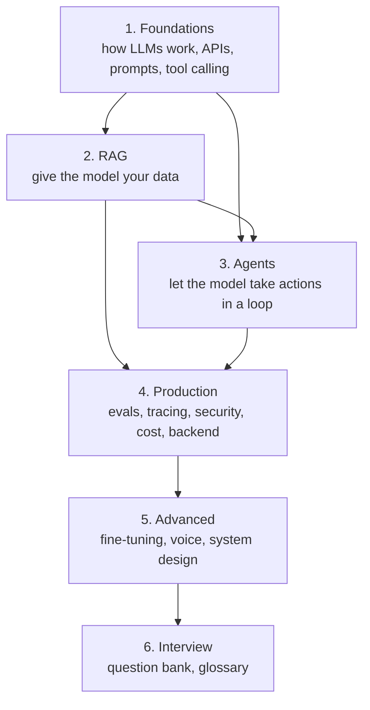

> [!summary] Read the posts in order. Each one has the same shape: why it matters, the idea in plain words, how it works, code to type out yourself, production notes, interview questions, links.

## The big picture

An AI engineer does not train models. An AI engineer builds reliable products on top of models: getting the right context in (RAG, memory), letting the model act (tools, agents), and proving it works (evals, tracing).

## 1. Foundations

| Post | You will be able to explain |
| --- | --- |
| [How LLMs Work](/blog/how-llms-work) | Tokens, attention, context window, temperature, why models hallucinate |
| [LLM APIs and Model Selection](/blog/llm-apis-and-model-selection) | Message roles, streaming, token cost, rate limits, picking a model |
| [Prompt Engineering](/blog/prompt-engineering) | What makes a prompt work, few-shot, chaining, how to iterate with tests |
| [Structured Outputs and Tool Calling](/blog/structured-outputs-and-tool-calling) | Pydantic-validated output, the tool-call round trip |

## 2. RAG

| Post | You will be able to explain |
| --- | --- |
| [Embeddings and Vector Databases](/blog/embeddings-and-vector-databases) | Embeddings, cosine similarity, HNSW, pgvector |
| [RAG Fundamentals](/blog/rag-fundamentals) | Indexing and query pipelines, chunking, where RAG fails |
| [Advanced RAG](/blog/advanced-rag) | Hybrid search, RRF, reranking, query rewriting, agentic RAG |

## 3. Agents

| Post | You will be able to explain |
| --- | --- |
| [Agent Fundamentals](/blog/agent-fundamentals) | Workflows vs agents, the ReAct loop, why agents fail |
| [LangChain and LangGraph](/blog/langchain-and-langgraph) | State, nodes, edges, checkpointers, when to use a framework |
| [Memory and Context Engineering](/blog/memory-and-context-engineering) | What goes in the context window, short and long-term memory |
| [MCP: The Model Context Protocol](/blog/mcp-model-context-protocol) | Hosts, clients, servers, tools/resources/prompts, transports |
| [Multi-Agent Systems and Human-in-the-Loop](/blog/multi-agent-and-human-in-the-loop) | Supervisor pattern, interrupt and resume, approval gates |
| [Coding Agents and Agent Infrastructure](/blog/coding-agents-and-agent-infrastructure) | Coding agents, PR bots, sandboxes, benchmarks, browser infra |

## 4. Production

| Post | You will be able to explain |
| --- | --- |
| [Evals: Measuring LLM Apps](/blog/evals) | Golden sets, LLM-as-judge, RAG and agent metrics, evals in CI |
| [Observability and Tracing](/blog/observability-and-tracing) | Traces, spans, what to log, debugging a bad answer |
| [Guardrails and Security](/blog/guardrails-and-security) | Prompt injection, least privilege, safe SQL, PII |
| [Cost, Latency and Reliability](/blog/cost-latency-and-reliability) | Caching, routing, retries, fallbacks, rate limiting |
| [Backend and Deployment for AI Apps](/blog/backend-and-deployment-for-ai) | FastAPI, async, SSE, queues, Docker, CI, deployment |

## 5. Advanced

| Post | You will be able to explain |
| --- | --- |
| [Fine-Tuning](/blog/fine-tuning) | When to fine-tune, LoRA, comparing against prompting |
| [Voice AI](/blog/voice-ai) | STT, LLM, TTS pipeline, latency budget, barge-in |
| [LLM System Design](/blog/llm-system-design) | A 7-step framework and five worked designs |

## 6. Interview

| Post | Use it for |
| --- | --- |
| [AI Engineering Interview Question Bank](/blog/interview-question-bank) | About 100 questions with short answers, by topic and difficulty |
| [AI Engineering Glossary](/blog/glossary) | Quick lookup of any term |

## Must-know before any interview

If time is short, these seven carry most interviews: [Structured Outputs and Tool Calling](/blog/structured-outputs-and-tool-calling), [RAG Fundamentals](/blog/rag-fundamentals), [Advanced RAG](/blog/advanced-rag), [Agent Fundamentals](/blog/agent-fundamentals), [Evals: Measuring LLM Apps](/blog/evals), [Cost, Latency and Reliability](/blog/cost-latency-and-reliability), [LLM System Design](/blog/llm-system-design).
