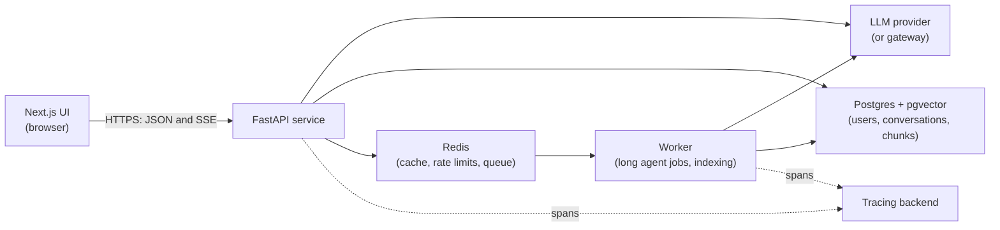
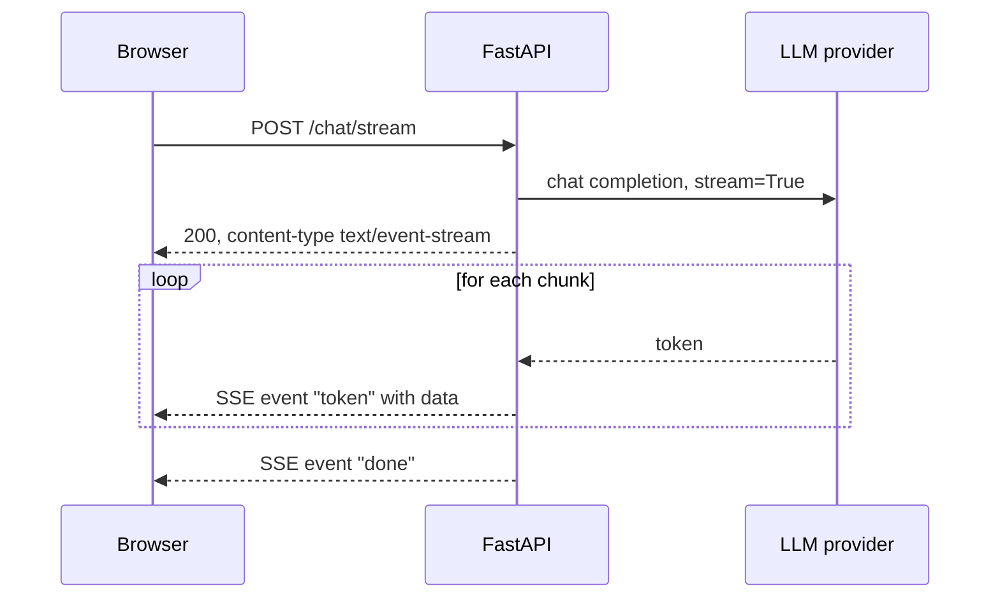
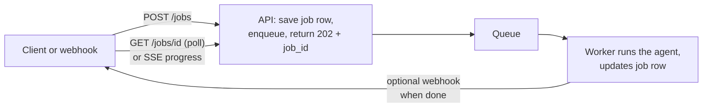

> [!summary] An AI feature is mostly ordinary backend work around a slow, streaming, unreliable API call. This post is the "full-stack" half of the job: a FastAPI service that streams tokens, runs long jobs on a queue, is tested without calling a real model, ships in a container, and is consumed by a Next.js front end.

## Why this matters

A notebook that calls an LLM is not something other people can use. Employers hiring a full-stack AI engineer want someone who can put the model behind an API, stream it to a browser, keep secrets safe, test it and deploy it. In interviews this shows up as "design the backend for a chat app", "SSE or WebSockets?" and "how do you test code that calls an LLM?". Any project you want other people to try needs a live demo, and this post is how you get one.

## The idea in plain words

Think of a restaurant. The model is a brilliant but slow chef. The backend is everything else: the waiter who takes the order and checks it is readable, the kitchen ticket system, the pass where plates come out one at a time, and the rule that a 40-minute dish gets a buzzer instead of a customer standing at the counter.

One waiter can serve many tables because most of the time they are waiting on the kitchen, not working. They take an order, hand it in, and go to the next table. That is **async**: one worker handling many requests by never standing still while waiting. The one thing the waiter must never do is go and chop onions for ten minutes, because every table stops being served. That is **blocking the event loop**.

## How it works

### Reference architecture



The API handles short requests and streams. The worker handles anything long. Postgres holds what must not be lost; Redis holds what is fast and can be rebuilt. Both API and worker send traces (see [Observability and Tracing](/blog/observability-and-tracing)).

### FastAPI essentials

FastAPI is a Python web framework built on type hints. Six ideas cover most of what you need:

| Idea | What it is | Use in an AI app |
|---|---|---|
| **Path operation** | A function with a decorator such as `@app.post("/chat")` | One per endpoint |
| **Pydantic models** | Classes describing request and response bodies; FastAPI validates and documents them | Reject bad input with a 422 before any tokens are spent |
| **Dependency injection** | `Depends(fn)`: FastAPI calls `fn` and passes the result into your endpoint | Supply the LLM client, DB session, current user; swap a fake in tests |
| **Lifespan** | Code that runs once at startup and once at shutdown | Create one LLM client and one DB connection pool, close them cleanly |
| **Background tasks** | `BackgroundTasks`: run a small function after the response is sent | Save a log or feedback; not for long jobs, since it dies with the process |
| **Exception handlers** | Map an exception type to an HTTP response | Turn a provider failure into a clean 502 instead of a stack trace |

### Async against sync

An LLM app is **I/O bound**: it spends its time waiting on the network (the model, the database, a tool), not computing. Python's **event loop** is a single thread that runs many tasks by switching between them whenever one says `await`, which means "I am waiting, let someone else run".

- `async def` endpoint: runs on the event loop. Use async clients inside it (`AsyncOpenAI`, `httpx.AsyncClient`, an async DB driver).
- `def` endpoint: FastAPI runs it in a thread pool, so blocking code is acceptable there, up to the pool size.

> [!warning] Never block the event loop. A sync call inside `async def`, such as `time.sleep`, `requests.get`, the sync `OpenAI` client, or heavy CPU work like parsing a large PDF, freezes every other request on that process until it finishes. Use the async version, or push it to a thread with `await asyncio.to_thread(fn, ...)`, or to a worker.

### Streaming to the browser

| Method | Direction | How it works | Best for |
|---|---|---|---|
| **Polling** | Client asks repeatedly | `GET /jobs/123` every few seconds | Status of long background jobs; simplest, works everywhere |
| **SSE** (server-sent events) | Server to client | One long HTTP response; the server writes `data: ...` lines as events happen | Token streaming, progress and tool-activity events |
| **WebSockets** | Both ways | A persistent two-way connection after an upgrade handshake | Voice, live audio, interrupting mid-answer, collaborative UIs (see [Voice AI](/blog/voice-ai)) |

For chat, use SSE. It is plain HTTP, so it passes through proxies and load balancers, needs no special server, and is what LLM providers themselves use. An SSE event is text: optional `event: name`, then `data: payload`, then a blank line.



One detail: the browser's built-in `EventSource` only does GET requests. Chat needs a POST body, so front ends read the stream with `fetch` and a `ReadableStream`, as in the TypeScript below.

### Long-running agent jobs

A PR review or a document-indexing run can take minutes. Holding an HTTP request open that long fails: proxies time out, users close tabs, a deploy kills it.



- The API returns `202 Accepted` with a job id at once.
- A **worker** process takes jobs from a **queue**. Python options include Celery (mature, many features), arq (small, async, Redis) and RQ (simple, Redis).
- The job row in Postgres holds status (`queued`, `running`, `succeeded`, `failed`), progress and the result. The client polls it, or you call a **webhook** (an HTTP callback to the caller's URL) when done.
- Workers crash. Make jobs safe to retry (idempotent, see [Cost, Latency and Reliability](/blog/cost-latency-and-reliability)) and save progress. **Durable workflow engines** go further: they record each completed step so a job resumes exactly where it stopped. LangGraph's checkpointer gives a similar property for agent state (see [LangChain and LangGraph](/blog/langchain-and-langgraph)).

### Auth, config and data

**Auth and rate limiting.** Know who is calling before you spend tokens. Common setups: a session or JWT from an auth provider for browser users, API keys for programs. Put it in a dependency (`get_current_user`) so every endpoint can require it. Rate-limit per user id (per IP for anonymous demos) with counters in Redis. The LLM key stays on the server; the browser never sees it.

**Config and secrets.** Settings come from environment variables, not from code. `pydantic-settings` reads them into a typed object and fails at startup if one is missing:

```python
from functools import lru_cache
from pydantic import SecretStr
from pydantic_settings import BaseSettings, SettingsConfigDict


class Settings(BaseSettings):
    model_config = SettingsConfigDict(env_file=".env", extra="ignore")

    llm_api_key: SecretStr                  # read from LLM_API_KEY; startup fails if missing
    llm_model: str
    llm_base_url: str | None = None
    database_url: str = "postgresql://localhost/app"


@lru_cache
def get_settings() -> Settings:
    return Settings()
```

`SecretStr` prints as `**********`, so the key does not leak into logs. Keep `.env` out of git; in production set the variables in the platform's secrets store.

**Database basics.** Postgres is a sound default: with the pgvector extension it holds your relational data and your embeddings in one place (see [Embeddings and Vector Databases](/blog/embeddings-and-vector-databases)).

- **Migrations**: versioned scripts that change the schema (Alembic is the usual tool with SQLAlchemy). Never edit a production schema by hand.
- **Connection pooling**: opening a connection is slow and Postgres allows a limited number. Create a pool once in lifespan and borrow from it per request. With several app instances, the pools add up, so size them with the database's limit in mind.
- **Storing conversations**: a `conversations` table (id, user id, title, created at) and a `messages` table (id, conversation id, role, content as JSON, token counts, model, trace id, created at). Storing the trace id lets you jump from a message to its trace.

### Testing

The rule: **unit tests never call a real model**. Real calls are slow, cost money and give different output each run.

- Put the LLM behind a small interface and inject it. In tests, override the dependency with a fake that returns fixed text. Code below.
- Test your own logic: prompt building, output parsing, validation, routing, error paths (make the fake raise).
- Test endpoints with FastAPI's `TestClient` (it is built on httpx), including streaming ones via `client.stream(...)`. For async tests use `httpx.AsyncClient` with `ASGITransport`.
- Quality is tested separately by **evals** against the real model, on a schedule or on prompt changes (see [Evals: Measuring LLM Apps](/blog/evals)).

### Packaging, containers and CI

- **uv** manages the project: `uv init`, `uv add fastapi`, `uv run pytest`. It writes `pyproject.toml` and a lockfile `uv.lock`, so everyone installs the same versions.
- **Docker** packages the app with its runtime. A **multi-stage** build installs dependencies in one stage and copies only the result into a small final image.
- **docker compose** starts the whole local stack with one command:

```yaml
services:
  api:
    build: .
    ports: ["8000:8000"]
    env_file: .env
    depends_on: [db, redis]
  db:
    image: pgvector/pgvector:pg17
    environment: { POSTGRES_PASSWORD: postgres }
    volumes: ["pgdata:/var/lib/postgresql/data"]
  redis:
    image: redis:7
volumes:
  pgdata:
```

- **CI** (continuous integration) runs checks on every push. With GitHub Actions, the usual steps are: install with uv, lint (`ruff check`), type-check (`mypy` or `pyright`), `pytest`, then a small eval run that fails the build if the score drops below a threshold. Keep the eval step small, or run the full set nightly, because it costs real tokens and needs the API key as a repository secret.

### Deployment options

| Category | Examples | Good for | Caveats |
|---|---|---|---|
| Frontend hosting | Vercel, Netlify, Cloudflare Pages | The Next.js app | Serverless functions have time limits, so keep long work in the Python backend |
| Container platforms (PaaS) | Render, Railway, Fly.io | FastAPI plus a worker; simplest path for a portfolio | Free or hobby tiers often sleep when idle, so the first request is slow |
| Serverless containers | Google Cloud Run, AWS App Runner | Scale to zero, pay per use | Cold starts; request time limits; check streaming support and background work rules |
| Managed Postgres | Neon, Supabase, cloud provider databases | Database with pgvector | Free tiers have storage and connection limits and may pause when idle |
| A plain VM | Any cloud VM with Docker Compose | Full control, steady cost | You do the TLS, updates and backups |

Free tiers change often. Before you rely on one, read its current limits: sleep behaviour, request timeout, memory, and whether a card is required.

### The front end side

- **Reading the stream**: `fetch` plus `ReadableStream`, parsing SSE frames (code below). The Vercel AI SDK is an alternative: a TypeScript library with React hooks such as `useChat` that manage messages and streaming for you. It expects its own stream format, so either emit that from FastAPI or write a small adapter. Writing the reader by hand once is worth it for understanding.
- **Typed events, not just text**: send different event names: `token`, `citation`, `tool_start`, `tool_result`, `approval_required`, `error`, `done`. The UI can then show "Searching documents..." while a tool runs.
- **Citations**: send the source list as its own event (id, title, snippet, link) and render numbered markers that open the source.
- **Approval UIs**: when the agent pauses for a human, send `approval_required` with what it wants to do, show Approve and Reject buttons, and resume with a second request that carries the decision (see [Multi-Agent Systems and Human-in-the-Loop](/blog/multi-agent-and-human-in-the-loop)).
- **Small things users notice**: a Stop button (cancel the fetch with `AbortController`), auto-scroll that stops when the user scrolls up, markdown rendered safely, and a clear error state with retry.

## Code you should be able to write

### A FastAPI app with JSON and SSE endpoints

```python
import json
import os
from contextlib import asynccontextmanager
from typing import Annotated, AsyncIterator, Protocol

from fastapi import Depends, FastAPI, Request
from fastapi.responses import JSONResponse, StreamingResponse
from openai import APIError, AsyncOpenAI
from pydantic import BaseModel, Field


class ChatRequest(BaseModel):
    message: str = Field(min_length=1, max_length=4000)


class ChatResponse(BaseModel):
    answer: str


class LLM(Protocol):                       # the interface the endpoints depend on
    async def complete(self, message: str) -> str: ...
    def stream(self, message: str) -> AsyncIterator[str]: ...


class OpenAILLM:
    def __init__(self, client: AsyncOpenAI, model: str) -> None:
        self.client, self.model = client, model

    async def complete(self, message: str) -> str:
        resp = await self.client.chat.completions.create(
            model=self.model, messages=[{"role": "user", "content": message}])
        return resp.choices[0].message.content or ""

    async def stream(self, message: str) -> AsyncIterator[str]:
        chunks = await self.client.chat.completions.create(
            model=self.model, messages=[{"role": "user", "content": message}], stream=True)
        async for chunk in chunks:
            if chunk.choices and chunk.choices[0].delta.content:
                yield chunk.choices[0].delta.content


@asynccontextmanager
async def lifespan(app: FastAPI) -> AsyncIterator[None]:
    client = AsyncOpenAI(base_url=os.getenv("LLM_BASE_URL"), api_key=os.environ["LLM_API_KEY"])
    app.state.llm = OpenAILLM(client, os.environ["LLM_MODEL"])   # one client for the whole app
    yield
    await client.close()


app = FastAPI(lifespan=lifespan)


def get_llm(request: Request) -> LLM:
    return request.app.state.llm


LLMDep = Annotated[LLM, Depends(get_llm)]


@app.exception_handler(APIError)
async def llm_error(request: Request, exc: APIError) -> JSONResponse:
    return JSONResponse(status_code=502, content={"detail": "The model provider failed. Try again."})


@app.post("/chat")
async def chat(req: ChatRequest, llm: LLMDep) -> ChatResponse:
    return ChatResponse(answer=await llm.complete(req.message))


def sse(event: str, data: dict[str, str]) -> str:
    return f"event: {event}\ndata: {json.dumps(data)}\n\n"       # blank line ends one event


@app.post("/chat/stream")
async def chat_stream(req: ChatRequest, llm: LLMDep) -> StreamingResponse:
    async def events() -> AsyncIterator[str]:
        try:
            async for token in llm.stream(req.message):
                yield sse("token", {"text": token})
            yield sse("done", {})
        except Exception:                 # headers are already sent, so report in-band
            yield sse("error", {"detail": "stream failed"})

    return StreamingResponse(events(), media_type="text/event-stream",
                             headers={"Cache-Control": "no-cache", "X-Accel-Buffering": "no"})
```

Things to notice: tokens are JSON-encoded so a newline inside a token cannot break the SSE framing; once streaming has started the status code is already 200, so errors must be sent as an event; `X-Accel-Buffering: no` asks nginx-style proxies not to hold the stream back.

### Testing it with a fake LLM

```python
import json
from typing import AsyncIterator, Iterator

import pytest
from fastapi.testclient import TestClient

from app.main import app, get_llm


class FakeLLM:
    async def complete(self, message: str) -> str:
        return f"echo: {message}"

    async def stream(self, message: str) -> AsyncIterator[str]:
        for token in ["Hel", "lo ", "there"]:
            yield token


@pytest.fixture
def client() -> Iterator[TestClient]:
    app.dependency_overrides[get_llm] = lambda: FakeLLM()
    yield TestClient(app)                 # no `with`, so lifespan (the real client) never runs
    app.dependency_overrides.clear()


def test_chat_returns_answer(client: TestClient) -> None:
    resp = client.post("/chat", json={"message": "hi"})
    assert resp.status_code == 200
    assert resp.json() == {"answer": "echo: hi"}


def test_empty_message_is_rejected(client: TestClient) -> None:
    assert client.post("/chat", json={"message": ""}).status_code == 422


def test_stream_sends_tokens_then_done(client: TestClient) -> None:
    with client.stream("POST", "/chat/stream", json={"message": "hi"}) as resp:
        assert resp.headers["content-type"].startswith("text/event-stream")
        lines = [line for line in resp.iter_lines() if line]
    tokens = [json.loads(l[6:])["text"] for l in lines if l.startswith("data: ") and "text" in l]
    assert "".join(tokens) == "Hello there"
    assert lines[-2] == "event: done"
```

With the app in `app/main.py` and this in `tests/test_chat.py`, `uv run pytest -q` prints `3 passed`, with no API key and no network.

### Dockerfile (multi-stage, slim, uv)

```dockerfile
FROM python:3.12-slim AS builder
COPY --from=ghcr.io/astral-sh/uv:latest /uv /bin/uv
WORKDIR /app
ENV UV_COMPILE_BYTECODE=1 UV_LINK_MODE=copy
COPY pyproject.toml uv.lock ./
RUN uv sync --locked --no-dev --no-install-project    # this layer is cached until the lockfile changes
COPY app ./app

FROM python:3.12-slim
RUN useradd --create-home appuser
WORKDIR /app
COPY --from=builder /app /app
ENV PATH="/app/.venv/bin:$PATH"
USER appuser
EXPOSE 8000
CMD ["uvicorn", "app.main:app", "--host", "0.0.0.0", "--port", "8000"]
```

Dependencies are copied before the source so a code change does not reinstall everything. The final image has no uv and no build tools, and runs as a non-root user. For real projects pin the uv image to a version in place of `latest`.

### Reading the SSE stream in TypeScript

```typescript
type StreamEvent = { event: string; data: { text?: string; detail?: string } };

export async function* streamChat(
  url: string, message: string, signal?: AbortSignal,
): AsyncGenerator<StreamEvent> {
  const res = await fetch(url, {
    method: "POST",
    headers: { "Content-Type": "application/json" },
    body: JSON.stringify({ message }),
    signal,                                  // lets a Stop button cancel the request
  });
  if (!res.ok || !res.body) throw new Error(`HTTP ${res.status}`);

  const reader = res.body.pipeThrough(new TextDecoderStream()).getReader();
  let buffer = "";
  while (true) {
    const { done, value } = await reader.read();
    if (done) break;
    buffer += value;
    const frames = buffer.split("\n\n");     // one SSE event ends with a blank line
    buffer = frames.pop() ?? "";             // the last piece may be half an event
    for (const frame of frames) {
      const event = frame.match(/^event: (.*)$/m)?.[1] ?? "message";
      const data = frame.match(/^data: (.*)$/m)?.[1] ?? "{}";
      yield { event, data: JSON.parse(data) };
    }
  }
}
```

In a React component: `for await (const ev of streamChat("/api/chat/stream", text, controller.signal))`, and on `ev.event === "token"` append `ev.data.text` to the message in state. The buffer matters: a network chunk can end in the middle of an event, so you only parse complete frames.

## In production

- **Proxies buffer streams.** If tokens arrive all at once at the end, something between the server and the browser is buffering or compressing the response. Check the reverse proxy, the platform's settings and any gzip middleware.
- **Client disconnects.** When a user closes the tab mid-stream, stop the LLM call, or you pay for tokens nobody reads. Starlette cancels the generator on disconnect; make sure your code lets that cancellation through and closes the upstream stream.
- **Save the message after streaming ends.** Collect the tokens as you yield them and write the full assistant message, token counts and trace id to the database at the end, including when the stream was cut short.
- **One client, created once.** A new `AsyncOpenAI` or DB connection per request wastes time on connection setup and can exhaust sockets. Create them in lifespan.
- **Scaling.** Run several worker processes or instances. Then anything kept in process memory (caches, rate-limit counters, conversation state) is wrong, because each process has its own copy. Put shared state in Redis or Postgres.
- **CORS.** If the UI and API are on different domains, the browser blocks calls until the API allows that origin with CORS middleware. Allow your own front end's origin, not `*`, when credentials are involved.
- **Webhooks need verification.** For the GitHub webhook, check the signature header against your shared secret before doing anything, respond quickly with 2xx, and do the work on the queue. Webhooks can be delivered twice, so use the delivery id as an idempotency key.
- **Health checks and timeouts.** Expose `/healthz` for the platform. Know your platform's request timeout; a streaming response that goes quiet for too long may be cut, so some apps send a comment line as a heartbeat.
- **`BackgroundTasks` is not a queue.** It runs in the same process after the response. If the process restarts, the task is gone. Use it for small things only.
- **Cold starts on free tiers** make a demo look broken. Say so in the README, or keep the service warm, and make the UI show a "waking up" state.

## Interview questions

**Q: Why are LLM backends usually written async?**
Because the work is I/O bound: a request spends seconds waiting on the model, the database and tools, and almost no time computing. With async, one process can hold many open requests and streams at once, switching between them at each `await`. With sync code, each waiting request would hold a thread.

**Q: What does "blocking the event loop" mean, and how do you avoid it?**
The event loop is one thread that runs all async tasks. If one task runs sync code that takes a long time, such as `requests.get`, `time.sleep` or heavy parsing, nothing else can run until it finishes, so every user waits. Use async libraries, move blocking calls to a thread with `asyncio.to_thread`, and send heavy work to a worker.

**Q: SSE, WebSockets or polling for a chat app?**
SSE for token streaming: it is one-way server to client over plain HTTP, simple, and proxy-friendly. WebSockets when the client must also send continuously, as in voice or live interruption. Polling for checking the status of long background jobs, where a few seconds of delay is fine.

**Q: How does dependency injection help in FastAPI?**
An endpoint declares what it needs, such as an LLM client or the current user, and FastAPI supplies it. Shared setup lives in one place, auth can be required per endpoint, and in tests I replace a dependency with a fake through `app.dependency_overrides`, without touching the endpoint code.

**Q: How do you test an endpoint that calls an LLM?**
I hide the model behind a small interface and inject it. Unit tests override it with a fake that returns fixed text or raises errors, so they are fast, free and repeatable, and they check my logic: validation, parsing, routing, error handling and the stream format. Answer quality is checked separately with evals against the real model.

**Q: A user starts an agent task that takes five minutes. How do you design it?**
The API validates the request, writes a job row, puts the job on a queue and returns 202 with a job id. A worker runs the agent and updates status and progress in the database. The client polls or subscribes to progress events, or gets a webhook at the end. The job is idempotent and checkpointed so a worker crash means a retry, not lost or doubled work.

**Q: What goes in lifespan, and why?**
Things that should be created once per process and closed cleanly: the LLM client, HTTP clients, the database pool, the Redis connection. Creating them per request is slow and can run out of connections. Lifespan runs setup before the first request and cleanup at shutdown.

**Q: How do you handle an error in the middle of a streamed response?**
The status code and headers have already been sent, so I cannot return a 500. I send an `error` event in the stream, which the UI shows with a retry option, and I log it with the trace id. I also save whatever part of the answer was produced, marked as incomplete.

**Q: Where do API keys live, and how does the browser call the model?**
Keys live in environment variables or a secrets manager on the server, loaded through a settings object. The browser never calls the provider directly; it calls my backend, which checks the user, applies rate limits and then calls the model. A key in frontend code is public.

**Q: What tables would you use to store chat history?**
A conversations table keyed by user, and a messages table with conversation id, role, content, model, token counts, a trace id and a timestamp. Content is stored as JSON so tool calls and citations fit. I index by conversation id and created time, and load only the recent messages needed for the context.

**Q: What does your CI pipeline run for an AI service?**
Lint and type-check, then unit tests with a fake LLM, then a small eval suite against the real model with a pass threshold, then the Docker build. The full eval set runs nightly or on prompt changes, because it costs tokens and time.

**Q: Why a multi-stage Docker build?**
The first stage has the tools needed to install dependencies; the final stage copies in only the installed environment and the app code. The result is a smaller image with less in it to attack, and ordering the layers so dependencies come before source code makes rebuilds fast.

**Q: Your stream works locally but arrives in one piece in production. Why?**
Something in between is buffering: a reverse proxy, a CDN, compression middleware, or a serverless platform that does not stream responses. I check with `curl -N` against each hop, turn off buffering for that route, and confirm the response has the `text/event-stream` content type.


## Go deeper

- [FastAPI docs: Dependencies](https://fastapi.tiangolo.com/tutorial/dependencies/) - the feature that makes testing and auth clean.
- [FastAPI docs: Concurrency and async / await](https://fastapi.tiangolo.com/async/) - the best plain-language explanation of async, from the framework's author.
- [FastAPI docs: Lifespan events](https://fastapi.tiangolo.com/advanced/events/) - where clients and pools should be created.
- [FastAPI docs: Testing dependencies with overrides](https://fastapi.tiangolo.com/advanced/testing-dependencies/) - the fake-client pattern used above.
- [MDN: Using server-sent events](https://developer.mozilla.org/en-US/docs/Web/API/Server-sent_events/Using_server-sent_events) - the wire format in full.
- [uv docs: Using uv in Docker](https://docs.astral.sh/uv/guides/integration/docker/) - the official multi-stage and caching patterns.
- [Pydantic docs: Settings management](https://docs.pydantic.dev/latest/concepts/pydantic_settings/) - env vars, `.env` files and secrets.
- [The Twelve-Factor App: Config](https://12factor.net/config) - the short, classic argument for config in the environment.
