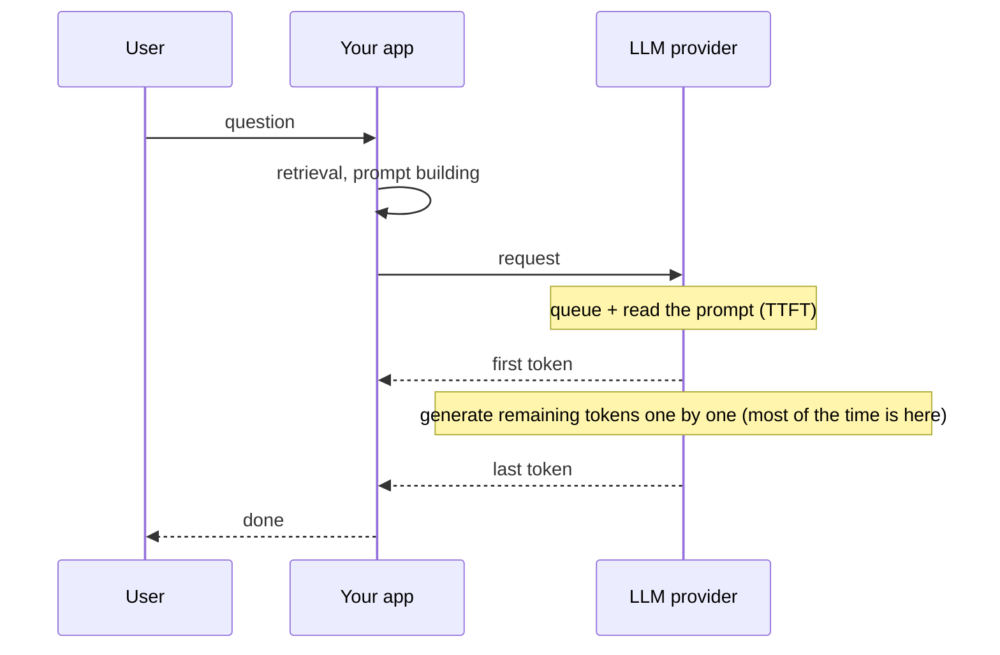
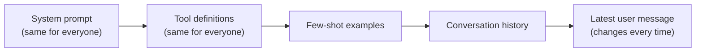
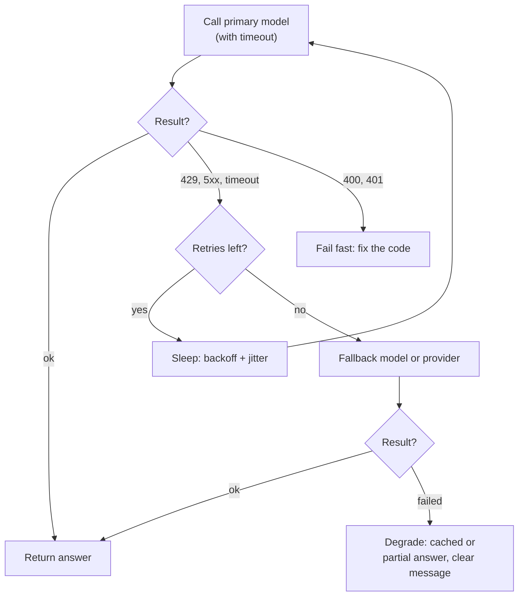

> [!summary] LLM calls are slow, priced per token, and fail more often than normal APIs. Output tokens drive most of the latency; total tokens drive the cost. You control all three with a small set of levers: a smaller model where it is enough, caching, shorter outputs, streaming, parallel calls, and careful retries with fallbacks.

## Why this matters

A demo that takes 20 seconds and costs a rupee per question is not a product. In production you will be asked to make it faster, cheaper and more dependable without making answers worse. Interviewers ask "how would you cut the cost of this system by half?" and "what happens when the provider returns a 429?", and they expect concrete levers and trade-offs, not "use a better model".

## The idea in plain words

Think of a restaurant kitchen.

- **Latency** is how long the customer waits. Part of it is the wait before the first plate arrives; part is the time to bring the rest. A big order takes longer than a small one.
- **Cost** is ingredients. You pay for everything that goes into the dish and everything that comes out, on every order.
- **Reliability** is what you do when the gas runs out or a supplier is late: wait and try again, switch to a second supplier, or offer a simpler dish instead of closing the restaurant.

A good kitchen does not run the head chef on every order. Simple orders go to a junior cook. Popular dishes are prepared ahead. Starters come out first so nobody stares at an empty table. Each of these has a direct match in LLM apps.

## How it works

### Where latency comes from

An LLM produces its answer one token at a time, so there are two clocks:

- **TTFT** (time to first token): network time, queueing at the provider, and reading the input prompt. Longer prompts raise it somewhat.
- **Generation time**: about (number of output tokens) divided by (tokens per second). This is usually the big part.



Rule of thumb: **output tokens dominate latency**. Halving the input rarely halves the time; halving the output nearly does. Reasoning or "thinking" models add hidden output tokens before the visible answer, which raises both TTFT and cost. In agents, latency is the sum of every step, so the number of steps matters more than the speed of any one of them.

### Where cost comes from

Cost per call = input tokens x input price + output tokens x output price. Three facts shape everything:

1. Output tokens usually cost several times more than input tokens.
2. Input tokens are usually far more numerous (system prompt, history, retrieved chunks, tool definitions), so they often make up most of the bill anyway.
3. In an agent loop, the whole conversation so far is sent again on every step. Ten steps with a growing context is not ten times one step; it is closer to the sum 1 + 2 + ... + 10.

Also count the calls you forget: embeddings, rerankers, judges and guardrail checks, retries, and evals in CI.

### The levers

| Lever | Helps | How | Watch out for |
|---|---|---|---|
| Smaller model | Cost, latency | Use a small, cheap model for easy tasks (classification, routing, extraction) | Quality drops on hard cases; check with evals |
| **Routing** | Cost, latency | A cheap classifier or rule sends each request to the right model | The router itself can be wrong |
| **Cascade** | Cost | Try the small model first; escalate to the big one only if a check fails | Slow path is slower than calling the big model directly |
| **Prompt caching** | Cost, some TTFT | The provider stores the processed prefix of your prompt and charges less when the next request starts with the same tokens | Needs a stable prefix; see below |
| **Response caching** (exact) | Cost, latency | Same request, same stored answer, no LLM call | Stale answers; only safe for deterministic, non-personal requests |
| **Semantic caching** | Cost, latency | Reuse an answer when a new question is close in meaning to an old one | False hits return a wrong answer confidently |
| Shorter prompts | Cost | Fewer and smaller chunks, trimmed history, shorter tool descriptions | Cutting needed context hurts quality |
| Shorter outputs | Latency, cost | Ask for brevity, set `max_tokens`, return ids instead of full text | Truncated answers |
| Streaming | Perceived latency only | Show tokens as they arrive | Total time and cost are unchanged |
| Parallel calls | Latency | Run independent calls at the same time | Rate limits; cost unchanged |
| **Batch APIs** | Cost | Submit many requests as an offline job for a discount; results arrive later | Not for interactive use |
| Fewer agent steps | Both | Better tools, parallel tool calls, a step limit, a plan up front | Too tight a limit cuts off real work |

**Prompt caching** deserves care, because it is nearly free money. Providers cache from the start of the prompt up to the first token that differs. So order the prompt from most stable to least stable:



Putting a timestamp, a request id or the user's name at the top of the system prompt breaks the cache for everything after it. Some providers cache automatically, some need you to mark cache points, and the discount, minimum length and lifetime differ, so read your provider's docs. See [Memory and Context Engineering](/blog/memory-and-context-engineering).

### Reliability

LLM APIs fail in more ways than a normal API: rate limits, overload, timeouts, and answers that arrive but are unusable.

| Failure | Typical signal | What to do |
|---|---|---|
| Rate limit | HTTP 429, often with a `Retry-After` header | Wait (respect the header), retry with backoff, lower concurrency |
| Server error or overload | 500, 502, 503, 529 | Retry with backoff, then fall back |
| Timeout | No response within your limit | Retry once or fall back; always set a timeout |
| Bad request | 400, 401, 403, 404 | Do not retry. The request is wrong; fix the code |
| Unusable output | Invalid JSON, schema failure, refusal, cut off at max tokens | Retry with the error fed back, or fall back (see [Structured Outputs and Tool Calling](/blog/structured-outputs-and-tool-calling)) |

The standard tools:

- **Timeouts.** Every network call gets one. For streaming, use a timeout on the gap between chunks, not only on the whole call.
- **Retries with exponential backoff and jitter.** Wait longer after each failure (0.5 s, 1 s, 2 s, 4 s). **Jitter** means adding randomness to the wait. Without it, a thousand clients that failed together all retry at the same instant and knock the service over again.
- **Fallbacks.** If the primary model keeps failing, try another model or another provider. Test the fallback's prompt too; prompts do not always transfer.
- **Circuit breaker.** After N failures in a row, stop calling that provider for a cool-down period and go straight to the fallback. Then let one test request through; if it works, close the circuit again. This stops you from spending 30 seconds of timeouts on every request during an outage.
- **Idempotency.** A retry must not do the action twice. Reads are safe to repeat; "send email" or "create order" is not. Give each action an **idempotency key** (a unique id), and have the tool refuse to run the same key twice.
- **Graceful degradation.** When everything fails, do less instead of nothing: show the retrieved passages without a generated answer, return a cached answer, or give a clear "try again shortly".



### Concurrency, queues, gateways and budgets

- **Concurrency limits.** Sending 500 calls at once earns a wall of 429s. A **semaphore** is a counter that lets only N tasks through at a time. Use one per provider.
- **Background jobs.** Anything longer than a few seconds (indexing documents, a long agent run) should not hold an HTTP request open. Put a job on a queue, return a job id, and let a worker do it. See [Backend and Deployment for AI Apps](/blog/backend-and-deployment-for-ai).
- **LLM gateways.** A gateway (or router) sits between your app and the providers and gives you one API for many models, plus retries, fallbacks, caching, per-key budgets and logging in one place. LiteLLM (a library and a self-hosted proxy) and OpenRouter (a hosted service) are examples. The trade-off is one more hop and one more thing that can fail.
- **Budgets and quotas.** Set a hard spend cap at the provider, a budget per user or per API key, a token limit per request, and a step limit per agent run. Track cost per user so one heavy user or bot is visible.

### A worked cost example

> [!warning] Every number in this section is a made-up round placeholder, chosen to make the arithmetic easy. They are not real prices. Take real prices from your provider's pricing page.

Placeholder prices: input 1.00 per million tokens, output 4.00 per million tokens (any currency).

**One RAG answer:** 3,000 input tokens (system prompt, chunks, question) and 400 output tokens.

- Input: 3,000 / 1,000,000 x 1.00 = 0.0030
- Output: 400 / 1,000,000 x 4.00 = 0.0016
- Total: **0.0046 per answer**. At 10,000 answers a day that is 46 per day, about 1,380 per 30-day month.

**Add prompt caching.** Say 2,000 of the 3,000 input tokens are a stable prefix, and cached tokens are billed at 10% (placeholder discount).

- Input: (1,000 x 1.00 + 2,000 x 0.10) / 1,000,000 = 0.0012
- Total: 0.0012 + 0.0016 = **0.0028 per answer**, about 39% less.

**Add a response cache** with a 20% hit rate (placeholder): 0.0028 x 0.8 = **0.00224 per answer**, roughly half the original.

**Compare an agent run:** 6 steps, averaging 5,000 input and 200 output tokens per step, because the context grows.

- Input: 30,000 / 1,000,000 x 1.00 = 0.030. Output: 1,200 / 1,000,000 x 4.00 = 0.0048.
- Total: **0.0348 per run**, about 7.5 times the single RAG answer.

The lessons hold whatever the real prices are: input volume dominates, agent steps multiply it, and caching the stable prefix is the cheapest win.

### Measure first

Do not guess where the time or money goes. Open your traces (see [Observability and Tracing](/blog/observability-and-tracing)) and look at latency and tokens per span. Often the surprise is a 4,000-token tool description sent on every step, or a reranker that takes longer than the LLM. Fix the biggest span, then re-run your evals ([Evals: Measuring LLM Apps](/blog/evals)) to confirm quality held.

## Code you should be able to write

All of the snippets below were run with stand-in functions in place of real LLM calls.

### Async retry with backoff and jitter

```python
import asyncio, random
from typing import Awaitable, Callable, TypeVar

T = TypeVar("T")


class RetryableError(Exception):
    """429, 5xx, timeout: worth trying again."""
    def __init__(self, msg: str, retry_after: float | None = None) -> None:
        super().__init__(msg)
        self.retry_after = retry_after


async def with_retry(fn: Callable[[], Awaitable[T]], *, attempts: int = 4,
                     base: float = 0.5, cap: float = 8.0, timeout: float = 30.0) -> T:
    for attempt in range(attempts):
        try:
            return await asyncio.wait_for(fn(), timeout)
        except (RetryableError, asyncio.TimeoutError) as exc:
            if attempt == attempts - 1:
                raise                                         # out of attempts
            backoff = min(cap, base * 2 ** attempt)           # 0.5, 1, 2, 4 ...
            delay = random.uniform(0, backoff)                # "full jitter"
            delay = max(delay, getattr(exc, "retry_after", None) or 0)
            await asyncio.sleep(delay)
    raise RuntimeError("unreachable")
```

In real code, map the SDK's errors onto this: with the `openai` SDK, `RateLimitError`, `APITimeoutError`, `APIConnectionError` and `InternalServerError` are retryable; `BadRequestError` and `AuthenticationError` are not. The SDK also retries a couple of times by itself (`max_retries` on the client), so do not stack two retry layers without thinking; total attempts multiply.

### Bounded concurrency

```python
async def map_bounded(fn: Callable[[str], Awaitable[T]], items: list[str],
                      limit: int = 5) -> list[T | BaseException]:
    sem = asyncio.Semaphore(limit)                 # at most `limit` calls in flight

    async def one(item: str) -> T:
        async with sem:
            return await fn(item)

    return await asyncio.gather(*(one(i) for i in items), return_exceptions=True)
```

With ten items that each sleep 0.2 s and `limit=5`, this finished in 0.4 s: two waves of five. `return_exceptions=True` means one failure does not cancel the other nine; check each result with `isinstance(r, BaseException)`.

### A fallback chain

```python
async def with_fallback(prompt: str, chain: list[Callable[[str], Awaitable[str]]]) -> str:
    last: Exception | None = None
    for call in chain:                             # e.g. [primary, other_provider, small_model]
        try:
            return await with_retry(lambda: call(prompt), attempts=2)
        except Exception as exc:                   # in real code: log which link failed
            last = exc
    raise RuntimeError("all models failed") from last
```

### Exact-match cache and a semantic cache sketch

```python
import hashlib, json, time
from typing import Any


def cache_key(model: str, messages: list[dict[str, str]], **params: Any) -> str:
    blob = json.dumps({"model": model, "messages": messages, "params": params}, sort_keys=True)
    return hashlib.sha256(blob.encode()).hexdigest()


class ExactCache:
    def __init__(self, ttl_s: float = 3600) -> None:
        self.ttl_s = ttl_s
        self.store: dict[str, tuple[float, str]] = {}   # in production: Redis with EXPIRE

    def get(self, key: str) -> str | None:
        hit = self.store.get(key)
        return hit[1] if hit and time.monotonic() - hit[0] < self.ttl_s else None

    def set(self, key: str, value: str) -> None:
        self.store[key] = (time.monotonic(), value)


def cosine(a: list[float], b: list[float]) -> float:
    dot = sum(x * y for x, y in zip(a, b))
    return dot / ((sum(x * x for x in a) ** 0.5) * (sum(y * y for y in b) ** 0.5))


class SemanticCache:
    """Sketch: linear scan. In production the lookup is a vector index query."""
    def __init__(self, embed: Callable[[str], list[float]], threshold: float = 0.92) -> None:
        self.embed, self.threshold = embed, threshold
        self.items: list[tuple[list[float], str]] = []

    def get(self, question: str) -> str | None:
        q = self.embed(question)
        best = max(self.items, key=lambda it: cosine(q, it[0]), default=None)
        return best[1] if best and cosine(q, best[0]) >= self.threshold else None

    def set(self, question: str, answer: str) -> None:
        self.items.append((self.embed(question), answer))
```

The key must include everything that changes the answer: model, all messages, temperature, and for RAG the version of the index. `sort_keys=True` makes the same request always hash the same. The threshold 0.92 is a placeholder; tune it on real question pairs, because the right value depends on the embedding model (see [Embeddings and Vector Databases](/blog/embeddings-and-vector-databases)).

### A token-bucket rate limiter

A bucket holds up to `capacity` tokens and refills at `rate_per_s`. Each request takes one. This allows short bursts but holds the long-run rate.

```python
class TokenBucket:
    def __init__(self, rate_per_s: float, capacity: float) -> None:
        self.rate, self.capacity = rate_per_s, capacity
        self.tokens, self.updated = capacity, time.monotonic()

    def allow(self, cost: float = 1.0) -> bool:
        now = time.monotonic()
        self.tokens = min(self.capacity, self.tokens + (now - self.updated) * self.rate)
        self.updated = now
        if self.tokens >= cost:
            self.tokens -= cost
            return True
        return False
```

With `TokenBucket(rate_per_s=2, capacity=3)`, five instant calls gave `[True, True, True, False, False]`; after one second, three more gave `[True, True, False]`. Keep one bucket per user id or IP. With several server processes, the buckets must live in a shared store such as Redis.

## In production

- **Streaming changes how the app feels, not what it costs.** It is still the first thing to do for any chat UI.
- **Do not cache what is personal or time-sensitive.** A cached answer to "what is my balance?" served to another user is a data leak. Put the user id or tenant id in the key, or do not cache those routes at all.
- **Semantic caches fail quietly.** "How do I cancel my order?" and "How do I cancel my subscription?" are close in embedding space and need different answers. Start with exact-match caching; add semantic caching only for a narrow FAQ-style route, with a high threshold and logged hits.
- **Retries multiply cost and load.** Three retries at three layers is 27 calls. Retry in one layer, cap total attempts, and never retry non-retryable errors.
- **Rate limits come in several kinds.** Requests per minute and tokens per minute are separate, and limits are per model and per account tier. A few huge prompts can hit the token limit while the request count looks fine.
- **A fallback model is a different model.** It may format differently or fail your schema. Run your eval set against the fallback path too.
- **Cascades need a cheap, trustworthy check.** "Escalate if the small model's JSON fails validation or its confidence is low" works. "Ask another LLM if the answer is good" may cost more than it saves.
- **Latency targets are percentiles.** Report p50 and p95. A provider's slow minute shows up in p95 long before the average moves.
- **`max_tokens` is a safety belt.** Always set it. A runaway output is a cost and latency problem at once. Check the finish reason so you notice truncation.
- **Batch what is not interactive.** Nightly document summaries, eval runs and bulk classification are good fits for a batch API or a low-priority queue.
- **Quality is the constraint.** Every lever here can make answers worse. The order of work is: measure, change one thing, re-run evals, then ship.

## Interview questions

**Q: Where does the latency of an LLM call come from?**
There is time to first token (network, queueing, reading the prompt) and then generation time, which grows with the number of output tokens because they are produced one at a time. Output length is usually the largest factor. In agents, total latency is the sum over all steps.

**Q: Your RAG endpoint takes 12 seconds. How do you speed it up?**
First I look at a trace to see which span is slow. Then, depending on what I find: stream the answer so the user sees text within a second, cut the output length, send fewer or smaller chunks, run independent steps such as query rewriting and retrieval variants in parallel, use a smaller model for routing and grading, and cache repeated questions. I re-run evals after each change.

**Q: How would you cut the cost of an LLM feature by half?**
Measure tokens per call first. Then order the prompt so the stable part is a cacheable prefix, trim context and history, route easy requests to a small model, cache repeated requests, limit output length, reduce agent steps, and move offline work to a batch API. Each step is checked against the eval set so quality does not drop unnoticed.

**Q: What is prompt caching and how do you design a prompt for it?**
The provider stores the processed form of a prompt prefix and bills less when the next request starts with exactly the same tokens. So static content goes first (system prompt, tool definitions, examples) and changing content goes last (history, the new message). Anything dynamic near the top, such as a timestamp, breaks the cache for all that follows.

**Q: Exact-match cache against semantic cache: what is the difference and the risk?**
An exact cache keys on a hash of the full request and only hits when everything is identical, so it is safe but hits less often. A semantic cache embeds the question and reuses an answer for a close-enough earlier question, which hits more often but can return an answer to a different question. Both need care with personal data and stale content.

**Q: Why exponential backoff, and why add jitter?**
Backoff gives an overloaded service time to recover by waiting longer after each failure. Jitter randomises the wait so that many clients that failed at the same moment do not all retry at the same moment and cause a second spike. Without jitter, retries arrive in synchronised waves.

**Q: Which errors do you retry?**
429 rate limits, 5xx server errors, timeouts and connection errors, and for 429 I respect `Retry-After`. I do not retry 400, 401 or 403, because the same request will fail the same way. For invalid model output I retry a small number of times, usually with the validation error added to the prompt.

**Q: What is a circuit breaker?**
A guard that counts recent failures for a dependency. After a threshold it "opens" and calls fail fast or go straight to a fallback for a cool-down period, then it lets a test request through to see if the dependency has recovered. It prevents every request from waiting out a full timeout during an outage.

**Q: What is idempotency and why does it matter for agents?**
An operation is idempotent if doing it twice has the same effect as doing it once. Retries and resumed agent runs can repeat a tool call, so tools with side effects, such as sending an email or posting a comment, need an idempotency key so the second attempt is ignored.

**Q: You need to summarise 10,000 documents. How do you do it?**
If it is not urgent, a batch API is cheapest. Otherwise I run async calls with a semaphore sized to stay under the rate limit, with retry and backoff per item, results saved as each finishes so a crash does not lose progress, and a list of failures to re-run. I would use a small model if evals show it is good enough.

**Q: What is a cascade, and when is it worth it?**
Try a cheap model first and escalate to a stronger one only when a check says the cheap answer is not good enough. It pays off when most requests are easy and the check is cheap and reliable, such as schema validation. If most requests escalate, you pay for two calls and wait longer.

**Q: What does an LLM gateway give you?**
One API in front of many providers, with retries, fallbacks, caching, rate limits, per-key budgets and usage logging handled centrally. It makes switching models a config change. The costs are an extra network hop and a new single point of failure, so it needs its own monitoring.

**Q: The provider has a full outage. What does your app do?**
Requests time out quickly, the circuit breaker opens, and traffic goes to a fallback provider or model. If that also fails, the app degrades: cached answers, search results without a generated summary, or a clear message, and background jobs stay queued for later. Alerts on error rate tell me it is happening.


## Go deeper

- [AWS Architecture Blog: Exponential backoff and jitter](https://aws.amazon.com/blogs/architecture/exponential-backoff-and-jitter/) - the classic post, with charts showing why jitter matters.
- [OpenAI: Latency optimization guide](https://platform.openai.com/docs/guides/latency-optimization) - a clear list of latency levers that applies to any provider.
- [OpenAI: Prompt caching guide](https://platform.openai.com/docs/guides/prompt-caching) - how automatic prefix caching behaves.
- [Anthropic: Prompt caching](https://docs.anthropic.com/en/docs/build-with-claude/prompt-caching) - the explicit cache-point style; reading both shows how providers differ.
- [LiteLLM docs](https://docs.litellm.ai/docs/) - a concrete gateway: fallbacks, budgets and routing in config.
- [Martin Fowler: Circuit Breaker](https://martinfowler.com/bliki/CircuitBreaker.html) - the pattern in two pages.
- [Applied LLMs: What we learned from a year of building with LLMs](https://applied-llms.org/) - practical advice on caching, cost and reliability from several practitioners.
