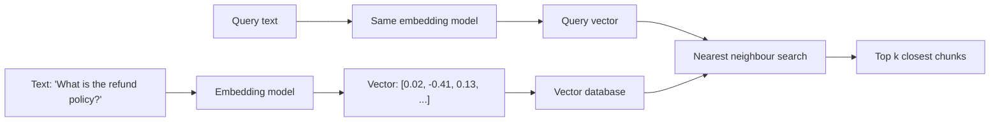
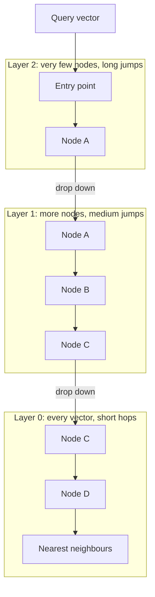

> [!summary] An embedding turns text into a list of numbers so that texts with similar meaning land close together. A vector database stores those lists and finds the closest ones to a query quickly. Together they are the "search by meaning" engine under every RAG system.

## Why this matters

Every RAG system, semantic search box, recommendation feature and agent memory sits on top of embeddings. If retrieval returns the wrong text, no prompt can save the answer. In interviews this topic is asked in almost every AI-engineer loop: "cosine or dot product?", "how does HNSW work?", "why did you pick pgvector?", "what happens when you change the embedding model?". You should be able to answer each in two or three calm sentences and write the small code below from memory.

## The idea in plain words

Think of a map of India. Every city has two numbers: latitude and longitude. Cities that are close on the ground have close numbers. You can answer "which cities are near Gurugram?" with arithmetic alone, without knowing anything about the cities.

An **embedding** does the same for meaning. An **embedding model** reads a piece of text and gives back a fixed-length list of numbers, called a **vector**. Texts that mean similar things get vectors that point in similar directions. "How do I get my money back?" and "What is the refund policy?" share almost no words, yet their vectors land close together. "How do I cook rice?" lands far away.

The map has 2 numbers per city. An embedding has hundreds or thousands of numbers per text. Each number is one **dimension**. You cannot picture 1,000 dimensions, and you do not need to. The rule is the same as on the map: near means similar.

A **vector database** is a store built for one question: "here is a vector, give me the k stored vectors closest to it". That operation is called **nearest neighbour search**.

## How it works

### From text to vector



Things to know about dimensions:

- The model fixes the dimension count. Common sizes run from a few hundred to a few thousand.
- More dimensions can hold finer shades of meaning, but cost more storage, more memory and slower search. Bigger is not automatically better.
- Some models are trained so that you can cut the vector short and still keep most of the quality (this is called **Matryoshka** embeddings, after the nesting dolls). The OpenAI embeddings API exposes this as a `dimensions` parameter. If you shorten a vector yourself, normalise it again afterwards.
- Embedding models have a maximum input length in tokens. Text beyond the limit is cut off or rejected, depending on the provider. This is one reason we chunk documents (see [RAG Fundamentals](/blog/rag-fundamentals)).

### Measuring "close"

| Measure | What it computes | Higher or lower is better | Cares about length? |
|---|---|---|---|
| **Cosine similarity** | Cosine of the angle between two vectors, from -1 to 1 | Higher | No, direction only |
| **Dot product** (inner product) | Sum of the pairwise products | Higher | Yes, longer vectors score higher |
| **Euclidean distance** (L2) | Straight-line distance between the two points | Lower | Yes |

The key interview fact: **if all vectors are normalised to length 1, the three give the same ranking.** For unit vectors the dot product equals the cosine, and squared Euclidean distance equals `2 - 2 * cosine`. So the closest by one measure is the closest by the others.

Rules of thumb:

- Use the measure the model was trained with. The model card tells you.
- Many API embedding models return unit-length vectors. Then dot product is the cheapest choice and gives the same result as cosine.
- If you are not sure whether vectors are normalised, use cosine. It is the safe default.

### Embedding models

An embedding model is usually a transformer encoder trained on huge numbers of text pairs so that matching pairs (question and its answer, title and its body) end up close and non-matching pairs end up far apart. You get them in two ways: hosted behind an API (you pay per token) or as open-weight models you run yourself (for example through the `sentence-transformers` library).

**Query vs document embeddings.** A short question and a long passage that answers it do not look alike. Many models handle this by treating the two sides differently. Some want a text prefix (for example `query: ` and `passage: `), some take a parameter that says which side you are embedding (a "task type" or "input type"). If the model card asks for this and you skip it, retrieval quality drops quietly. No error is raised. Always read the model card.

**How to choose a model:**

1. Language coverage. If your documents are in Hindi and English, you need a multilingual model.
2. Maximum input length versus your chunk size.
3. Dimension count versus your storage and latency budget.
4. Hosted or self-hosted: data privacy, cost, rate limits.
5. Quality on your data. Public leaderboards such as MTEB help you make a shortlist, but they do not know your documents. Build a small test set of 30-50 real questions with the chunk that should be found, and measure recall@k for each candidate. See [Evals: Measuring LLM Apps](/blog/evals).

> [!warning] Vectors from different models are not comparable. Each model has its own "map". If you change the embedding model, or even its version or dimension setting, you must re-embed every document and rebuild the index. Store the model name next to the vectors so you can never mix them by accident.

### Exact search vs approximate search

**Exact kNN** (k nearest neighbours) compares the query with every stored vector and keeps the best k. It is always correct. Its cost grows in a straight line with the number of vectors. For a few thousand to roughly a hundred thousand vectors this is fast enough and you need no index at all.

**Approximate nearest neighbour (ANN)** search builds an index that lets you look at only a small part of the data. It is much faster on large collections, but it can miss some true neighbours. We measure that with **recall**: out of the true top k, what fraction did the index return? Every ANN index has a knob that trades recall for speed.

### HNSW, explained simply

**HNSW** stands for Hierarchical Navigable Small World. Think of travelling from Gurugram to a small village in Kerala. You do not take village roads all the way. You take a flight to the nearest big city, then a highway to the nearest town, then local roads.

HNSW builds a graph in layers. Every vector is a node. The bottom layer holds all nodes, each linked to its near neighbours. Each higher layer holds a random, smaller sample of nodes with longer links. Search starts at the top, greedily walks to the node closest to the query, drops one layer, and repeats.



The three knobs (names as used in pgvector):

- `m`: how many links each node keeps. More links give better recall, a bigger index and slower builds.
- `ef_construction`: how hard the builder searches for good links while inserting. Higher gives a better graph and a slower build.
- `ef_search`: how many candidates the search keeps in hand at query time. Higher gives better recall and slower queries. This is the one you tune per query.

HNSW gives a very good speed-to-recall trade-off and handles inserts without a rebuild. Its costs are memory and slow index builds.

### IVF, explained simply

**IVF** means inverted file index. Think of a library. Books are placed on shelves by topic. To find a book you go to the one or two most likely shelves instead of scanning the whole library.

IVF runs k-means clustering on your vectors to find a set of centres (pgvector calls the count `lists`). Each vector is stored in the list of its nearest centre. At query time, it finds the closest few centres (`probes`) and scans only those lists.

IVF builds faster and uses less memory than HNSW. Its weak points: a neighbour that sits just across a cluster border is missed unless you probe more lists, and the centres are learned from the data present at build time, so you should build it after loading data and rebuild if the data shifts a lot.

| | HNSW | IVF (IVFFlat) |
|---|---|---|
| Structure | Layered graph | Clusters with lists |
| Query speed vs recall | Better | Good |
| Build time and memory | Higher | Lower |
| Needs data before building | No | Yes (to learn centres) |
| Query-time knob | `ef_search` | `probes` |

### Metadata filtering: pre vs post

Real queries carry conditions: "only this tenant", "only documents from 2026", "only PDFs". Each chunk carries **metadata** (plain fields stored beside the vector) and the search must respect it.

- **Post-filtering**: run the vector search, then throw away results that fail the filter. Simple, but if the filter is strict you asked for 5 and may get 1 or 0.
- **Pre-filtering**: apply the filter first, then search only among matching rows. Results are always correct. If the matching set is small, an exact scan is cheap. If it is large, you want the ANN index to cooperate.
- **Filter-aware index search**: modern engines check the filter while walking the graph, or keep scanning until enough matching rows are found. Qdrant does the first. pgvector (0.8 and later) offers the second as "iterative index scans".

### The landscape

| Tool | What it is | How you run it | Good fit | Watch out for |
|---|---|---|---|---|
| **pgvector** | Postgres extension that adds a `vector` type with HNSW and IVFFlat indexes | Inside your existing Postgres | You already run Postgres and want vectors next to relational data | You tune and scale Postgres yourself |
| **Qdrant** | Open-source dedicated vector database | Self-hosted or managed cloud | Heavy metadata filtering, dense plus sparse vectors | One more service to operate |
| **Pinecone** | Proprietary managed vector database | Managed cloud only | No operations work, namespaces per tenant | Vendor lock-in, data lives in the vendor's cloud |
| **Weaviate** | Open-source vector database with built-in hybrid (keyword plus vector) search | Self-hosted or managed cloud | Hybrid search out of the box | More concepts to learn |
| **Chroma** | Open-source, developer-friendly vector store | Embedded in your Python process, or as a server | Prototypes, notebooks, small apps | Check its fit before betting a large production system on it |
| **FAISS** | A similarity-search library from Meta, not a database | In-process, in your own code | Research, offline batch jobs, custom indexes | No server, no filtering by metadata, no access control: you build all of that |

Feature lists change often. Check each project's docs before you decide.

**Why pgvector is a fine default when you already run Postgres.** You get one database to back up, monitor and secure. Chunks, users, permissions and vectors live together, so a filter is a normal `WHERE` clause and a join is a normal join. Inserts are transactional: a document and its vectors are saved together or not at all. Postgres full-text search sits in the same database, which makes hybrid search easy (see [Advanced RAG](/blog/advanced-rag)). Move to a dedicated vector database when you have measured a real problem, such as index size beyond what one machine's memory can hold or a need for features Postgres lacks.

### Sparse vs dense vectors

Everything above is about **dense vectors**: a few hundred to a few thousand numbers, almost all non-zero, capturing meaning. A **sparse vector** has one slot per word in the vocabulary, so it is very long and almost entirely zeros. Only the words that appear in the text have a value. BM25 keyword scoring is the classic sparse method. Dense vectors are good at paraphrase ("money back" matches "refund"). Sparse vectors are good at exact tokens (order ids, error codes, names). Production systems often use both, which is called hybrid search.

### Quantization in one paragraph

**Quantization** means storing each number with fewer bits to save memory. Scalar quantization turns 32-bit floats into 8-bit integers. Binary quantization keeps one bit per dimension. Product quantization replaces groups of dimensions with short codes. All of them lose a little accuracy. The usual fix is two steps: search the small quantized vectors to get a generous candidate list, then re-score those candidates with the full-precision vectors. In pgvector the simplest form is the `halfvec` type, which stores 16-bit floats.

### Multi-tenancy and namespaces

**Multi-tenancy** means many customers share one system, and customer A must never see customer B's data. Three common designs:

1. A `tenant_id` column (or metadata field) plus a filter on every query. Simplest. In Postgres, add row-level security so a forgotten `WHERE` cannot leak data.
2. A **namespace** or partition per tenant, a feature of several vector databases. Each search touches only one tenant's data, so it is also faster.
3. A separate collection or database per tenant. Strongest isolation, most operational work.

The tenant filter must come from your authenticated session in backend code. Never let the LLM decide it.

## Code you should be able to write

Cosine similarity with numpy, and proof that normalised vectors make the measures agree:

```python
import numpy as np


def cosine_similarity(a: np.ndarray, b: np.ndarray) -> float:
    """1.0 = same direction, 0.0 = unrelated, -1.0 = opposite."""
    return float(np.dot(a, b) / (np.linalg.norm(a) * np.linalg.norm(b)))


def normalize(v: np.ndarray) -> np.ndarray:
    """Scale a vector (or each row of a matrix) to length 1."""
    return v / np.linalg.norm(v, axis=-1, keepdims=True)


a = np.array([1.0, 2.0, 3.0])
b = np.array([2.0, 4.0, 6.0])   # same direction, twice as long
c = np.array([-1.0, 0.0, 1.0])

print(cosine_similarity(a, b))  # 1.0   (length does not matter)
print(cosine_similarity(a, c))  # 0.378 (weakly related)

# For unit-length vectors, a plain dot product IS the cosine similarity.
print(float(np.dot(normalize(a), normalize(c))))  # 0.378 again
```

A tiny in-memory vector store with exact search and a metadata filter:

```python
from dataclasses import dataclass, field
from typing import Any

import numpy as np


@dataclass
class Hit:
    id: str
    score: float
    text: str
    metadata: dict[str, Any]


@dataclass
class VectorStore:
    """Exact (brute force) cosine search. Fine for small collections."""

    ids: list[str] = field(default_factory=list)
    texts: list[str] = field(default_factory=list)
    metadatas: list[dict[str, Any]] = field(default_factory=list)
    vectors: list[np.ndarray] = field(default_factory=list)

    def add(self, id: str, vector: list[float], text: str, metadata: dict[str, Any] | None = None) -> None:
        v = np.asarray(vector, dtype=np.float32)
        self.ids.append(id)
        self.texts.append(text)
        self.metadatas.append(metadata or {})
        self.vectors.append(v / np.linalg.norm(v))  # store unit vectors

    def search(self, query: list[float], k: int = 3, where: dict[str, Any] | None = None) -> list[Hit]:
        if not self.vectors:
            return []
        q = np.asarray(query, dtype=np.float32)
        q = q / np.linalg.norm(q)
        scores = np.stack(self.vectors) @ q  # one dot product per stored vector
        hits: list[Hit] = []
        for i in np.argsort(-scores):  # best score first
            meta = self.metadatas[i]
            if where and any(meta.get(key) != value for key, value in where.items()):
                continue  # metadata filter
            hits.append(Hit(self.ids[i], float(scores[i]), self.texts[i], meta))
            if len(hits) == k:
                break
        return hits


store = VectorStore()
store.add("d1", [0.9, 0.1, 0.0], "Refunds take 5 working days.", {"tenant": "acme"})
store.add("d2", [0.8, 0.2, 0.1], "Refunds are not offered on gift cards.", {"tenant": "globex"})
store.add("d3", [0.0, 0.1, 0.9], "Our office is in Gurugram.", {"tenant": "acme"})

for hit in store.search([1.0, 0.0, 0.0], k=2, where={"tenant": "acme"}):
    print(hit.id, round(hit.score, 3), hit.text)  # d1 first, d2 is filtered out
```

Getting real embeddings uses the same client as chat calls:

```python
import os
from openai import OpenAI

client = OpenAI(base_url=os.getenv("LLM_BASE_URL"), api_key=os.environ["LLM_API_KEY"])
EMBED_MODEL = os.environ["EMBED_MODEL"]


def embed(texts: list[str]) -> list[list[float]]:
    response = client.embeddings.create(model=EMBED_MODEL, input=texts)
    return [item.embedding for item in response.data]
```

The pgvector SQL. Set the number in `vector(1536)` to your model's dimension count:

```sql
CREATE EXTENSION IF NOT EXISTS vector;

CREATE TABLE chunks (
    id         bigserial PRIMARY KEY,
    tenant_id  text NOT NULL,
    doc_id     text NOT NULL,
    content    text NOT NULL,
    metadata   jsonb NOT NULL DEFAULT '{}',
    embedding  vector(1536) NOT NULL
);

-- HNSW index for cosine distance (values shown are the defaults)
CREATE INDEX ON chunks USING hnsw (embedding vector_cosine_ops)
    WITH (m = 16, ef_construction = 64);

-- Optional: trade speed for recall in this session (default is 40)
SET hnsw.ef_search = 100;

-- Top 5 chunks for one tenant. $1 is the query vector, e.g. '[0.02,-0.41,...]'
SELECT id, content, 1 - (embedding <=> $1) AS cosine_similarity
FROM chunks
WHERE tenant_id = $2
ORDER BY embedding <=> $1
LIMIT 5;
```

Operators to remember: `<=>` is cosine **distance** (so similarity is `1 - distance`), `<->` is Euclidean distance, `<#>` is the **negative** inner product. All three are "smaller is closer", so you always `ORDER BY ... ASC` with a `LIMIT`. The index operator class must match the operator: `vector_cosine_ops` with `<=>`, `vector_l2_ops` with `<->`, `vector_ip_ops` with `<#>`.

## In production

- **Start without an index.** Exact search has perfect recall. Add HNSW when latency tells you to, then measure recall against the exact results on a sample of queries.
- **The planner decides whether the index is used.** In Postgres, run `EXPLAIN ANALYZE`. The index is used only for `ORDER BY embedding <op> $1 LIMIT n` with the matching operator class. Ordering by `1 - (embedding <=> $1) DESC` will not use it.
- **Filtered queries can return too few rows.** With an HNSW index and a strict `WHERE`, pgvector filters after the index scan. Raise `hnsw.ef_search`, turn on iterative scans (`SET hnsw.iterative_scan = strict_order;`), or partition by tenant.
- **Dimension limits.** pgvector can index a `vector` column up to 2,000 dimensions. Above that, use `halfvec` (up to 4,000) or ask the model for shorter vectors.
- **Re-embedding is a migration.** Add a new column or table, backfill it in batches, compare eval scores, switch reads, then drop the old one. Never mix two models in one index.
- **Memory is the real cost** of HNSW. Estimate vector count times dimensions times 4 bytes, plus graph overhead, and check it fits in RAM.
- **Similarity scores are not probabilities.** A score of 0.8 from one model means nothing for another model. Do not hard-code a threshold without testing it on your data.
- **Embeddings are not anonymous.** Research has shown that text can be partly recovered from vectors. Protect them like the source text.

## Interview questions

**Q: What is an embedding?**
A fixed-length list of numbers produced by a model so that texts with similar meaning get vectors pointing in similar directions. It lets a computer compare meaning with arithmetic instead of matching exact words.

**Q: Cosine similarity vs dot product vs Euclidean distance. Which do you use?**
Cosine looks only at direction, dot product also rewards longer vectors, Euclidean measures straight-line distance. If vectors are normalised to length 1, all three give the same ranking, and dot product is the cheapest to compute. I use the one the model was trained with, and cosine when unsure.

**Q: What is the difference between exact kNN and ANN?**
Exact kNN compares the query against every vector, so it is always right but slows down linearly with data size. ANN uses an index such as HNSW or IVF to check only a small part of the data. It is much faster but may miss some true neighbours, which we measure as recall.

**Q: Explain HNSW in simple terms.**
It is a layered graph. The top layers have few nodes with long links, the bottom layer has every vector with short links. Search starts at the top, greedily moves to the closest node, drops down a layer and repeats, like going from flights to highways to local roads. `m`, `ef_construction` and `ef_search` trade recall against memory, build time and query time.

**Q: When would you choose IVF over HNSW?**
When memory or build time is tight and slightly lower recall at a given speed is acceptable. IVF clusters the vectors and scans only the nearest clusters. It needs representative data before building and may need rebuilding as data changes.

**Q: You switched to a better embedding model and search quality collapsed. Why?**
Most likely the new query vectors are being compared with old document vectors. Vectors from different models live in different spaces and cannot be compared. Everything must be re-embedded with the new model and the index rebuilt.

**Q: A user filters by date and gets 1 result instead of 5, although more matching documents exist. What is happening?**
This is post-filtering. The ANN index returned its top candidates first, then the filter removed most of them. Fixes: pre-filter, raise the candidate count (`ef_search`), use filter-aware or iterative scans, or partition the data by the filter field.

**Q: Why pgvector instead of a dedicated vector database?**
If Postgres is already in the stack, pgvector adds vector search without a new service. Vectors sit beside relational data, so filters, joins, transactions, backups and access control all work the usual way. I would move to a dedicated engine only after measuring a limit, such as index size or missing features.

**Q: How do you pick an embedding model?**
I shortlist by language support, input length, dimensions, cost and whether data may leave our network. Then I build a small labelled set of real questions with their correct chunks and compare recall@k. Public leaderboards are a starting point, not the answer.

**Q: How do you keep tenants isolated in a shared vector store?**
Every chunk carries a tenant id, and every query filters on it using the id from the authenticated session, never from the model. Namespaces or partitions per tenant make this both safer and faster. In Postgres, row-level security is a second line of defence.


## Go deeper

- [pgvector README](https://github.com/pgvector/pgvector): the source of truth for the SQL, index options, filtering and limits. Read it fully once.
- [Pinecone Learn: Hierarchical Navigable Small Worlds](https://www.pinecone.io/learn/series/faiss/hnsw/): the clearest illustrated walk through HNSW.
- [The Illustrated Word2vec by Jay Alammar](https://jalammar.github.io/illustrated-word2vec/): builds the intuition for "meaning as direction" with pictures.
- [OpenAI embeddings guide](https://developers.openai.com/api/docs/guides/embeddings): a typical embeddings API, including the `dimensions` option.
- [Pinecone Learn: What is a vector database?](https://www.pinecone.io/learn/vector-database/): a broad overview of what a vector database adds over a bare index.
- [HNSW paper (Malkov and Yashunin)](https://arxiv.org/abs/1603.09320): the original algorithm, readable once you have the picture above.
- [MTEB leaderboard](https://huggingface.co/spaces/mteb/leaderboard): for shortlisting embedding models, not for the final choice.
- [FAISS wiki](https://github.com/facebookresearch/faiss/wiki): index types, IVF and product quantization from the library that popularised them.
