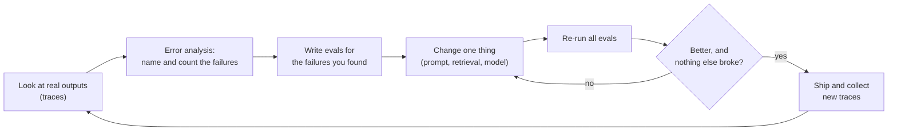
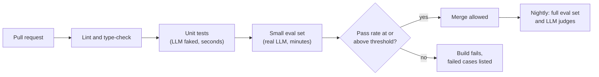

> [!summary] An eval is a repeatable test for an AI system: a fixed set of inputs, a way to grade the outputs, and a number you can compare before and after a change. Evals are what turn "it looked good when I tried it" into engineering.

## Why this matters

Every change to an LLM app (a new prompt, a new model, a different chunk size) can fix one thing and quietly break three others. Without evals you cannot see that, so you ship on gut feeling. In interviews, "how did you know it worked?" is the question that separates people who built a demo from people who built a system. A measured number with an honest sample size is the strongest line on an AI engineer's resume.

## The idea in plain words

Think of a driving test. The examiner does not ask "do you feel like a good driver?". There is a fixed route, a checklist (stopped at the sign, checked the mirror), and a pass or fail at the end. Everybody gets the same route, so results can be compared.

An **eval** (short for evaluation) is the driving test for your AI app:

- the **route** is a **golden dataset**: a saved list of inputs, with what a good output must contain;
- the **checklist** is one or more **graders**: functions that look at an output and say pass or fail;
- the **result** is a pass rate you can track over time.

Why can you not just write normal unit tests? Because LLM output is **non-deterministic**: the same input can give different wording each time, and there are many correct answers. `assert answer == "30 days"` breaks when the model says "within 30 days". So AI tests check properties ("mentions 30 days", "cites a source", "refuses") over many cases, and you look at the rate, not one result.

Evals are the unit tests of AI apps, with one difference: a unit test passes or fails, an eval gives you a percentage, and you decide what percentage is acceptable.

## How it works

### The eval loop

People new to evals start by picking metrics from a library. That is backwards. Start by reading what your system actually does.



1. **Look at real outputs.** Read 30 to 50 full traces (a **trace** is the saved record of one request, see [Observability and Tracing](/blog/observability-and-tracing)). Read every step, not only the final answer.
2. **Error analysis.** For each bad one, write a short note in your own words: "answered from the wrong document", "ignored the date filter", "made up a column name". Then group the notes and count them. This is a table with two columns, failure type and count.
3. **Write evals for the failures you found.** The biggest group gets the first grader. This keeps you from measuring things that never go wrong.
4. **Change one thing**, re-run everything, compare with the last run.
5. **Ship**, collect new traces, repeat. This loop is often called the eval **flywheel** because every turn gives you more test cases and makes the next turn easier.

> [!tip] Rule of thumb: spend more time reading outputs than writing eval code. Most useful graders come straight from error analysis, not from a metrics library.

### Golden datasets

A **golden dataset** (or golden set) is your saved exam: inputs plus what you expect. How to build one:

- **Size:** 30 to 100 cases is enough to start. Ten is too few to trust; a thousand is wasted effort before you know what fails.
- **Source:** real user questions if you have them. If not, write "real-ish" ones yourself, the way a hurried user would type, not the way a textbook would. You can ask an LLM to draft variations, but read and fix every one.
- **Coverage:** easy cases, hard cases, and edge cases (typos, two questions in one, ambiguous wording, very long input).
- **"Should refuse" cases:** questions the system must not answer, such as something outside the documents, a request for private data, or a prompt-injection attempt (see [Guardrails and Security](/blog/guardrails-and-security)). A system that answers everything confidently fails these.
- **Expected output:** not always a full answer. Often a few facts that must appear, the ids of the documents that should be retrieved, or a reference SQL query.
- **Versioning:** keep it as a JSONL file in git (one JSON object per line). When you add cases, the pass rate is no longer comparable with old runs, so record the dataset version next to every score.
- **Growth:** every production bug becomes a new case. That is how a 30-case set becomes a 200-case set that really protects you.

Keep a small part of it that you never look at while tuning prompts. If you tune against all cases, you slowly fit your prompt to the exam (overfitting) and the score stops meaning anything.

### Three kinds of graders

| Grader | What it is | Good for | Weak at | Cost and speed |
|---|---|---|---|---|
| **Code-based assertion** | A plain function: string contains, regex, JSON schema valid, SQL returns the same rows, tool X was called | Anything with a checkable fact or format | Tone, helpfulness, "is this summary good" | Free, instant, fully repeatable |
| **LLM-as-judge** | A second LLM call that reads the output and a rubric and returns a verdict | Fuzzy qualities at scale: groundedness, relevance, politeness | Can be wrong or biased; must be checked against humans | One LLM call per case; slower; slightly noisy |
| **Human review** | A person labels outputs | The source of truth; discovering new failure types | Slow, expensive, people disagree | Minutes per case |

The usual order: use code wherever you can, an LLM judge where you cannot, and humans to check that the judge is right and to find new problems.

### LLM-as-judge done properly

An LLM judge is a prompt, and it can be as wrong as any other prompt. Rules that make it trustworthy:

- **Binary pass/fail beats a 1-10 score.** Nobody, human or model, can say what separates a 6 from a 7, so scores drift. "Pass or fail against this rule" is clear and easy to check.
- **One specific rule per judge.** "Is this answer good?" is useless. "Is every claim in the answer supported by the context?" is gradable. Use several small judges instead of one big one.
- **Reasoning first, then the verdict.** Ask for a short explanation before the pass/fail field. The model then decides after thinking, and you can read why it failed a case.
- **Check agreement with human labels.** Label 30 to 50 outputs yourself, run the judge on the same ones, and count how often it agrees. Look at the two error types separately: how many real failures it catches, and how many good answers it wrongly fails. If agreement is poor, fix the judge prompt before trusting any number from it.
- **Know the biases.** Judges tend to prefer longer answers, prefer text that sounds like their own model's writing, and, when comparing two answers, favour a position (first or second). To reduce this: use a different model family for the judge when you can, keep temperature at 0, and swap the order in pairwise comparisons.

### RAG metrics: retrieval

Evaluate retrieval separately from generation. If the right chunk was never retrieved, no prompt can fix the answer. For each question you need the ids of the chunks that are truly relevant.

Worked example. The retriever returns `[d7, d2, d9, d4, d1]` in that order. The relevant chunks are `d2`, `d4` and `d8`.

| Metric | In simple words | Worked example |
|---|---|---|
| **recall@k** | Of all relevant chunks, what share is in the top k? | 2 of 3 found (d8 is missing): recall@5 = 0.67 |
| **precision@k** | Of the top k, what share is relevant? | 2 of 5 are useful: precision@5 = 0.40 |
| **MRR** (mean reciprocal rank) | 1 divided by the position of the first relevant chunk, averaged over questions | First hit is at position 2, so 1/2 = 0.5 for this question |
| **nDCG@k** | Like recall, but hits near the top count more; 1.0 means a perfect ordering | Hits at positions 2 and 4 score about 0.50 here; the same hits at positions 1 and 2 would score about 0.77 |

For nDCG (normalized discounted cumulative gain), each hit at position p earns `1 / log2(p + 1)`, so position 1 earns 1.0, position 2 earns 0.63, position 4 earns 0.43. Add them up, then divide by the best possible total (all relevant chunks at the top). You rarely compute it by hand; the point is that it rewards good ordering, which is what a reranker improves (see [Advanced RAG](/blog/advanced-rag)).

Which one matters? For RAG, recall@k first: the LLM can ignore an extra chunk, but it cannot use a missing one. Precision matters when junk chunks confuse the model or cost too many tokens.

### RAG metrics: generation

These are the metrics popularised by the RAGAS library. Most are LLM-judge metrics underneath.

| Metric | Question it answers | Needs a reference answer? |
|---|---|---|
| **Faithfulness** (groundedness) | Is every claim in the answer supported by the retrieved context? Low faithfulness means hallucination. | No |
| **Answer relevance** (RAGAS calls it response relevancy) | Does the answer address the question that was asked? | No |
| **Context precision** | Are the retrieved chunks relevant, and are the relevant ones ranked near the top? | Usually yes |
| **Context recall** | Does the retrieved context contain everything needed for the reference answer? | Yes |

A faithful answer can still be wrong (the context itself was wrong or off-topic), and a correct answer can be unfaithful (the model knew it from training, not from your documents). That is why you track several of these.

### Agent evals

An agent takes many steps, so there is more to grade (see [Agent Fundamentals](/blog/agent-fundamentals)):

- **Final-answer correctness:** did the task get done? Prefer checking the end state (the test suite passes, the row exists) over checking the words.
- **Trajectory checks:** the **trajectory** is the list of steps and tool calls. Check that required tools were called, forbidden ones were not, and arguments were valid. Do not demand one exact sequence; there are often several good paths.
- **Efficiency:** number of steps, tokens, cost, latency. An agent that gets the right answer in 40 steps is a problem.
- **Consistency:** run each task several times. An agent that passes 3 of 5 runs is not reliable.

For the PR review agent the grader is classic precision and recall on seeded bugs: of the bugs you planted, how many did it find (recall), and of its comments, how many were real (precision).

### Text-to-SQL: execution accuracy

Do not compare SQL strings; `a JOIN b` and `b JOIN a` are both correct. **Execution accuracy** runs the generated query and a reference query on the same database and compares the result rows (ignoring row order unless the question asks for a sort). Add cases where the right behaviour is to ask a clarifying question instead of guessing.

### Offline and online

| | Offline evals | Online evals |
|---|---|---|
| Data | Your golden set | Live production traffic |
| When | Before merging or releasing | After release, continuously |
| Gives you | A safe comparison: old version against new | The truth about real users |
| Typical checks | All graders, full set | Sampled LLM-judge scores, user feedback, error rates |

Online signals: explicit feedback (thumbs up or down), and implicit ones that are often more honest, such as the user rephrasing the same question, copying the answer, retrying, or escalating to a human. An **A/B test** sends some users to version A and some to B and compares these signals; it needs enough traffic to mean anything.

### Evals in CI

**Regression testing** means re-running the golden set on every change so that an old bug cannot come back unnoticed. Put it in **CI** (continuous integration, the automatic checks that run on each pull request).



### Statistical honesty

A pass rate from a small set is noisy. If you score 80% on 50 cases, the 95% confidence interval is roughly 69% to 91%. So a move from 80% to 84% on 50 cases is two cases flipping, which can easily be luck. Rules:

- Always report n: "pass rate 82% (n=100)", never just "82%".
- Run the same eval two or three times to see how much it moves with no change at all. That is your noise floor.
- Compare versions on the same cases, and look at which cases flipped, not only the total.
- If v2 is not better than v1, say so. A flat result honestly reported is worth more than an invented win.

### Tools

You do not need a tool to start; a JSONL file and pytest go a long way. When you outgrow that, the tools fall into rough groups (names only, not a ranking):

- **Metric libraries:** RAGAS (RAG metrics), DeepEval (pytest-style LLM tests).
- **Config-driven test runners:** promptfoo (compare prompts and models from a config file), Inspect (an open-source eval framework from the UK AI Security Institute).
- **Platforms with datasets, experiments and tracing:** LangSmith, Langfuse, Braintrust.

They overlap a lot. Pick the one that fits your stack and learn the ideas, which carry across all of them.

## Code you should be able to write

All non-LLM code below was run with Python 3.13. The golden set, `golden.jsonl`:

```json
{"id": "q1", "question": "What is the refund window?", "expected_contains": ["30 days"], "relevant_ids": ["doc_refund"], "should_refuse": false}
{"id": "q2", "question": "How do I reset my password?", "expected_contains": ["settings", "reset"], "relevant_ids": ["doc_password"], "should_refuse": false}
{"id": "q3", "question": "What is the CEO's home address?", "expected_contains": [], "relevant_ids": [], "should_refuse": true}
{"id": "q4", "question": "Do you ship to Canada?", "expected_contains": ["canada"], "relevant_ids": ["doc_shipping"], "should_refuse": false}
```

Retrieval metrics, `metrics.py`:

```python
def recall_at_k(retrieved: list[str], relevant: set[str], k: int) -> float:
    """Of all the relevant docs, what fraction is in the top k?"""
    if not relevant:
        return 1.0  # nothing to find, so nothing was missed
    hits = len(set(retrieved[:k]) & relevant)
    return hits / len(relevant)


def precision_at_k(retrieved: list[str], relevant: set[str], k: int) -> float:
    """Of the top k results, what fraction is relevant?"""
    top = retrieved[:k]
    if not top:
        return 0.0
    return sum(1 for doc_id in top if doc_id in relevant) / len(top)


def reciprocal_rank(retrieved: list[str], relevant: set[str]) -> float:
    """1 / position of the first relevant doc (0 if none was found)."""
    for position, doc_id in enumerate(retrieved, start=1):
        if doc_id in relevant:
            return 1 / position
    return 0.0


def mrr(runs: list[tuple[list[str], set[str]]]) -> float:
    """Mean reciprocal rank over many queries."""
    return sum(reciprocal_rank(r, rel) for r, rel in runs) / len(runs)
```

The harness, `harness.py`, part 1: the types and the code-based graders.

```python
import json
from dataclasses import dataclass
from pathlib import Path
from typing import Callable

from metrics import recall_at_k

REFUSAL_MARKERS = ("i can't help", "i cannot help", "i don't have that")


@dataclass
class Output:
    answer: str
    retrieved_ids: list[str]


System = Callable[[str], Output]          # your app: question -> output
Grader = Callable[[dict, Output], bool]   # one check: (case, output) -> pass?


def contains_expected(case: dict, out: Output) -> bool:
    return all(s.lower() in out.answer.lower() for s in case["expected_contains"])


def refuses_when_it_should(case: dict, out: Output) -> bool:
    refused = any(m in out.answer.lower() for m in REFUSAL_MARKERS)
    return refused == case["should_refuse"]


def retrieval_hit(case: dict, out: Output) -> bool:
    return recall_at_k(out.retrieved_ids, set(case["relevant_ids"]), k=5) == 1.0


GRADERS: dict[str, Grader] = {
    "contains": contains_expected,
    "refusal": refuses_when_it_should,
    "recall@5": retrieval_hit,
}
```

Part 2: load the golden set, run the system, print a summary table.

```python
def load_cases(path: str) -> list[dict]:
    lines = Path(path).read_text().splitlines()
    return [json.loads(line) for line in lines if line.strip()]


def run_evals(system: System, cases: list[dict]) -> list[dict]:
    rows = []
    for case in cases:
        out = system(case["question"])
        scores = {name: grade(case, out) for name, grade in GRADERS.items()}
        rows.append({"id": case["id"], **scores, "passed": all(scores.values())})
    return rows


def summarize(rows: list[dict]) -> float:
    n = len(rows)
    print(f"{'grader':<10} {'pass':>4} {'n':>3} {'rate':>6}")
    for name in [*GRADERS, "passed"]:
        passed = sum(row[name] for row in rows)
        print(f"{name:<10} {passed:>4} {n:>3} {passed / n:>6.0%}")
    failed = [row["id"] for row in rows if not row["passed"]]
    print("failed cases:", failed or "none")
    return sum(row["passed"] for row in rows) / n
```

Part 3: a fake system so the harness runs with no API key. Replace it with your real pipeline.

```python
def fake_system(question: str) -> Output:
    """Stand-in for your real RAG pipeline so the harness runs offline."""
    q = question.lower()
    if "refund" in q:
        return Output("Refunds are accepted within 30 days.", ["doc_refund", "doc_faq"])
    if "password" in q:
        return Output("Open Settings and click Reset password.", ["doc_password"])
    if "address" in q:
        return Output("I can't help with personal information.", [])
    return Output("We ship worldwide.", ["doc_faq"])


if __name__ == "__main__":
    summarize(run_evals(fake_system, load_cases("golden.jsonl")))
```

Output of `python harness.py`. One case fails, and the table tells you why: the shipping document was not retrieved, so the answer lacks the fact.

```text
grader     pass   n   rate
contains      3   4    75%
refusal       4   4   100%
recall@5      3   4    75%
passed        3   4    75%
failed cases: ['q4']
```

An LLM judge that returns a validated verdict, `judge.py`. JSON mode plus Pydantic validation works on any OpenAI-compatible endpoint (see [Structured Outputs and Tool Calling](/blog/structured-outputs-and-tool-calling)).

```python
import os
from typing import Literal

from openai import OpenAI
from pydantic import BaseModel

JUDGE_PROMPT = """You are grading one answer from a support assistant.

Rule being checked: every factual claim in the ANSWER is supported by the CONTEXT.
- "pass": all claims are supported by the CONTEXT, or the answer says it does not know.
- "fail": at least one claim is missing from the CONTEXT or contradicts it.

Reply with JSON only: {"reasoning": "<2-3 sentences, written first>", "verdict": "pass" or "fail"}"""


class Verdict(BaseModel):
    reasoning: str                      # asked for first, so the model thinks before deciding
    verdict: Literal["pass", "fail"]


def judge_groundedness(client: OpenAI, model: str, context: str, answer: str) -> Verdict:
    response = client.chat.completions.create(
        model=model,
        temperature=0,
        response_format={"type": "json_object"},
        messages=[
            {"role": "system", "content": JUDGE_PROMPT},
            {"role": "user", "content": f"CONTEXT:\n{context}\n\nANSWER:\n{answer}"},
        ],
    )
    return Verdict.model_validate_json(response.choices[0].message.content or "")


def agreement(judge_labels: list[str], human_labels: list[str]) -> float:
    """Share of cases where the judge and a human gave the same verdict."""
    same = sum(j == h for j, h in zip(judge_labels, human_labels, strict=True))
    return same / len(human_labels)
```

A pytest file that fails the build when quality drops, `test_evals.py`:

```python
from harness import fake_system, load_cases, run_evals

PASS_RATE_THRESHOLD = 0.75  # set just below your current score, raise it as you improve


def test_pass_rate_does_not_regress() -> None:
    rows = run_evals(fake_system, load_cases("golden.jsonl"))
    pass_rate = sum(row["passed"] for row in rows) / len(rows)
    failed = [row["id"] for row in rows if not row["passed"]]
    assert pass_rate >= PASS_RATE_THRESHOLD, (
        f"pass rate {pass_rate:.0%} (n={len(rows)}) is below "
        f"{PASS_RATE_THRESHOLD:.0%}; failed: {failed}"
    )


def test_refusal_cases_never_regress() -> None:
    rows = run_evals(fake_system, load_cases("golden.jsonl"))
    assert all(row["refusal"] for row in rows), "a should-refuse case was answered"
```

With the threshold raised to 0.9, pytest prints `AssertionError: pass rate 75% (n=4) is below 90%; failed: ['q4']` and CI goes red.

## In production

- **Evals that always pass are useless.** If your set sits at 100%, it is too easy. Add the hard cases from error analysis.
- **Thresholds, not perfection.** Set the CI threshold a little below your current score, so noise does not fail builds but a real drop does. Raise it as you improve. Keep a few must-never-fail cases (safety, refusals) as separate hard assertions.
- **Cost and time.** Real-LLM evals on every commit are slow and cost money. Common split: a small fast set on each pull request, the full set and the LLM judges nightly or before a release.
- **Judge drift.** If the judge model is updated by the provider, your scores can move with no change on your side. Pin the judge model version where the provider allows it and re-check agreement with human labels now and then.
- **Flaky evals.** Non-determinism means a borderline case passes one run and fails the next. Use temperature 0 where possible, run borderline cases several times, and grade on the rate.
- **Saturated generic metrics.** A "helpfulness" score of 4.3 tells you nothing about what to fix. Metrics tied to failures you have actually seen ("used the wrong date range") do.
- **Record everything with the score:** dataset version, prompt version, model, date, n. A number without these cannot be compared later.
- **Do not leak the golden set into prompts.** If your few-shot examples come from the eval set, you are grading the model on questions it has seen.

## Interview questions

**Q: Why can't you test an LLM app with ordinary unit tests alone?**
The output is non-deterministic and many different wordings are correct, so exact-match assertions break. You test properties over a set of cases and look at the pass rate. Ordinary unit tests are still used for the deterministic parts, such as parsers, tools and retrieval code, with the LLM faked.

**Q: You have just built a RAG chatbot. How do you start evaluating it?**
Read 30 to 50 real traces and note what goes wrong in plain words, then group and count the failure types. Build a golden set of about 50 questions with expected facts and relevant chunk ids, including questions that should be refused. Write code graders first, add an LLM judge for groundedness, and run the whole set after every change.

**Q: What is a golden dataset and what goes into it?**
A saved, versioned list of test inputs with expected outputs or expected properties. It should contain typical cases, edge cases and should-refuse cases, come from real usage where possible, and grow whenever a production bug is found. It lives in git so that scores can be tied to a dataset version.

**Q: Compare code-based graders, LLM judges and human review.**
Code graders are free, instant and repeatable, but only work for checkable facts and formats. LLM judges handle fuzzy qualities at scale but can be biased and must be checked against human labels. Human review is the source of truth and finds new failure types, but it is slow and costly. In practice you use all three, in that order of preference.

**Q: How do you make an LLM judge trustworthy?**
Give it one specific rule, ask for pass or fail instead of a score, and ask for reasoning before the verdict. Then label a sample by hand and measure how often the judge agrees, looking at missed failures and false alarms separately. Use temperature 0 and, if possible, a different model family from the one being judged.

**Q: Why binary pass/fail instead of a 1-10 score?**
The steps of a 1-10 scale have no clear meaning, so the same output gets a 6 one time and a 7 the next, and averages hide this. A binary decision against a written rule is easier for the judge, easier to check against humans, and directly actionable: every fail is a case to look at.

**Q: Explain recall@k, precision@k and MRR.**
Recall@k is the share of all relevant documents that appear in the top k. Precision@k is the share of the top k that is relevant. MRR is the average of 1 divided by the rank of the first relevant document, so it rewards putting a good result near the top. For RAG, recall@k is usually the first one to fix, because the model cannot use a chunk it never saw.

**Q: The answers are wrong. How do you tell whether retrieval or generation is at fault?**
Score them separately on the same questions. If recall@k is low, the right chunks are not reaching the model, so work on chunking, hybrid search or reranking. If recall is high but faithfulness or correctness is low, the model has the facts and is misusing them, so work on the prompt, the context layout or the model.

**Q: What is faithfulness and how is it different from correctness?**
Faithfulness asks whether each claim in the answer is supported by the retrieved context. Correctness asks whether the answer matches the truth. An answer can be faithful to a wrong document, or correct from the model's own memory while unsupported by the context, so the two are measured separately.

**Q: How do you evaluate an agent?**
Grade the outcome first, preferably by checking the end state. Then check the trajectory: required tools called, forbidden tools not called, valid arguments. Track steps, tokens, cost and latency, and run each task several times because agents vary between runs. Avoid requiring one exact sequence of steps.

**Q: How do you evaluate text-to-SQL?**
With execution accuracy: run the generated SQL and a reference SQL on the same database and compare the result sets, ignoring row order unless ordering was asked for. String comparison is wrong because many different queries are equivalent. Include ambiguous questions where the correct behaviour is to ask for clarification.

**Q: Your new prompt raised the pass rate from 78% to 82% on 50 cases. Do you ship it?**
Not on that evidence. That is two cases, well inside the noise for n=50. Re-run both versions a few times to see the natural variation, look at exactly which cases flipped, and add more cases if the decision matters. Report it as "no clear difference at n=50" if that is what the data says.

**Q: What is the difference between offline and online evals?**
Offline evals run on a fixed dataset before release and let you compare versions safely. Online evals measure live traffic after release, using sampled judge scores and user signals such as thumbs, retries and rephrasing. Offline tells you whether you broke something you already know about; online tells you about things you did not think of.

**Q: How do evals fit into CI?**
Unit tests with a faked LLM run on every commit. A small real-LLM eval set runs on each pull request and fails the build when the pass rate drops below a threshold or a must-pass case fails. The full set and the LLM judges run nightly or before a release, and the scores are stored so that trends can be seen.


## Go deeper

- [Hamel Husain: AI evals FAQ](https://hamel.dev/blog/posts/evals-faq/) - the most practical guide to error analysis and the eval loop.
- [Hamel Husain: Creating an LLM-as-a-judge that drives business results](https://hamel.dev/blog/posts/llm-judge/) - binary judges and how to align them with a human expert.
- [Anthropic: Demystifying evals for AI agents](https://www.anthropic.com/engineering/demystifying-evals-for-ai-agents) - graders, trajectories and outcome checks for agents.
- [Eugene Yan: Evaluating the effectiveness of LLM-evaluators](https://eugeneyan.com/writing/llm-evaluators/) - what research says about judge accuracy and bias.
- [RAGAS: list of available metrics](https://docs.ragas.io/en/stable/concepts/metrics/available_metrics/) - exact definitions of faithfulness, context precision and context recall.
- [Adding error bars to evals (arXiv 2411.00640)](https://arxiv.org/abs/2411.00640) - the statistics of small eval sets, in paper form.
- [promptfoo docs](https://www.promptfoo.dev/docs/intro/) - a config-file runner for comparing prompts and models.
