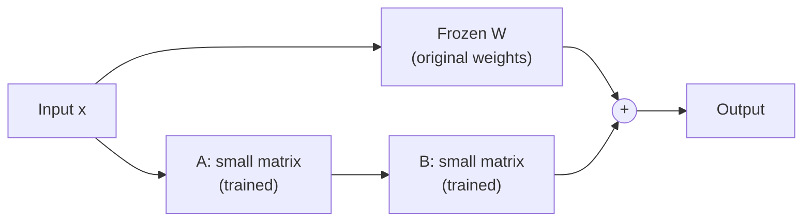
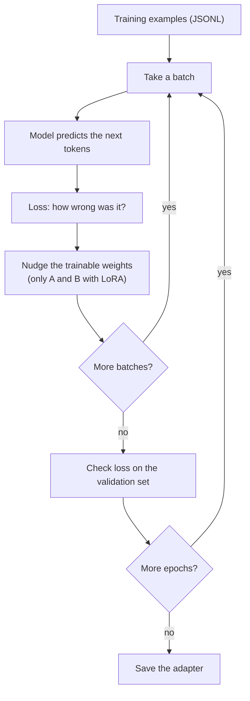

> [!summary] Fine-tuning means training an existing model a little more on your own examples so it changes its behaviour. It fixes how a model answers (format, style, a narrow skill), not what it knows. Try prompting, few-shot examples and RAG first.

## Why this matters

Most AI engineering jobs need little or no fine-tuning. Interviewers still ask about it, mostly to check your judgement: "When would you fine-tune instead of using RAG?" is one of the most common questions. In production it shows up in three places: making a small cheap model do one narrow job as well as a big one, forcing a very steady output style, and improving retrieval by tuning an embedding model.

## The idea in plain words

Think of a new employee who is already well educated. That is the base model.

- **Prompting** is giving them written instructions for the task.
- **Few-shot** is adding three worked examples to those instructions.
- **RAG** is letting them look things up in the company wiki while they work.
- **Fine-tuning** is sending them on a training course, so the new habit is inside their head and you no longer have to repeat the instructions.

A course is slow and costs money, and it does not help if the real problem is "they do not have the document". So you only pay for it when instructions and the wiki are not enough.

### The decision ladder

Climb one step at a time. Move up only when you have measured that the current step is not good enough.

| Step | What you change | What it fixes | Cost to try |
|---|---|---|---|
| 1. Prompting | The instructions | Unclear task, wrong tone, missing rules | Minutes |
| 2. Few-shot | Add examples to the prompt | Format, edge cases, style | Minutes |
| 3. RAG | Add retrieved facts to the prompt | Missing or changing **knowledge**, citations | Days |
| 4. Fine-tuning | The model's weights | **Behaviour**: steady format, style, a narrow skill, shorter prompts, smaller model | Days to weeks, plus upkeep |

The key split to remember: **RAG fixes knowledge. Fine-tuning fixes behaviour.** They are not rivals. A fine-tuned model can still use RAG.

**Fine-tuning is worth it when:**

- You have a narrow, repeated task (classify tickets, extract fields, write in one house style) and a good prompt still fails too often.
- You want a small model to match a big model on that one task, to cut cost and latency.
- Your prompt is huge because of rules and examples, and you want to bake them in.
- You have a few hundred or more high-quality examples, and an eval set to prove the gain.

**It is not worth it when:**

- The model lacks facts, or the facts change often. Use RAG. See [RAG Fundamentals](/blog/rag-fundamentals).
- You have no eval. You cannot tell if the tuned model is better. See [Evals: Measuring LLM Apps](/blog/evals).
- You have not seriously tried prompting and few-shot. See [Prompt Engineering](/blog/prompt-engineering).
- The task changes every month. Each change means new data and a new training run.

## How it works

### Full fine-tuning vs PEFT

A model is a very large set of numbers called **weights**. Training means nudging those numbers so the model's output gets closer to your examples.

- **Full fine-tuning** updates every weight. It needs a lot of GPU memory, and you get a full new copy of the model for each task.
- **PEFT** (parameter-efficient fine-tuning) freezes the original weights and trains only a small number of new ones. The most used PEFT method is LoRA.

### LoRA: freeze the big matrix, learn two small ones

Inside the model are many big tables of numbers (matrices). Call one of them `W`. Full fine-tuning would learn a change `dW` of the same size as `W`.

**LoRA** (Low-Rank Adaptation) makes a bet: the useful change is simple, so it can be written as two thin matrices multiplied together, `B x A`. `W` stays frozen. Only `A` and `B` are trained.

```
Full fine-tuning                  LoRA

  W  (4096 x 4096)                  W  (4096 x 4096)   frozen
  all 16.8M numbers change          +
                                    B (4096 x 8)  x  A (8 x 4096)   trained
                                    = 65,536 numbers  (about 0.4% of W)
```

The `8` is the **rank** (`r`). A higher rank lets the adapter learn more, and costs more memory. The output of the layer becomes `W·x + (alpha / r)·B·A·x`, where `alpha` is a scaling number you choose.



Why people like LoRA:

- The trained file (the **adapter**) is small, often megabytes instead of gigabytes.
- One base model can serve many adapters, one per task or customer.
- `B` starts at zero, so training starts from the exact behaviour of the base model.
- After training you can merge `B x A` into `W`, so there is no extra latency at inference.

### Quantization and QLoRA

**Quantization** means storing each weight with fewer bits. Weights are normally 16-bit or 32-bit numbers. In 8-bit or 4-bit form each number is rounded to one of a small set of values. It is like saving a photo as a smaller JPEG: much less space, a small loss in quality.

**QLoRA** combines both ideas: load the base model in 4-bit so it fits on a modest GPU, keep it frozen, and train LoRA adapters on top in normal precision. This is what made fine-tuning open models possible on a single consumer or free cloud GPU.

### Data preparation

Data is most of the work. The standard format is **chat-format JSONL**: a text file with one JSON object per line, and each object holds one full conversation that ends with the ideal assistant reply.

- **Quality over quantity.** A few hundred clean, consistent examples beat thousands of noisy ones. The model copies your mistakes faithfully.
- **Match production.** Use the same system prompt and the same input shape you will send at inference time.
- **Cover the edges.** Include refusals, empty inputs and the tricky cases, not only the easy ones.
- **Split the data.** Keep a **validation set** (often about 10%) that the model never trains on. Keep a separate test set, or your golden eval set, for the final comparison.
- **No leaks.** The same or near-same example must not be in both train and validation.

### The training loop



Key hyperparameters (settings you pick before training):

| Setting | Plain meaning | Rule of thumb |
|---|---|---|
| Epochs | How many times the model sees the whole dataset | 1-5. More epochs on small data leads to overfitting |
| Learning rate | How big each nudge is | Too high: training is unstable. Too low: nothing is learned. LoRA commonly uses values around 1e-4 to 2e-4 |
| Rank `r` | Size of the LoRA matrices | 8-32 is a common starting range |
| `lora_alpha` | How strongly the adapter is applied | Often set equal to `r` or twice `r` |
| Batch size | Examples per nudge | As large as memory allows |

These are starting points, not laws. You find good values by trying a few and watching the validation loss.

### Two ways it goes wrong

- **Overfitting**: the model memorises the training examples instead of learning the pattern. Sign: training loss keeps falling while validation loss starts rising. Fix: fewer epochs, more or more varied data, a lower rank, dropout.
- **Catastrophic forgetting**: while learning your task the model gets worse at things it used to do well. LoRA reduces this because the base weights are frozen, but a merged adapter can still hurt general ability. Fix: test general tasks too, and mix some general examples into the data.

### Distillation: a big model teaches a small one

**Distillation** uses a large "teacher" model to produce good outputs for many inputs. A small "student" model is then fine-tuned on those input-output pairs. The student ends up cheap and fast, and close to the teacher on that one task. In practice this is the most common reason product teams fine-tune at all. Check the teacher provider's terms of use before training another model on its outputs.

### Where to do it

| Option | What it is | Good for | Trade-off |
|---|---|---|---|
| Hosted fine-tuning API | Upload JSONL to a model provider, get back a private model ID | Fastest path, no GPUs | Only some models, you do not get the weights, pricing differs for tuned models |
| Hugging Face stack | `transformers` (models and trainer), `peft` (LoRA), `datasets` (data loading) | Full control, open models | You manage GPUs and code |
| Unsloth and similar tools | Wrappers that make LoRA/QLoRA training faster and lighter, with ready notebooks | Learning, single-GPU runs | Another layer to keep up with |

### Serving an open model, in brief

- **vLLM**: a server built for throughput. It batches many requests together and exposes an OpenAI-compatible API. This is the usual choice for production on GPUs.
- **Ollama**: one command to run a model on your laptop. Great for development. It also exposes an OpenAI-compatible endpoint, so the code in this series works with it.
- **llama.cpp**: a C/C++ engine that runs quantized models (GGUF files) on CPUs and small devices. Ollama builds on the same family of technology.

### Fine-tuning embeddings and rerankers

You can also fine-tune the retrieval side of RAG. An embedding model or reranker is trained on pairs of (question, relevant passage), often with "hard negatives": passages that look relevant but are not. This helps when your domain has words that general models do not handle well, such as product codes or internal jargon. It is often cheaper and more useful than fine-tuning the LLM, because better retrieval lifts the whole pipeline. The `sentence-transformers` library is the common tool. Measure with recall@k before and after. See [Embeddings and Vector Databases](/blog/embeddings-and-vector-databases) and [Advanced RAG](/blog/advanced-rag).

## Code you should be able to write

### 1. Prepare a chat-format JSONL dataset

```python
import json
import random
from pathlib import Path

from pydantic import BaseModel

SYSTEM = "You are a support assistant. Reply in two short sentences."


class Example(BaseModel):
    question: str
    ideal_answer: str


def to_chat_row(ex: Example) -> dict[str, list[dict[str, str]]]:
    """One training example = one full conversation ending in the ideal reply."""
    return {
        "messages": [
            {"role": "system", "content": SYSTEM},
            {"role": "user", "content": ex.question.strip()},
            {"role": "assistant", "content": ex.ideal_answer.strip()},
        ]
    }


def write_jsonl(rows: list[dict], path: Path) -> None:
    with path.open("w", encoding="utf-8") as f:
        for row in rows:
            f.write(json.dumps(row, ensure_ascii=False) + "\n")  # one JSON object per line


def build_dataset(examples: list[Example], out_dir: Path, val_ratio: float = 0.1) -> None:
    seen: set[str] = set()
    rows: list[dict] = []
    for ex in examples:
        key = ex.question.strip().lower()
        if key in seen or not ex.ideal_answer.strip():  # drop duplicates and empty answers
            continue
        seen.add(key)
        rows.append(to_chat_row(ex))
    random.Random(42).shuffle(rows)  # fixed seed = same split every run
    n_val = max(1, int(len(rows) * val_ratio))
    write_jsonl(rows[n_val:], out_dir / "train.jsonl")
    write_jsonl(rows[:n_val], out_dir / "val.jsonl")
    print(f"train={len(rows) - n_val} val={n_val}")
```

### 2. A QLoRA setup sketch with `peft`

This is a sketch of the setup, not a full training script. It needs a GPU plus `torch`, `transformers`, `peft` and `bitsandbytes`. The argument names match the official PEFT documentation; the right `target_modules` depend on the model, so check its model card.

```python
import os

import torch
from peft import LoraConfig, get_peft_model, prepare_model_for_kbit_training
from transformers import AutoModelForCausalLM, BitsAndBytesConfig

BASE_MODEL = os.environ["BASE_MODEL"]  # an open model ID from the Hugging Face Hub

quant = BitsAndBytesConfig(          # load the frozen base model in 4-bit (the "Q" in QLoRA)
    load_in_4bit=True,
    bnb_4bit_quant_type="nf4",
    bnb_4bit_use_double_quant=True,
    bnb_4bit_compute_dtype=torch.bfloat16,
)
model = AutoModelForCausalLM.from_pretrained(BASE_MODEL, quantization_config=quant)
model = prepare_model_for_kbit_training(model)

lora = LoraConfig(
    r=16,                         # rank: size of the two small matrices
    lora_alpha=32,                # scaling; the adapter is applied with strength alpha / r
    lora_dropout=0.05,            # a little dropout to reduce overfitting
    target_modules="all-linear",  # or a list of layer names such as ["q_proj", "v_proj"]
    bias="none",
    task_type="CAUSAL_LM",
)
model = get_peft_model(model, lora)
model.print_trainable_parameters()  # expect a small percentage of all parameters
# Next: train with transformers.Trainer (or TRL's SFTTrainer), then model.save_pretrained("adapter/")
```

## In production

- **Always keep a prompting baseline.** Run your eval set on (a) the base model with your best prompt and few-shot examples, and (b) the tuned model. If (b) is not clearly better on the metric you care about, do not ship it. Report it honestly either way.
- **Compare on cost and latency too.** A tuned small model that matches a big model's quality at a fraction of the cost is a win even with equal accuracy.
- **A fine-tuned model is a dependency you own.** When the provider retires the base model, you retrain. When the task changes, you retrain. Keep the dataset and the training script in version control.
- **The model can go stale.** Anything you baked in (policies, product names) stays until you retrain. Keep facts in RAG, not in weights.
- **Data privacy.** Training data can be memorised and repeated. Remove personal data and secrets before training.
- **Structured output is often solved without tuning.** Schema-constrained output from the API fixes most "the JSON is broken" problems. See [Structured Outputs and Tool Calling](/blog/structured-outputs-and-tool-calling).
- **Use the exact chat template.** With open models, training and inference must format messages the same way. A mismatch quietly ruins quality.
- **Serving has a cost.** A hosted tuned model may be billed differently from the base model, and a self-hosted model means paying for a GPU all day. See [Cost, Latency and Reliability](/blog/cost-latency-and-reliability).

> [!warning] The most common mistake is fine-tuning to add knowledge. The model may learn the style of your documents and then state wrong facts with more confidence. Use RAG for knowledge.

## Interview questions

**Q: What is fine-tuning?**
It is extra training of an already trained model on your own examples, so its weights change and it behaves differently by default. You use it to teach a behaviour, such as a format, a style or a narrow skill.

**Q: When would you fine-tune instead of using RAG?**
RAG when the problem is missing or changing knowledge, or when I need citations. Fine-tuning when the problem is behaviour: the model knows enough but will not answer in the right form, or I want a smaller model to do one narrow job. I would try prompting and few-shot first for both. The two can be combined.

**Q: Explain LoRA simply.**
Freeze the original weights. Next to each chosen big matrix, add two small matrices whose product is the "change" to that matrix. Train only the small ones. You get most of the benefit of fine-tuning while training well under one percent of the parameters, and the result is a small adapter file.

**Q: What does the rank `r` control?**
The size of the two small matrices, so how much the adapter is able to learn. A low rank is cheap and less likely to overfit. A higher rank can fit harder tasks but uses more memory and can overfit on small data.

**Q: What is QLoRA?**
LoRA on top of a base model that has been loaded in 4-bit quantized form. The quantized base is frozen and uses much less GPU memory, while the adapters train in normal precision. It lets you tune fairly large models on one GPU.

**Q: What is quantization and what do you lose?**
Storing weights with fewer bits, for example 4 or 8 instead of 16. The model needs less memory and can run faster on small hardware. You lose a little accuracy, and the loss grows as you go to fewer bits.

**Q: How much data do you need?**
It depends on the task; there is no fixed number. A narrow format or style task can improve with a few hundred good examples. I would start small, measure, and add data aimed at the failures I see, instead of collecting thousands of examples up front.

**Q: Your validation loss goes up while training loss goes down. What is happening?**
Overfitting. The model is memorising the training set. I would stop earlier or use fewer epochs, add more varied data, lower the rank or add dropout, and keep the checkpoint with the best validation loss.

**Q: What is catastrophic forgetting?**
The model gets worse at general things while learning the new task. I would check for it by running a small general eval next to the task eval. Freezing the base with LoRA, a lower learning rate, and mixing in general examples all reduce it.

**Q: How do you prove a fine-tuned model is better?**
Hold out a test set the model never saw. Run the base model with the best prompt as the baseline, then the tuned model, on the same metric. Also compare cost and latency. If the numbers are not better, I say so and do not ship it.

**Q: What is distillation?**
A large teacher model labels many inputs, and a small student model is fine-tuned on those labels. The student becomes cheap and fast on that one task. It is a common way to cut cost once a big model has proven the task is possible.

**Q: Hosted fine-tuning or open-source?**
Hosted is fastest and needs no GPUs, but I am limited to the provider's models and never hold the weights. Open-source gives control, privacy and portability, and I pay with operations work: GPUs, serving, upgrades. I choose by privacy needs, traffic volume and team skills.

**Q: How would you serve a fine-tuned open model?**
For production on GPUs, vLLM behind an OpenAI-compatible endpoint, because it batches requests for throughput. For local development, Ollama. For CPU or edge devices, a quantized model on llama.cpp. I can either merge the adapter into the base or load adapters per request.


## Go deeper

- [LoRA paper](https://arxiv.org/abs/2106.09685) - the original idea; the first three pages are enough.
- [QLoRA paper](https://arxiv.org/abs/2305.14314) - 4-bit base model plus LoRA adapters.
- [Hugging Face PEFT docs](https://huggingface.co/docs/peft/index) - the library you will actually use; see the LoRA and quantization guides.
- [OpenAI supervised fine-tuning guide](https://developers.openai.com/api/docs/guides/supervised-fine-tuning) - a clear example of a hosted flow and the JSONL chat format.
- [Unsloth docs](https://unsloth.ai/docs) - ready notebooks for single-GPU LoRA runs.
- [vLLM docs](https://docs.vllm.ai/en/latest/) - serving open models with an OpenAI-compatible server.
- [Sentence Transformers training overview](https://sbert.net/docs/sentence_transformer/training_overview.html) - fine-tuning embedding models.
- [Distilling the Knowledge in a Neural Network](https://arxiv.org/abs/1503.02531) - the classic distillation paper by Hinton and co-authors.
