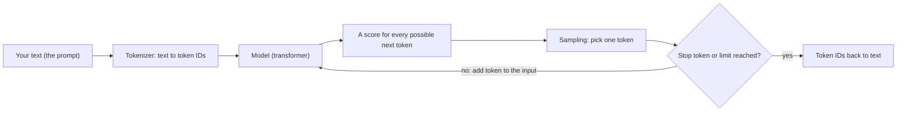
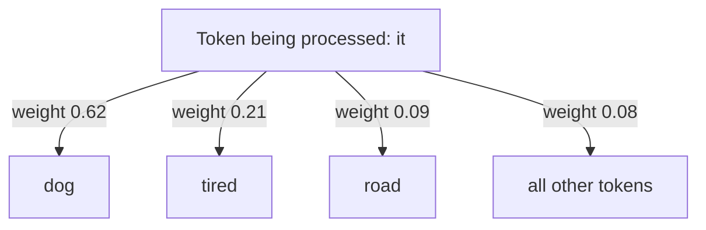

> [!summary] An LLM is a program that predicts the next token of a text, again and again. Almost every strange thing it does (hallucination, randomness, cost, limits) follows from that one fact.

## Why this matters

You will not train a model in an AI engineer job, but you will debug one every day. "Why did it make that up?", "why is the answer different each time?", "why is this call so expensive?" all have answers that come from how the model works inside. Interviewers ask these basics first to check that you are not just gluing APIs together.

## The idea in plain words

Think of the autocomplete on your phone keyboard. You type "see you", it suggests "tomorrow". A **large language model (LLM)** is the same idea made huge: it has read a big part of the internet, and it is very good at guessing what comes next.

It does not look up answers in a database. It does not "know" facts the way a table of records does. It produces the most likely continuation of the text you gave it, one small piece at a time. When the likely continuation is also the true one, it looks smart. When it is not, it sounds just as confident. That is the whole story in one paragraph.

## How it works

### The loop: text in, one token out, repeat



The model writes one token, adds it to the input, and runs again. This is called **autoregressive** generation. A 500-token answer means 500 trips around this loop.

### Tokens and tokenization

A **token** is the unit the model reads and writes. It is a chunk of text: sometimes a whole word, often a piece of a word, sometimes one character. A **tokenizer** cuts text into tokens and turns each into a number (an ID) from a fixed list called the **vocabulary** (typically tens of thousands to a couple of hundred thousand entries).

- Common words are usually one token. Rare or long words are split into pieces.
- Rule of thumb for English: 1 token is about 4 characters, or about three quarters of a word. So 1,000 tokens is roughly 750 words. This is only a rule of thumb. Code, numbers, and languages like Hindi usually take more tokens per word.
- Every tokenizer is different, so the same text has different token counts on different models.

Why "how many r's in strawberry?" used to fail: the model never sees letters. It sees something like `str` + `aw` + `berry` as three ID numbers (the exact split depends on the tokenizer). Counting letters inside an ID is like asking you how many strokes are in a word you only heard spoken. Newer models do better, partly by reasoning step by step, but the cause is the same: **tokens are not words and not letters**.

Tokens matter to you for three reasons: you pay per token, limits are counted in tokens, and speed is measured in tokens per second.

### Embeddings inside the model

The model cannot do math on an ID like 4821. So the first step is a lookup table that turns each token ID into a long list of numbers (a **vector**, often thousands of numbers long). This vector is the token's **embedding**. Tokens with similar meaning get similar vectors. These vectors are learned during training.

This is related to, but not the same as, the embeddings you use for search in [Embeddings and Vector Databases](/blog/embeddings-and-vector-databases). Those come from a separate model that gives one vector for a whole sentence or chunk.

### The transformer and attention

The **transformer** is the model design used by all current LLMs. Its key part is **attention**: for each token, the model looks at every other token in the input and decides how much each one matters for understanding this one.

A small example. Take the sentence: "The dog did not cross the road because it was tired." What does "it" mean? You know it is the dog. Attention is how the model works that out: when processing "it", it gives a high weight to "dog", and low weights to most other words.



The weights add up to 1 (these numbers are made up to show the idea). The new vector for "it" becomes a mix of the other tokens' vectors, using these weights. After this step, the vector for "it" carries some "dog" meaning.

Three more facts complete the picture:

- **Layers.** A model stacks many of these blocks (dozens). Each layer has attention followed by a small ordinary neural network. Early layers tend to pick up grammar and nearby words; later layers pick up meaning and longer-range links. That is a rough picture, not a strict rule.
- **Position.** Attention alone does not know word order, so position information is added to each token.
- **Looking left only.** When generating, a token can only attend to tokens before it. The model cannot peek at the future.

The **parameters** (or **weights**) are the billions of numbers inside these layers. "A 70B model" means 70 billion parameters.

### Context window

The **context window** is the largest number of tokens the model can handle in one call: your input plus its output together. Think of it as the model's desk. Anything not on the desk does not exist for the model. It has no memory between calls.

Bigger windows exist now (hundreds of thousands of tokens or more), but filling them costs money and time, and models often pay less attention to the middle of a very long input. Managing what goes on the desk is a skill of its own: see [Memory and Context Engineering](/blog/memory-and-context-engineering).

### How the model was trained

| Stage | What happens | Result |
|---|---|---|
| **Pretraining** | Predict the next token on a huge amount of text. Very expensive. | A model that continues any text, but does not follow instructions well |
| **Fine-tuning / instruction tuning** | More training on smaller, chosen data, such as question-and-answer pairs | A model that behaves like a helpful assistant |
| **RLHF and similar** | Reinforcement learning from human feedback: people (or other models) rate answers, and the model is nudged toward the better ones | Answers that are more useful, polite and safe |

Training ends at a date called the **knowledge cutoff**. The model knows nothing after it unless you put the information in the prompt. You can also fine-tune a model yourself: see [Fine-Tuning](/blog/fine-tuning).

### Inference: from scores to a chosen token

**Inference** means using the trained model. At each step the model outputs a raw score for every token in the vocabulary. These scores are called **logits**. A function called **softmax** turns them into probabilities that add up to 1. Then one token is picked by **sampling**. You control the picking with these settings:

| Setting | What it does | Typical use |
|---|---|---|
| **temperature** | Divides the logits before softmax. Low (0 to 0.3) makes the top token dominate. High (1 and above) flattens the choices. | Low for extraction, code, SQL. Higher for creative writing. |
| **top-p** (nucleus) | Keep only the smallest set of tokens whose probabilities add up to p (say 0.9), then sample from those | Cuts off the long tail of silly tokens |
| **top-k** | Keep only the k most likely tokens | Same goal; not offered by every API |
| **max tokens** | Hard limit on output length. Output is cut mid-sentence when it is hit. | Cost and safety limit |
| **stop sequences** | Strings that end generation as soon as they appear | Stop at a closing tag or a newline |

Change temperature or top-p, not both at once, so you know what caused a change.

### Why LLMs hallucinate

A **hallucination** is output that sounds right but is false or unsupported. It is not a bug that will be patched; it follows from the design. The model is trained to give a likely continuation, not a verified one. It has no built-in step that checks facts, and "I do not know" is rarely the most likely next text. The risk is highest for rare facts, exact numbers, quotes, links, and anything after the knowledge cutoff.

The fixes are all engineering around the model: give it the facts in the prompt ([RAG Fundamentals](/blog/rag-fundamentals)), let it call tools, ask for citations, allow it to say "I do not know" ([Prompt Engineering](/blog/prompt-engineering)), and measure it ([Evals: Measuring LLM Apps](/blog/evals)).

### Why the output is not deterministic

Sampling is a random pick, so the same prompt can give different answers. Even at temperature 0 you may see small differences: the provider runs your request on different hardware, batches it with other requests, and floating-point math is not exactly repeatable across those setups. Providers also update models. Some APIs offer a `seed` setting, but it is best effort. Design your system and your tests to accept this.

### Reasoning ("thinking") models

A standard model starts writing the answer at once. A **reasoning model** first writes a private scratchpad of **reasoning tokens** where it plans, tries things and checks itself, then writes the final answer. It is the same next-token loop, just with thinking space before the answer.

| | Standard model | Reasoning model |
|---|---|---|
| Speed | Fast | Slower, sometimes much slower |
| Cost | Lower | Higher: reasoning tokens are billed as output |
| Good for | Chat, extraction, classification, simple tool calls | Multi-step logic, math, planning, hard debugging |
| Controls | temperature and friends | Often an "effort" or thinking-budget setting; some ignore temperature |

Many current models can do both, with thinking switched on or off per request.

### Multimodal models

A **multimodal** model accepts more than text: images, audio, sometimes video. The trick is the same as with text. An image is cut into small patches, and an encoder turns each patch into vectors that sit in the same sequence as the text token vectors. From there the transformer treats them all alike. Images and audio therefore also use up tokens and context window. Voice is covered in [Voice AI](/blog/voice-ai).

### Open weights vs closed weights

**Closed-weight** models are only reachable through the maker's API. You cannot download them. **Open-weight** models can be downloaded and run on your own machine or by any hosting company. Closed models have usually led on the hardest tasks; open models give you control, privacy, the option to fine-tune, and often lower cost. The gap moves every few months, so test rather than assume.

### The KV cache, and why output tokens cost more

Reading the input can be done for all tokens at once, in parallel. Writing cannot: each output token needs its own trip through the model, one after another. To avoid redoing work on every trip, the model saves the attention results (called keys and values) for all earlier tokens. This saved state is the **KV cache**. It makes generation practical, but output is still step by step, which is why providers charge several times more per output token than per input token. **Prompt caching**, which you will meet in [LLM APIs and Model Selection](/blog/llm-apis-and-model-selection), is the same idea across requests: if a new request starts with the exact same text as an earlier one, the provider reuses the saved work and gives you a discount.

## Code you should be able to write

The sampling step in plain Python, with no libraries. If you can write this, you understand temperature and top-p.

```python
import math
import random


def softmax(logits: list[float], temperature: float = 1.0) -> list[float]:
    """Turn raw scores into probabilities. Lower temperature = sharper."""
    scaled = [x / temperature for x in logits]
    biggest = max(scaled)  # subtract the max so exp() cannot overflow
    exps = [math.exp(x - biggest) for x in scaled]
    total = sum(exps)
    return [e / total for e in exps]


def sample(logits: dict[str, float], temperature: float = 1.0, top_p: float = 1.0) -> str:
    if temperature == 0:  # "greedy": always take the top token
        return max(logits, key=lambda tok: logits[tok])
    tokens = list(logits)
    probs = softmax([logits[t] for t in tokens], temperature)
    ranked = sorted(zip(tokens, probs), key=lambda pair: pair[1], reverse=True)
    kept: list[tuple[str, float]] = []
    running = 0.0
    for tok, p in ranked:  # top-p: keep tokens until their sum reaches top_p
        kept.append((tok, p))
        running += p
        if running >= top_p:
            break
    return random.choices([t for t, _ in kept], weights=[p for _, p in kept])[0]


# Pretend scores for the token after "The capital of France is"
logits = {" Paris": 6.0, " a": 3.0, " the": 2.5, " Lyon": 2.0, " pizza": -1.0}
print([round(p, 3) for p in softmax(list(logits.values()), temperature=1.0)])
print([round(p, 3) for p in softmax(list(logits.values()), temperature=2.0)])
print([sample(logits, temperature=1.5, top_p=0.95) for _ in range(8)])
```

The same settings on a real API call:

```python
import os
from openai import OpenAI

client = OpenAI(base_url=os.getenv("LLM_BASE_URL"), api_key=os.environ["LLM_API_KEY"])
MODEL = os.environ["LLM_MODEL"]

resp = client.chat.completions.create(
    model=MODEL,
    messages=[{"role": "user", "content": "Name three fruits, one per line."}],
    temperature=0.2,  # low: we want a steady answer
    top_p=1.0,
    max_tokens=50,    # hard limit on output length
    stop=["\n\n"],    # stop at the first blank line
)
choice = resp.choices[0]
print(choice.message.content)
print("finish_reason:", choice.finish_reason)  # "stop" = ended normally, "length" = hit max_tokens
if resp.usage:
    print("input tokens:", resp.usage.prompt_tokens, "output tokens:", resp.usage.completion_tokens)
```

> [!tip] Some newer and reasoning models on some providers want `max_completion_tokens` instead of `max_tokens`, and reject a custom `temperature`. If you get a 400 error about one of these, that is why.

## In production

- **Check `finish_reason`.** If it is `length`, the answer was cut off. Cut-off JSON will break your parser.
- **Count tokens, not characters.** Budget your context in tokens, and leave room for the output. Use the provider's tokenizer or the `usage` numbers from a real call.
- **Never trust a bare fact.** For anything that must be right, give the model the source text or a tool, and ask it to quote or cite.
- **Use low temperature for machine-read output**, but do not expect identical output. Write tests that check meaning or structure, not exact strings.
- **Reasoning is not free.** Turn thinking on only for steps that need it. A classifier step does not.
- **Long context is not free either.** It raises cost and delay, and quality can drop when the important part is buried in the middle.
- **The cutoff is real.** For recent facts the model needs retrieval or a search tool.

## Interview questions

**Q: In one sentence, what does an LLM do?**
It predicts the next token given all the tokens so far, and repeats this to build a full answer. Everything else (chat, tools, agents) is built on top of that loop.

**Q: What is a token, and why does it matter to an engineer?**
A token is a chunk of text, often part of a word, that the model reads and writes as a number. Cost, context limits, rate limits and speed are all measured in tokens. A rough rule for English is 4 characters or three quarters of a word per token, but it changes with the language and the tokenizer.

**Q: Why did models struggle to count the r's in "strawberry"?**
Because the model sees a few token IDs, not letters. The spelling is hidden inside each token. Letter-level tasks need the model to recall the spelling and reason step by step, or to use a tool such as running code.

**Q: Explain attention without math.**
For each token, the model looks at all the other tokens it is allowed to see and gives each a weight for how relevant it is. It then mixes their information into the current token using those weights. This is how "it" gets linked to "the dog" earlier in the sentence.

**Q: What does temperature do? What happens at 0?**
Temperature rescales the logits before they become probabilities. Low values make the most likely token win almost every time; high values spread the choice out. At 0 the model takes the top token each step (greedy), which is steadier but still not guaranteed to be identical across calls.

**Q: What is the difference between top-p and top-k?**
Top-k keeps a fixed number of the most likely tokens. Top-p keeps a changing number: the smallest group whose probabilities add up to p. Top-p adapts: when the model is sure it keeps few tokens, when unsure it keeps more.

**Q: Why do LLMs hallucinate, and how do you reduce it?**
They are trained to produce likely text, not checked text, and have no built-in fact check. You reduce it by putting trusted facts in the context (RAG), giving tools, asking for citations, allowing "I do not know", and measuring with evals. You cannot bring it to zero.

**Q: I set temperature to 0 and still get different answers. Why?**
Hardware differences, request batching and floating-point rounding can flip a close call between two tokens, and one different token changes everything after it. The provider may also have updated the model. Use a seed if offered, pin the model version, and make tests tolerant.

**Q: What is the context window, and what happens when you go over it?**
It is the maximum input plus output tokens per call. Go over it and the API returns an error, or your framework silently cuts something out. You must choose what to keep: trim history, summarise, or retrieve only what is relevant.

**Q: Why are output tokens priced higher than input tokens?**
Input tokens are processed together in parallel. Output tokens are made one at a time, each needing a pass through the model. The KV cache avoids recomputing earlier tokens but generation is still sequential and holds the GPU longer.

**Q: When would you choose a reasoning model, and when not?**
Choose it for multi-step problems: planning, hard debugging, math, tricky SQL. Avoid it for simple, high-volume steps such as classification or extraction, where it adds delay and cost for no gain. Measure both on your own test set.

**Q: Pretraining vs fine-tuning vs RLHF?**
Pretraining teaches general language by next-token prediction on huge data. Fine-tuning continues training on smaller targeted data, for example to follow instructions. RLHF uses ratings of outputs to push the model toward answers people prefer.

**Q: Open-weight or closed-weight model for a product: how do you decide?**
Look at quality on your task, data privacy rules, cost at your volume, latency, and whether you need to fine-tune or run offline. Closed models are quick to start with and often strongest. Open weights give control and can be cheaper at scale, but you or a host must run them.


## Go deeper

- [Andrej Karpathy: Intro to Large Language Models](https://www.youtube.com/watch?v=zjkBMFhNj_g): the best one-hour overview, no math needed.
- [3Blue1Brown: Transformers, the tech behind LLMs](https://www.3blue1brown.com/lessons/gpt): animated pictures of tokens, embeddings and attention.
- [Jay Alammar: The Illustrated Transformer](https://jalammar.github.io/illustrated-transformer/): the classic step-by-step drawing of the architecture.
- [Andrej Karpathy: Let's build GPT from scratch](https://www.youtube.com/watch?v=kCc8FmEb1nY): write a tiny transformer in Python; watch after the first three.
- [Andrej Karpathy: Let's build the GPT Tokenizer](https://www.youtube.com/watch?v=zduSFxRajkE): why tokenization causes so many odd behaviours.
- [Attention Is All You Need](https://arxiv.org/abs/1706.03762): the original transformer paper; skim it once so you can say you have.
