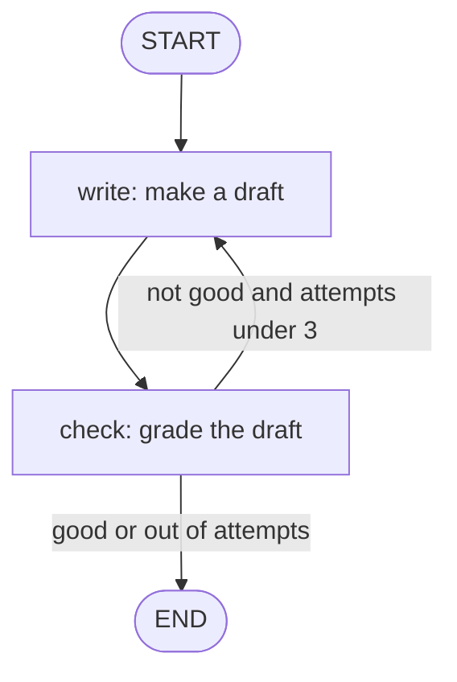
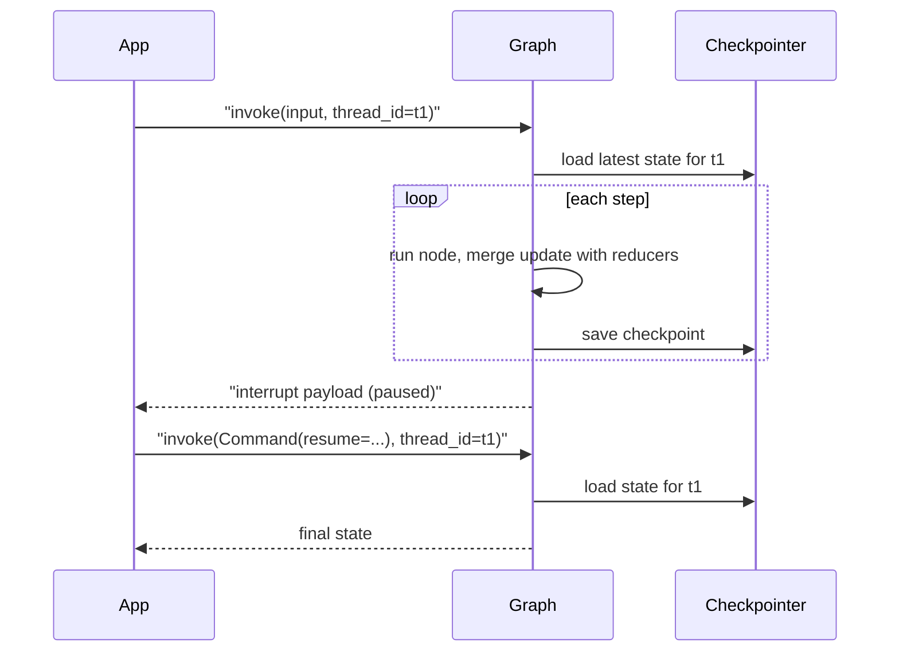

> [!summary] LangChain is a box of integrations and building blocks for LLM apps. LangGraph is a library for writing an agent as an explicit graph of steps that share one state, with saving, pausing for a human, and streaming built in.

## Why this matters

LangChain and LangGraph appear in a large share of AI engineer job posts, and interviewers expect you to explain state, nodes, edges, checkpointers and interrupts without notes. Interviewers also test whether you know what the framework is doing underneath, so learn it after the raw loop in [Agent Fundamentals](/blog/agent-fundamentals), not instead of it.

> [!tip] Every LangGraph example in this post that does not need an LLM was run and verified against langgraph 1.2 (1.2.21, with langchain-core 1.8) in Nov 2026. These libraries change often. If an import fails, check the official docs before anything else.

## The idea in plain words

**LangChain** is like a box of adapters and standard parts. Every model provider, vector database and document loader has its own plug shape. LangChain gives them all the same plug, so you can swap one for another without rewriting your app.

**LangGraph** is like a board game. There is one shared **board** (the **state**). Each **square** is a step (a **node**) that reads the board and changes part of it. **Arrows** (the **edges**) say which square comes next, and some arrows depend on what is on the board. You can save the game after every move (a **checkpointer**), stop to ask a person what to do (an **interrupt**), and carry on tomorrow from the same position.

A hand-written `while` loop hides the control flow inside `if` statements. LangGraph makes the control flow a visible thing you can draw, save and resume.

## How it works

### What LangChain is, and is not

LangChain gives you:

- **Integrations**: one interface over many chat models, embedding models, vector stores, document loaders and tools.
- **Abstractions**: chat models, prompt templates, output parsers, retrievers, tools, and a common message format (`HumanMessage`, `AIMessage`, `ToolMessage`).
- **LCEL** (LangChain Expression Language): the pipe syntax `prompt | model | parser`. Each piece is a "Runnable" with the same methods (`invoke`, `stream`, `batch`), so pieces snap together.

It is not a model, not a vector database, and not required. Everything it does, you can do with the provider SDK and plain Python.

The honest criticism, which you should be able to say in an interview:

- **Abstraction hides what is going on.** When a chain gives a bad answer, you need to see the exact prompt and the raw response. Layers of wrappers make that harder.
- **The API has changed a lot** between versions, so tutorials and old answers online are often out of date.
- **Simple things can become indirect.** One API call and an f-string is sometimes clearer than a chain.

The fair counterpoint: the integrations save real time, and tracing tools show the hidden prompts. A balanced position is: know the raw API first, then use the framework where it earns its place.

### Why LangGraph exists

Early LangChain agents were a black-box loop. Teams needed things the loop could not give them:

- **Explicit control flow**: you decide which step can follow which.
- **Cycles**: loops such as "grade the answer, and if it is weak, rewrite and retry".
- **Persistence**: save state after every step, survive a crash, continue a conversation later.
- **Human-in-the-loop**: pause, wait hours for approval, then resume.
- **Streaming**: show progress and tokens as they happen.

LangGraph models the agent as a **state machine**: a set of steps plus rules for moving between them. LangGraph does not need LangChain's chains; nodes are ordinary Python functions.



The thing to notice: `check` has a **conditional edge**. One branch goes back to `write`, which makes a **cycle**. The attempts counter in the state is what stops the cycle.

### The core concepts

| Concept | What it is |
|---|---|
| **State** | One typed dictionary shared by all nodes. A `TypedDict` or a Pydantic model |
| **Reducer** | A function that says how to merge a node's update into a state key. Default: overwrite. `operator.add`: append to a list. `add_messages`: append chat messages, and replace one that has the same id |
| **Node** | A function that takes the state and returns a partial update (only the keys it changed) |
| **Edge** | "After node A, run node B" |
| **Conditional edge** | A function that looks at the state and returns the name of the next node |
| **START / END** | Built-in entry and exit markers |
| **compile** | Checks the graph and returns a runnable object with `invoke` and `stream` |
| **Checkpointer** | Saves the state after every step, grouped by `thread_id` |
| **interrupt** | Pauses the graph inside a node and hands a value to the caller |

One run, step by step:



## Code you should be able to write

Install with `uv add langgraph`. The first four snippets run with no API key.

### State, nodes, edges, a conditional edge and a cycle

```python
import operator
from typing import Annotated, Literal
from typing_extensions import TypedDict

from langgraph.graph import StateGraph, START, END


class State(TypedDict):
    question: str
    draft: str
    attempts: int
    log: Annotated[list[str], operator.add]   # reducer: append, do not overwrite


def write(state: State) -> dict:
    n = state["attempts"] + 1
    return {"draft": f"draft v{n}", "attempts": n, "log": [f"write {n}"]}


def check(state: State) -> dict:
    return {"log": [f"check {state['attempts']}"]}


def route(state: State) -> Literal["write", "__end__"]:
    return END if state["attempts"] >= 3 else "write"


builder = StateGraph(State)
builder.add_node("write", write)
builder.add_node("check", check)
builder.add_edge(START, "write")
builder.add_edge("write", "check")
builder.add_conditional_edges("check", route)   # the cycle: check -> write
graph = builder.compile()

result = graph.invoke({"question": "hi", "attempts": 0, "log": []})
print(result["draft"], result["log"])
# draft v3 ['write 1', 'check 1', 'write 2', 'check 2', 'write 3', 'check 3']

for chunk in graph.stream({"question": "hi", "attempts": 0, "log": []}, stream_mode="updates"):
    print(chunk)            # {'write': {...}} then {'check': {...}} and so on
```

Things to notice:

- Nodes return only what changed. `check` returns just a `log` entry, and `draft` stays as it was.
- Without the `operator.add` reducer, each node's `log` would replace the previous one.
- `route` returns a node name. `END` is the string `"__end__"`. You can also return labels and pass a mapping: `add_conditional_edges("check", route, {"retry": "write", "done": END})`.
- LangGraph has a recursion limit on steps per run and raises `GraphRecursionError` when a cycle never ends. In the version tested here the default limit is very high, so it is a last-resort safety net and not a budget. Write your own counter, as above, or set `recursion_limit` in the config.

### Messages state, a checkpointer and thread_id

Chat agents keep a list of messages in the state. `add_messages` is the reducer for that list.

```python
from typing import Annotated
from typing_extensions import TypedDict

from langchain_core.messages import AIMessage
from langgraph.checkpoint.memory import InMemorySaver
from langgraph.graph import StateGraph, START, END
from langgraph.graph.message import add_messages


class ChatState(TypedDict):
    messages: Annotated[list, add_messages]


def bot(state: ChatState) -> dict:          # a stand-in for an LLM call
    last = state["messages"][-1].content
    return {"messages": [AIMessage(content=f"you said: {last}")]}


builder = StateGraph(ChatState)
builder.add_node("bot", bot)
builder.add_edge(START, "bot")
builder.add_edge("bot", END)
graph = builder.compile(checkpointer=InMemorySaver())

config = {"configurable": {"thread_id": "user-42"}}
graph.invoke({"messages": [{"role": "user", "content": "hi"}]}, config)
out = graph.invoke({"messages": [{"role": "user", "content": "again"}]}, config)
print(len(out["messages"]))   # 4: the thread remembered the first turn

snapshot = graph.get_state(config)          # latest saved state for this thread
print(snapshot.next, len(list(graph.get_state_history(config))))
```

A **thread** is one conversation or one run of a job. The same `thread_id` continues it. A new `thread_id` starts empty.

| Checkpointer | Import | Use |
|---|---|---|
| `InMemorySaver` (older name `MemorySaver`, same class) | `langgraph.checkpoint.memory` | Tests and notebooks. Lost on restart |
| `SqliteSaver` | `langgraph.checkpoint.sqlite` (package `langgraph-checkpoint-sqlite`) | Local apps and demos |
| `PostgresSaver` / `AsyncPostgresSaver` | `langgraph.checkpoint.postgres` (package `langgraph-checkpoint-postgres`) | Production. Call `.setup()` once to create the tables |

### interrupt and resuming with Command

```python
from typing_extensions import TypedDict

from langgraph.checkpoint.memory import InMemorySaver
from langgraph.graph import StateGraph, START, END
from langgraph.types import Command, interrupt


class SqlState(TypedDict):
    sql: str
    approved: bool
    result: str


def draft(state: SqlState) -> dict:
    return {"sql": "SELECT count(*) FROM orders"}


def approve(state: SqlState) -> dict:
    answer = interrupt({"question": "Run this SQL?", "sql": state["sql"]})  # pauses here
    return {"approved": answer == "yes"}


def run(state: SqlState) -> dict:
    return {"result": "42 rows" if state["approved"] else "cancelled"}


builder = StateGraph(SqlState)
builder.add_node("draft", draft)
builder.add_node("approve", approve)
builder.add_node("run", run)
builder.add_edge(START, "draft")
builder.add_edge("draft", "approve")
builder.add_edge("approve", "run")
builder.add_edge("run", END)
graph = builder.compile(checkpointer=InMemorySaver())   # interrupts need a checkpointer

config = {"configurable": {"thread_id": "job-1"}}
paused = graph.invoke({"sql": "", "approved": False, "result": ""}, config)
print(paused["__interrupt__"][0].value)     # {'question': 'Run this SQL?', 'sql': ...}

final = graph.invoke(Command(resume="yes"), config)      # same thread_id
print(final["result"])                                   # 42 rows
```

Rules for interrupts:

- You need a checkpointer and a `thread_id`. The pause is just a saved checkpoint, so the resume can happen minutes or days later, even from another process if the checkpointer is a database.
- The value passed to `interrupt()` must be JSON-serialisable. It comes back to the caller under `"__interrupt__"`.
- The value in `Command(resume=...)` becomes the return value of `interrupt()`.
- On resume, **the node runs again from its first line**. Any code before `interrupt()` runs twice. Keep side effects (sending an email, writing to a database) after the interrupt or in a later node.

### ToolNode and the tool loop

`ToolNode` is a prebuilt node that reads the tool calls on the last AI message, runs the matching tools, and returns `ToolMessage` results. `tools_condition` is a prebuilt router: go to `"tools"` if the last message has tool calls, otherwise end. This example uses a fake model so that it runs offline.

```python
from typing import Annotated
from typing_extensions import TypedDict

from langchain_core.messages import AIMessage, HumanMessage, ToolMessage
from langchain_core.tools import tool
from langgraph.graph import StateGraph, START
from langgraph.graph.message import add_messages
from langgraph.prebuilt import ToolNode, tools_condition


class AgentState(TypedDict):
    messages: Annotated[list, add_messages]


@tool
def add(a: int, b: int) -> int:
    """Add two integers."""
    return a + b


def fake_llm(state: AgentState) -> dict:    # real version: llm.bind_tools([add]).invoke(...)
    last = state["messages"][-1]
    if isinstance(last, ToolMessage):
        return {"messages": [AIMessage(content=f"The answer is {last.content}")]}
    call = {"name": "add", "args": {"a": 2, "b": 3}, "id": "call_1"}
    return {"messages": [AIMessage(content="", tool_calls=[call])]}


builder = StateGraph(AgentState)
builder.add_node("llm", fake_llm)
builder.add_node("tools", ToolNode([add]))
builder.add_edge(START, "llm")
builder.add_conditional_edges("llm", tools_condition)   # "tools" or END
builder.add_edge("tools", "llm")                        # the ReAct cycle
graph = builder.compile()

out = graph.invoke({"messages": [HumanMessage("What is 2 + 3?")]})
print([(m.type, m.content) for m in out["messages"]])
# [('human', 'What is 2 + 3?'), ('ai', ''), ('tool', '5'), ('ai', 'The answer is 5')]
```

This is the same think, act, observe loop from [Agent Fundamentals](/blog/agent-fundamentals), drawn as a graph with two nodes.

### The prebuilt ReAct agent, and LCEL

You do not have to build that graph by hand. There is a one-line helper. Its import location has moved across versions, so check the docs for your version. In the version verified here, `from langgraph.prebuilt import create_react_agent` still imports but is marked deprecated in favour of `create_agent` in the `langchain` package.

```python
import os

from langchain.agents import create_agent
from langchain_core.output_parsers import StrOutputParser
from langchain_core.prompts import ChatPromptTemplate
from langchain_openai import ChatOpenAI

llm = ChatOpenAI(model=os.environ["LLM_MODEL"], base_url=os.getenv("LLM_BASE_URL"),
                 api_key=os.environ["LLM_API_KEY"])

# Prebuilt agent: a compiled graph with a model node and a tools node (add is the tool above).
agent = create_agent(llm, tools=[add], system_prompt="You are a careful assistant.")
reply = agent.invoke({"messages": [{"role": "user", "content": "What is 2 + 3?"}]})
print(reply["messages"][-1].content)

# LCEL in brief: pipe a prompt into a model into a parser.
prompt = ChatPromptTemplate.from_messages(
    [("system", "Answer in one line."), ("human", "{question}")])
chain = prompt | llm | StrOutputParser()
print(chain.invoke({"question": "What is LCEL?"}))
```

For this snippet, building the agent and the pipe syntax were verified (the pipe with a stand-in model). The two calls that reach a real model need an API key and were not run.

### Subgraphs and streaming

A **subgraph** is a compiled graph used as a node inside another graph. If parent and child share state keys, add it directly: `parent.add_node("researcher", child_graph)`. If their states differ, call `child_graph.invoke(...)` inside a normal node function and map the keys yourself. Subgraphs keep big graphs readable and let teams own separate parts.

`graph.stream(...)` takes a `stream_mode`:

| Mode | What you get |
|---|---|
| `"values"` | The full state after each step |
| `"updates"` | Only what each node returned, keyed by node name |
| `"messages"` | LLM tokens as they are generated, with metadata. This is what a chat UI uses |
| `"custom"` | Anything a node sends through `get_stream_writer()`, such as progress text |
| `"debug"` | Very detailed events for troubleshooting |

Pass a list, for example `stream_mode=["updates", "custom"]`, and each chunk arrives as a `(mode, data)` tuple. Add `subgraphs=True` to see steps inside subgraphs. Newer releases also offer newer streaming interfaces, so read the streaming page for your version.

**LangSmith** is the hosted tracing and evaluation product from the same company. Set `LANGSMITH_TRACING=true` and `LANGSMITH_API_KEY`, and every node, model call and tool call is recorded as a trace. Open-source options such as Langfuse do a similar job; see [Observability and Tracing](/blog/observability-and-tracing).

## In production

- **Use a real database checkpointer.** `InMemorySaver` loses everything on restart, and two server workers will not share it. Use Postgres, and plan a clean-up job because checkpoints pile up.
- **Keep the state small.** The whole state is saved at every step. Store ids and short text, not large files or whole result sets.
- **A messages list with `add_messages` grows forever.** Trim or summarise it; see [Memory and Context Engineering](/blog/memory-and-context-engineering).
- **Nodes can run more than once.** After a crash or a resume, a node may run again. Make side effects safe to repeat.
- **Changing the state schema breaks old threads.** A paused thread saved last week must still load after you deploy. Add new keys with defaults, and avoid renaming keys.
- **Pin versions.** Pin `langgraph`, `langchain-core` and the integration packages in your lock file, and read the release notes before upgrading.
- **Keep business logic in plain functions.** Nodes should be thin wrappers that call your own code. Then you can unit-test the logic without the framework, and move off the framework if you need to.
- **Test the graph without an LLM.** As the examples here show, nodes are functions. Swap the model node for a fake and test routing, cycles and interrupts with pytest.

### When to use what

| Option | Core idea | Good fit | Watch out for |
|---|---|---|---|
| No framework | Your own loop on the provider SDK | Simple agents, full control, learning, small dependencies | You build persistence, streaming and pause/resume yourself |
| LangGraph | Explicit state graph with checkpoints | Multi-step flows with cycles, human approval, long-running or resumable jobs | More concepts to learn; APIs move between versions |
| OpenAI Agents SDK | Small set of primitives: agents, tools, handoffs, guardrails, built-in tracing | Tool-calling agents and handoffs with little code | Fewer controls over exact flow than a graph; check support for non-OpenAI models |
| PydanticAI | Type-safe agents with validated, structured outputs and dependency injection | Teams that already use Pydantic and FastAPI and want typed results | Younger ecosystem with fewer integrations |
| CrewAI | Agents with roles working as a "crew" on tasks | Fast prototypes of role-based multi-agent ideas | Less low-level control; role-play prompts add tokens |
| LlamaIndex | Data framework: loaders, indexes, query engines, plus agents and event-driven workflows | Apps where retrieval over documents is the main job | Agent features are not its original focus |

All of these change quickly, so treat the table as a starting point and read each project's docs before choosing. A rule of thumb: if the flow fits in a 60-line loop, write the loop. Reach for LangGraph when you need saved state, pauses for humans, or a flow complex enough that a drawing helps.

## Interview questions

**Q: What is the difference between LangChain and LangGraph?**
LangChain is a set of integrations and building blocks (models, prompts, parsers, retrievers, tools) with a pipe syntax for linear chains. LangGraph is a lower-level library for building agents as a graph of nodes over shared state, with cycles, persistence and human-in-the-loop. You can use LangGraph with or without LangChain components.

**Q: What are the main criticisms of LangChain?**
Its abstractions can hide the actual prompt and response, which makes debugging harder. Its API has changed often, so examples go stale. For simple cases it adds indirection over a plain SDK call. The sensible answer is to know the raw API and use the framework where it saves real work.

**Q: What is State in LangGraph, and what is a reducer?**
State is a typed dictionary shared by every node. A reducer is a function attached to a state key that says how to merge a node's update with the existing value. With no reducer the new value overwrites the old one; with `operator.add` or `add_messages` the update is appended.

**Q: What does a node return?**
A partial state update: a dict with only the keys it wants to change. LangGraph merges that update into the state using each key's reducer. A node does not need to return the whole state.

**Q: What is a conditional edge?**
A routing function that reads the state and returns the name of the next node (or `END`). It is how you express branches and loops, for example "if the grade is low, go back to rewrite".

**Q: What is a checkpointer, and what is thread_id for?**
A checkpointer saves a snapshot of the state after every step. The `thread_id` in the config groups snapshots into one conversation or job. Calling the graph again with the same `thread_id` continues from the saved state, which gives chat memory, crash recovery and pause/resume.

**Q: How does human-in-the-loop work in LangGraph?**
A node calls `interrupt(payload)`. The graph saves a checkpoint and returns the payload to the caller. Later, the app calls the graph with `Command(resume=value)` and the same `thread_id`; the node restarts and `interrupt()` returns that value. It needs a checkpointer.

**Q: After resuming from an interrupt, an email was sent twice. Why?**
The node re-runs from its first line on resume, so code before the `interrupt()` call ran again. Move the side effect after the interrupt or into a later node, or make it idempotent.

**Q: Your graph loops forever between two nodes. How do you fix it?**
Add a counter to the state and check it in the routing function, so the cycle has a hard exit. LangGraph's recursion limit will eventually raise an error, but that is a safety net, not a design. Then look at traces to see why the exit condition was never met.

**Q: What stream modes exist, and which would you use for a chat UI?**
`values` gives the full state per step, `updates` gives each node's change, `messages` gives LLM tokens, and `custom` gives your own events. A chat UI usually uses `messages` for tokens plus `updates` or `custom` for "searching..." status lines.

**Q: When would you choose a hand-written loop over LangGraph?**
When the agent is a simple tool loop, when you want minimal dependencies and full visibility, or when the team is small and the flow rarely changes. LangGraph pays off when you need durable state, approvals, complex branching, or resumable long jobs.

**Q: How do you test a LangGraph app?**
Unit-test node functions as plain functions. Then test the compiled graph with a fake model node and an in-memory checkpointer to check routing, loop limits and interrupt/resume. Keep LLM-quality checks in a separate eval suite; see [Evals: Measuring LLM Apps](/blog/evals).

**Q: How would you design a document Q&A agent with LangGraph?**
State holds the question, retrieved documents, a retry counter and the answer. Nodes: route, retrieve, grade documents, rewrite query, answer. A conditional edge after grading goes to answer if the documents are relevant, or to rewrite and back to retrieve if not, with the counter capping retries. Add a checkpointer for conversation memory and stream tokens to the UI.


## Go deeper

- [LangGraph overview (official docs)](https://docs.langchain.com/oss/python/langgraph/overview): the current entry point; start here and follow the quickstart.
- [Thinking in the Graph API](https://docs.langchain.com/oss/python/langgraph/thinking-in-graph-api): how to turn a process into state, nodes and edges.
- [Persistence](https://docs.langchain.com/oss/python/langgraph/persistence): checkpointers, threads and stores explained in full.
- [Interrupts](https://docs.langchain.com/oss/python/langgraph/interrupts): the rules for pausing and resuming, including the re-run behaviour.
- [Streaming](https://docs.langchain.com/oss/python/langgraph/streaming): every stream mode with examples.
- [Subgraphs](https://docs.langchain.com/oss/python/langgraph/use-subgraphs): shared-state and different-state patterns.
- [Building effective agents (Anthropic)](https://www.anthropic.com/research/building-effective-agents): includes a sober view on when frameworks help and when they get in the way.
