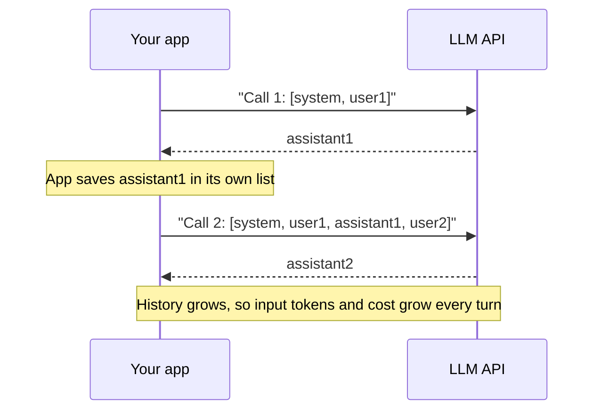
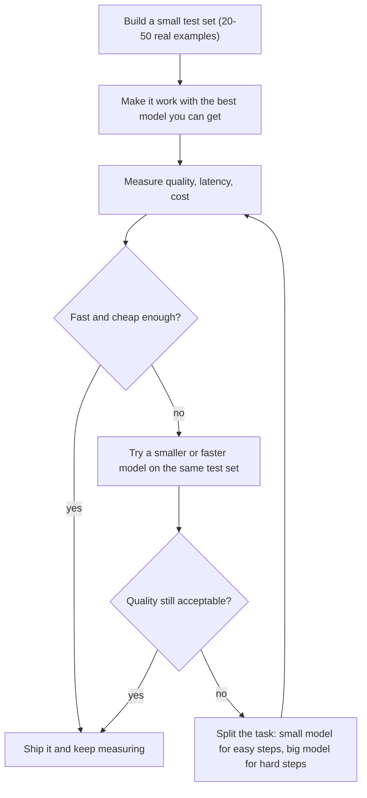

> [!summary] An LLM API is a stateless HTTP endpoint: you send a list of messages, you get back one more message and a token bill. Knowing the message format, streaming, cost, limits and how to pick a model covers most of daily AI engineering.

## Why this matters

Every LLM project starts with one HTTP call to a model. In production, the problems are rarely "the model is dumb". They are: the bill is too high, the first word takes four seconds, you hit a 429 at peak hour, or the chat "forgot" what the user said. Interviewers ask "how do you choose a model?" and "how do you handle rate limits?" in almost every AI engineer round.

## The idea in plain words

Calling an LLM is like sending a letter to an expert who has no memory. Each time you write, you must put the whole conversation so far in the envelope. The expert reads it all, writes one reply, and forgets everything. You are charged by how much they read and how much they write, and writing costs more than reading.

Choosing a model is like choosing who to send the letter to. A senior consultant is right more often but is slow and expensive. A junior is fast and cheap and fine for simple jobs. Good systems use both.

## How it works

### The message format

Almost every provider accepts the **chat completions** format: a list of messages, each with a **role** and **content**.

| Role | Who writes it | What it is for |
|---|---|---|
| `system` | You, the developer | Rules and background for the whole conversation: who the model is, what it must and must not do |
| `user` | The end user (or your code speaking for them) | The question or task |
| `assistant` | The model | Its earlier replies. You send them back so it can see what it said |
| `tool` | Your code | The result of a tool the model asked you to run (see [Structured Outputs and Tool Calling](/blog/structured-outputs-and-tool-calling)) |

Some newer models from one provider use the name `developer` for the system role. The idea is the same.

### Statelessness

The API is **stateless**: the server keeps nothing between calls. The "memory" of a chatbot is just your code resending the full history each time.



Two results follow. First, a long chat gets more expensive each turn, because you pay for the whole history again. Second, you control the memory: you can trim it, summarise it or rewrite it. That is the topic of [Memory and Context Engineering](/blog/memory-and-context-engineering).

### Streaming

Without streaming, you wait for the whole answer. With `stream=True`, the server sends the answer in small pieces as they are generated, using **server-sent events (SSE)**: one long HTTP response where the server keeps writing lines that start with `data:`.

Streaming does not make the model faster. It makes the wait feel shorter. Two numbers matter:

- **Time to first token (TTFT)**: how long until the first piece arrives. This is what the user feels.
- **Tokens per second**: how fast the rest arrives.

Total time is roughly TTFT + output tokens / tokens per second. Long outputs are slow no matter what you do.

### Token usage and cost

Every response has a `usage` object. Cost is computed from three kinds of tokens:

```text
cost = (uncached input tokens x input price)
     + (cached input tokens   x cached price)   <- much cheaper than input price
     + (output tokens         x output price)   <- usually several times the input price

Prices are quoted per 1 million tokens, so divide by 1,000,000.
```

Details to remember:

- In the chat completions `usage` object, `prompt_tokens` is all input tokens and already includes the cached ones. The cached count sits in `prompt_tokens_details.cached_tokens`.
- `completion_tokens` is all output tokens. For reasoning models it includes the hidden reasoning tokens, so a short visible answer can still be expensive.
- Do not memorise prices. They change often. Read them from the provider's pricing page and keep them in config, not in code.

### Rate limits and 429

Providers limit how much you can send. The common limits are **RPM** (requests per minute) and **TPM** (tokens per minute). Some also have daily limits. Limits are per model and depend on your account tier.

When you go over, you get HTTP status **429** ("Too Many Requests"). The correct response is to wait and try again, with **exponential backoff**: wait 1 second, then 2, then 4, plus a small random amount (**jitter**) so that many clients do not all retry at the same moment. If the response has a `retry-after` header, respect it.

### Timeouts and retries

Calls can hang or fail. Sort errors into two groups:

| Retry | Do not retry |
|---|---|
| 429 rate limit | 400 bad request (your payload is wrong) |
| 500, 502, 503 server errors | 401 / 403 (bad or missing key) |
| Timeouts and connection errors | 404 (wrong model name or URL) |

The `openai` SDK already retries the first group (2 retries by default, with backoff). Its default timeout is 10 minutes, which is far too long for a web request, so set your own.

### The provider landscape

Names and line-ups change monthly, so learn the three groups, not the list.

| Group | What it is | Why use it |
|---|---|---|
| Frontier closed models | The strongest models from the big labs, API only | Best quality on hard tasks; easiest start |
| Open-weight models on fast inference hosts | Downloadable models run by hosting companies on special hardware | Very high tokens per second, low price, no lock-in to one lab |
| Local models (for example with Ollama) | Open-weight models on your own laptop or server | Free per call, private, works offline; limited by your hardware |

The key idea that ties them together is the **OpenAI-compatible endpoint**. Most providers and local servers accept the same URL paths and JSON shape as OpenAI's chat completions API. So you keep one SDK and change three settings: base URL, API key, model name. That is why the code in this series reads `LLM_BASE_URL`, `LLM_API_KEY` and `LLM_MODEL` from the environment.

> [!warning] "Compatible" means the basic shape matches, not every feature. Tool calling, JSON schema output, usage in streams and some parameters vary by provider. Test the features you need on the provider you plan to use.

### How to choose a model

You trade off four things: **quality**, **latency**, **cost** and **context size**. You cannot max all four.



The working rules:

1. **Start with the best model, then go down.** First prove the task is possible. If the strongest model fails, a cheaper one will not save you. Then try smaller models and let your test set, not your gut, tell you when quality drops. Evals are covered in [Evals: Measuring LLM Apps](/blog/evals).
2. **Match the model to the step.** Use a small, fast model for routing, classification, extraction and query rewriting. Use a big or reasoning model for hard reasoning, planning and final answers that matter.
3. **Check the hard limits first.** Does the context window fit your input? Does it support tool calling, structured output, images? Where is the data processed?
4. **Latency is a feature.** For a chat UI, TTFT matters most. For a background job, only total cost matters.

### Batch APIs and prompt caching

Two simple ways to cut cost:

- **Batch API.** You upload a file of many requests and get results later (within a set window such as 24 hours) at a large discount, often about half price. Good for evals, backfills and nightly jobs. Useless for anything a user is waiting on.
- **Prompt caching.** If the start of your prompt is exactly the same as in a recent request, the provider reuses its work and charges much less for that part. So put the stable content first (system prompt, tool definitions, long documents) and the changing content last (the user's question). On some providers this is automatic; on others you mark what to cache. One changed character near the top breaks the cache for everything after it.

More cost and latency methods are in [Cost, Latency and Reliability](/blog/cost-latency-and-reliability).

### The embeddings endpoint

A second endpoint, `/embeddings`, takes text and returns a vector (a list of numbers) that represents its meaning. It uses a different, much cheaper model, has no output tokens, and is the base of search and RAG. See [Embeddings and Vector Databases](/blog/embeddings-and-vector-databases).

## Code you should be able to write

Setup shared by all snippets. Note the explicit timeout and retries.

```python
import os
import time
from openai import OpenAI

client = OpenAI(
    base_url=os.getenv("LLM_BASE_URL"),  # None = OpenAI's own endpoint
    api_key=os.environ["LLM_API_KEY"],
    timeout=30.0,    # seconds; the default is 10 minutes
    max_retries=3,   # retries 429, 5xx, timeouts with backoff
)
MODEL = os.environ["LLM_MODEL"]
```

A basic call:

```python
resp = client.chat.completions.create(
    model=MODEL,
    messages=[
        {"role": "system", "content": "You are a concise assistant."},
        {"role": "user", "content": "What is an API rate limit? One sentence."},
    ],
)
print(resp.choices[0].message.content)
print(resp.usage)
```

Streaming, with time to first token:

```python
def stream_answer(prompt: str) -> str:
    start = time.perf_counter()
    ttft: float | None = None
    parts: list[str] = []
    stream = client.chat.completions.create(
        model=MODEL,
        messages=[{"role": "user", "content": prompt}],
        stream=True,
        stream_options={"include_usage": True},  # usage arrives in the last chunk
    )
    for chunk in stream:
        if chunk.usage:  # the final chunk: no choices, only usage
            print(f"\n[output tokens: {chunk.usage.completion_tokens}]")
        if not chunk.choices:
            continue
        piece = chunk.choices[0].delta.content
        if piece:
            if ttft is None:
                ttft = time.perf_counter() - start
            parts.append(piece)
            print(piece, end="", flush=True)
    total = time.perf_counter() - start
    print(f"\n[TTFT {ttft or 0:.2f}s, total {total:.2f}s]")
    return "".join(parts)
```

If a provider rejects `stream_options`, remove that line; you then get no usage for streamed calls.

A multi-turn chat. The list `history` is the whole memory:

```python
from openai.types.chat import ChatCompletionMessageParam


def chat() -> None:
    history: list[ChatCompletionMessageParam] = [
        {"role": "system", "content": "You are a helpful assistant."}
    ]
    while True:
        user_text = input("you> ").strip()
        if user_text in {"", "quit"}:
            break
        history.append({"role": "user", "content": user_text})
        resp = client.chat.completions.create(model=MODEL, messages=history)
        answer = resp.choices[0].message.content or ""
        history.append({"role": "assistant", "content": answer})  # without this line it forgets
        print("bot>", answer)
```

Cost from the usage object. The prices are arguments because they change:

```python
from openai.types import CompletionUsage


def cost_usd(
    usage: CompletionUsage,
    input_per_m: float,
    output_per_m: float,
    cached_per_m: float | None = None,
) -> float:
    """Prices are in dollars per 1 million tokens, from the provider's pricing page."""
    details = usage.prompt_tokens_details
    cached = (details.cached_tokens or 0) if details else 0
    uncached = usage.prompt_tokens - cached  # prompt_tokens includes cached tokens
    cached_price = input_per_m if cached_per_m is None else cached_per_m
    total = uncached * input_per_m + cached * cached_price + usage.completion_tokens * output_per_m
    return total / 1_000_000


if resp.usage:
    # Example prices only. Look up the real ones for your model.
    print(f"${cost_usd(resp.usage, input_per_m=1.0, output_per_m=4.0, cached_per_m=0.1):.6f}")
```

Embeddings, for completeness:

```python
EMBED_MODEL = os.environ["EMBED_MODEL"]

emb = client.embeddings.create(model=EMBED_MODEL, input=["refund policy", "how do I get my money back"])
vectors: list[list[float]] = [item.embedding for item in emb.data]
print(len(vectors), "vectors of length", len(vectors[0]))
```

## In production

- **Log every call**: model, input tokens, output tokens, cached tokens, latency, TTFT, and a request ID. You cannot cut a cost you cannot see. See [Observability and Tracing](/blog/observability-and-tracing).
- **Cap the history.** Unbounded chat history is the most common cause of a creeping bill and a sudden "context length exceeded" error.
- **Set `max_tokens`.** A model stuck repeating itself will happily write until the limit.
- **Retries multiply.** SDK retries, your own retry wrapper and a queue retry can stack into dozens of calls. Retry in one layer only.
- **Retries need idempotency.** If the call has a side effect later (send an email, write to a database), make sure a retry cannot do it twice.
- **Have a fallback model** on a second provider for outages. The OpenAI-compatible format makes this a config change, but test that your prompts work on both.
- **Pin model versions.** An alias like "latest" can change behaviour under you. Pin a dated version and upgrade on purpose, with your evals.
- **Keep keys on the server.** Never ship an API key in browser or mobile code. The front end calls your backend; your backend calls the model. See [Backend and Deployment for AI Apps](/blog/backend-and-deployment-for-ai).
- **Async for throughput.** In a web server, use `AsyncOpenAI` so one slow model call does not block other requests.

## Interview questions

**Q: The LLM API is stateless. What does that mean for a chatbot?**
The server remembers nothing between calls. Your app must store the conversation and resend it every time. This means cost grows with each turn, and it means you decide what the model remembers.

**Q: What are the message roles?**
`system` holds the developer's rules and background. `user` is the person's input. `assistant` is the model's earlier replies. `tool` carries the result of a tool call back to the model.

**Q: How is the cost of a call computed?**
Input tokens times the input price, plus output tokens times the output price, with cached input tokens charged at a lower rate. Prices are per million tokens. Output is the expensive side, and for reasoning models it includes hidden thinking tokens.

**Q: What is TTFT and how do you improve it?**
Time to first token: the delay before the first piece of the answer shows up. Improve it with streaming, a smaller or faster model, a shorter prompt, prompt caching, and by not using a reasoning model where it is not needed. Also check your own code: slow retrieval before the call counts too.

**Q: You get 429 errors at peak time. What do you do?**
Short term: retry with exponential backoff and jitter, and honour `retry-after`. Then reduce the load: limit concurrency with a queue, cut tokens per request, cache repeated answers, move offline work to the batch API. Long term: ask for higher limits or spread traffic over a second model or provider.

**Q: Which errors should you retry?**
Retry 429, 5xx, timeouts and connection errors, since they are temporary. Do not retry 400, 401, 403 or 404: the same request will fail the same way. Always cap the number of retries.

**Q: What is an OpenAI-compatible endpoint and why does it matter?**
It is a server that accepts the same request and response shape as OpenAI's API. You can switch between providers or a local model by changing the base URL, key and model name. It reduces lock-in, though advanced features still differ between providers.

**Q: How do you choose a model for a new feature?**
Build a small test set from real examples. Get the task working with the strongest model. Then try cheaper and faster models on the same set and pick the cheapest one that still meets the quality bar. Check context size and feature support before anything else.

**Q: Your RAG app costs too much. Where do you look?**
Look at the token logs first. Usual causes: too many or too large retrieved chunks, full chat history sent every turn, a big model used for small steps, and long outputs. Fixes: fewer chunks with reranking, trim or summarise history, route easy steps to a small model, use prompt caching for the fixed prefix.

**Q: How does prompt caching work and how do you design for it?**
The provider saves its work for the start of a prompt and reuses it when a later request begins with exactly the same tokens. Put stable content first and variable content last. Do not put a timestamp or user ID at the top of the system prompt.

**Q: When would you use the batch API?**
When nobody is waiting: running evals, labelling or summarising a large dataset, nightly reports. You get a big discount and separate rate limits in exchange for a delay of up to about a day.

**Q: Why use a small model for routing and a large one for answering?**
Routing is a simple classification: a small model does it well in a fraction of the time and cost. The hard step gets the expensive model. The total is cheaper and faster than sending everything to the big model.

**Q: Streaming works locally but in production the text arrives all at once. Why?**
Something between the server and the browser is buffering the response: a reverse proxy, a load balancer, compression middleware. Turn off buffering for that route, send the right content type (`text/event-stream`), and test through the real path.


## Go deeper

- [openai-python README](https://github.com/openai/openai-python): the SDK's own guide to streaming, async, retries, timeouts and errors.
- [OpenAI: Rate limits](https://developers.openai.com/api/docs/guides/rate-limits): RPM/TPM explained, with backoff code.
- [OpenAI: Prompt caching](https://developers.openai.com/api/docs/guides/prompt-caching): how prefix matching works and how to structure prompts for it.
- [OpenAI: Batch API](https://developers.openai.com/api/docs/guides/batch): the file-in, file-out flow for offline jobs.
- [Gemini: OpenAI compatibility](https://ai.google.dev/gemini-api/docs/openai): run this series' code against Gemini by changing the base URL.
- [Groq: OpenAI compatibility](https://console.groq.com/docs/openai): a fast open-weight host; lists what is not supported.
- [Ollama: OpenAI compatibility](https://docs.ollama.com/api/openai-compatibility): the same code against a model on your laptop.
