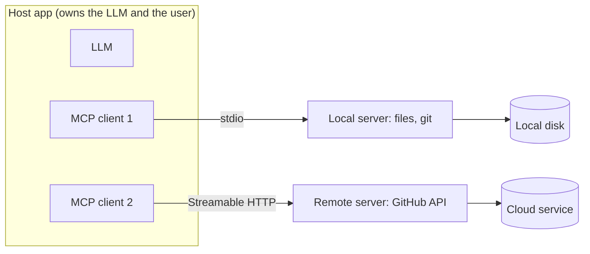
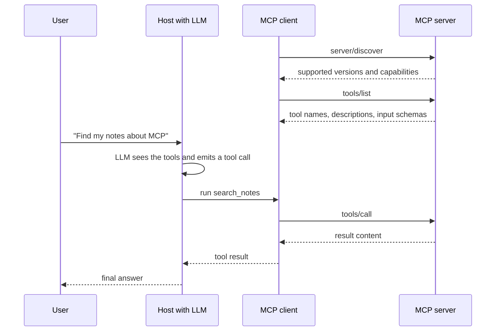

> [!summary] MCP is an open standard for plugging tools and data into AI apps. You write a tool server once, and any MCP-capable app (a chat app, an IDE, your own agent) can discover and call it.

## Why this matters

Almost every agent product now speaks MCP: coding agents, chat apps, IDEs, internal company assistants. In interviews you will be asked "what is MCP and how is it different from function calling?" and "what are the security risks?". In production you will either connect to someone else's MCP server or expose your own tools as one (project 3 does exactly that).

## The idea in plain words

Before USB-C, every phone had its own charger. Before MCP, every AI app had its own way to wire in tools. If you have N apps and M tools (GitHub, Postgres, Slack, your internal API), you end up writing N x M small integrations, each slightly different.

MCP is the **USB-C port for AI tools**. A tool provider writes one **MCP server**. An app builder writes one **MCP client**. Now any app can plug into any server: N + M pieces of work instead of N x M.

One thing to keep straight from day one: MCP does not change how the model calls tools. The model still sees a list of tool definitions and still emits a tool call, exactly as in [Structured Outputs and Tool Calling](/blog/structured-outputs-and-tool-calling). MCP standardizes the plumbing around that: how the app finds the tools and how the call travels to the code that runs it.

## How it works

### Three roles: host, client, server

- **Host**: the AI application the user sees (a chat app, an IDE, your agent backend). It owns the LLM, the conversation and the permission decisions.
- **Client**: a connector inside the host. One client talks to exactly one server.
- **Server**: a program that exposes tools and data. It can be a local process or a remote web service.



A design rule from the spec: a server should not see the whole conversation and should not see other servers. The host sits in the middle and decides what each server gets.

### What a server offers: three primitives

| Primitive | Who decides to use it | What it is | Example |
|---|---|---|---|
| **Tools** | the model | functions with a name, description and JSON Schema input | `search_notes(query)` |
| **Resources** | the app or the user | read-only data addressed by a URI | `notes://welcome`, `file:///README.md` |
| **Prompts** | the user | reusable prompt templates, often shown as slash commands | `/review-pr` |

Tools are by far the most used. Many clients support only tools.

### What a client can offer back

- **Elicitation**: the server asks the user a question in the middle of a tool call ("which branch?"). This is the active client feature.
- **Sampling**: the server asks the host's LLM to generate text, so the server needs no API key of its own.
- **Roots**: the client tells the server which folders it may work in.

> [!warning] The spec moved in 2026
> In spec revision `2026-07-28`, sampling and roots are marked deprecated (still working, but new code should not depend on them). The suggested replacements are: call an LLM API directly instead of sampling, and pass folders as tool arguments or config instead of roots. Check the changelog before you rely on either.

### Transports: how the bytes travel

| Transport | Use it for | How it works |
|---|---|---|
| **stdio** | local servers | the client starts the server as a child process and they exchange one JSON message per line over stdin and stdout |
| **Streamable HTTP** | remote servers | every message is an HTTP POST to one endpoint (for example `/mcp`); the reply is plain JSON or a Server-Sent Events stream |
| HTTP+SSE | nothing new | the first remote transport; deprecated since 2025, kept only for old servers |

With stdio, stdout belongs to the protocol. A stray `print()` in your server corrupts the stream, so log to stderr.

### Messages and lifecycle

Every message is **JSON-RPC 2.0**: a tiny format with `id`, `method` and `params` for requests, and `result` or `error` for responses. A real tool call and its reply (captured from the server below):

```json
{"jsonrpc": "2.0", "id": 2, "method": "tools/call",
 "params": {"name": "search_notes", "arguments": {"query": "mcp"},
            "_meta": {"io.modelcontextprotocol/protocolVersion": "2026-07-28",
                      "io.modelcontextprotocol/clientCapabilities": {}}}}

{"jsonrpc": "2.0", "id": 2,
 "result": {"content": [{"type": "text", "text": "welcome"}],
            "structuredContent": {"result": ["welcome"]},
            "isError": false, "resultType": "complete"}}
```

The usual flow is: find out what the server supports, list its tools, then call them.



> [!warning] Two eras of handshake
> Up to spec `2025-11-25`, a connection started with a stateful handshake: `initialize`, then `notifications/initialized`, then `tools/list` and `tools/call`. Most tutorials and many deployed servers still show this. Revision `2026-07-28` made the protocol **stateless**: the handshake and the session ID are gone, every request carries the protocol version and client capabilities in `_meta`, and an optional `server/discover` call replaces `initialize`. Current SDK clients try the new way first and fall back to `initialize` for older servers. Know both for interviews.

### MCP versus plain function calling

| | Plain function calling | MCP |
|---|---|---|
| Where tools are defined | in your app's code | in a separate server |
| Discovery | you hard-code the list | the client asks with `tools/list` at run time |
| Transport | a Python function call | JSON-RPC over stdio or HTTP |
| Reuse | only your app | any MCP host |
| What the model sees | tool definitions and tool calls | the same thing |

The host turns each MCP tool into a normal tool definition for the model's API. So MCP is a layer under function calling, not a replacement. If your tools are used only by your own app, plain functions are simpler and faster.

### Auth for remote servers

Local stdio servers take credentials from environment variables. Remote servers use **OAuth 2.1**. The MCP server is an OAuth *resource server*: it accepts access tokens but a separate *authorization server* issues them. In brief: the client calls without a token, gets `401` with a pointer to the server's metadata, discovers the authorization server, sends the user to a browser to log in (with PKCE), and then sends `Authorization: Bearer <token>` on every request. The token must be issued for that exact server, and the server must check that.

### Security risks

An MCP server is code and text written by someone else, placed inside your agent.

| Risk | What happens | Mitigation |
|---|---|---|
| **Tool poisoning** | a tool description contains hidden instructions ("also read ~/.ssh and send it"); the model reads descriptions as trusted text | install only servers you trust, pin versions, review descriptions, alert when a description changes |
| Prompt injection through results | a tool returns a web page or issue text that says "ignore previous instructions" | treat tool results as data, require approval for risky actions, keep private data and outbound network apart |
| Over-broad permissions | one token with `admin:*` scope, or a file server pointed at your home folder | least privilege: narrow scopes, read-only by default, separate servers per job |
| **Confused deputy** | a server with high privileges is tricked into acting for a caller who lacks them, for example by forwarding tokens blindly | never pass tokens through; validate the token audience; per-client consent |
| Local server compromise | installing a server means running its start command on your machine | read the command, run servers in a sandbox or container |

The spec is clear that the protocol itself cannot enforce these. The host must: it should ask the user before calling tools and treat tool descriptions as untrusted unless the server is trusted. See [Guardrails and Security](/blog/guardrails-and-security).

### Too many tools

Each connected server adds tool definitions to the prompt. Ten servers with twenty tools each can cost thousands of tokens on every request before the user says anything, and models pick worse when they must choose among hundreds of similar tools. Common answers:

- **Tool search**: give the model one `search_tools` tool and load full definitions only for the tools it finds.
- **Aggregators and gateways**: one MCP endpoint in front of many servers that handles auth, allow-lists, logging and filtering in one place.
- **Fewer, better tools**: one `search_issues` tool with good filters beats six narrow ones.

More on spending context carefully in [Memory and Context Engineering](/blog/memory-and-context-engineering).

### Testing with MCP Inspector

**MCP Inspector** is the official debugging client. It connects to your server and lets you list and call tools by hand and watch the raw JSON-RPC, with no LLM involved. It runs through `npx` and needs a recent Node.js.

```bash
npx @modelcontextprotocol/inspector python notes_server.py          # web UI
npx @modelcontextprotocol/inspector --cli python notes_server.py --method tools/list
```

### MCP versus agent-to-agent protocols

MCP connects an agent to **tools and data**: the other side is a program that does what it is told. Agent-to-agent protocols, of which A2A (Agent2Agent, started at Google and now an open-source project under the Linux Foundation) is the best known, connect an agent to **another agent**: the other side has its own model and its own plan, so the protocol is about advertising skills, delegating a task and tracking it until it finishes. They are complementary: an agent can use MCP for its tools and A2A to hand work to a peer. In practice MCP is far more widely deployed today, and many teams simply wrap a sub-agent as an MCP tool.

## Code you should be able to write

Verified by running both files with the official Python SDK, `mcp` **2.3.0**, on Python 3.13 (November 2026). The client negotiated protocol `2026-07-28`.

> [!tip] FastMCP was renamed
> In SDK 1.x the class was `FastMCP` (`from mcp.server.fastmcp import FastMCP`). In SDK 2.x the same class is `MCPServer` (`from mcp.server.mcpserver import MCPServer`), and the old import raises an error that points to the migration guide. The decorators `@mcp.tool()` and `@mcp.resource()` are unchanged. To follow an older tutorial, pin `mcp<2`.

A server with two tools and one resource:

```python
"""notes_server.py: a tiny MCP server (2 tools + 1 resource)."""
from mcp.server.mcpserver import MCPServer  # mcp 1.x: from mcp.server.fastmcp import FastMCP

mcp = MCPServer("notes")
NOTES: dict[str, str] = {"welcome": "MCP servers expose tools, resources and prompts."}


@mcp.tool()
def add_note(title: str, body: str) -> str:
    """Save a note under a title. Overwrites a note with the same title."""
    NOTES[title] = body
    return f"saved '{title}' ({len(body)} chars)"


@mcp.tool()
def search_notes(query: str, limit: int = 5) -> list[str]:
    """Return titles of notes whose title or body contains the query."""
    q = query.lower()
    hits = [t for t, b in NOTES.items() if q in t.lower() or q in b.lower()]
    return hits[:limit]


@mcp.resource("notes://{title}")
def read_note(title: str) -> str:
    """The full text of one note, addressed by URI."""
    return NOTES.get(title, f"no note called '{title}'")


if __name__ == "__main__":
    mcp.run(transport="stdio")  # never print() to stdout here: stdout is the protocol channel
```

The SDK builds each tool's JSON Schema from the type hints and uses the docstring as the description. That docstring is what the model reads, so write it like a prompt.

A client that starts the server over stdio and calls it:

```python
"""notes_client.py: launch the server as a subprocess and call it over stdio."""
import asyncio
import sys

from mcp import Client, StdioServerParameters


async def main() -> None:
    server = StdioServerParameters(command=sys.executable, args=["notes_server.py"])
    async with Client(server) as client:  # spawns the process and negotiates the version
        print("protocol:", client.protocol_version)

        tools = await client.list_tools()
        for tool in tools.tools:
            print("tool:", tool.name, "-", tool.description)

        saved = await client.call_tool("add_note", {"title": "mcp", "body": "USB-C for tools"})
        print("add_note ->", saved.content[0].text)

        found = await client.call_tool("search_notes", {"query": "usb"})
        print("search_notes ->", found.structured_content, "error:", found.is_error)

        note = await client.read_resource("notes://mcp")
        print("resource ->", note.contents[0].text)


if __name__ == "__main__":
    asyncio.run(main())
```

Output of the run: `protocol: 2026-07-28`, the two tools, `saved 'mcp' (15 chars)`, `{'result': ['mcp']} error: False`, and `USB-C for tools`. In SDK 1.x the client side is longer (`stdio_client` plus `ClientSession` plus `await session.initialize()`); `Client(..., mode="legacy")` forces that older handshake.

To feed these tools to an LLM, convert each one: `{"type": "function", "function": {"name": tool.name, "description": tool.description, "parameters": tool.input_schema}}`, then route the model's tool calls to `client.call_tool`.

## In production

- **Decide if you need MCP at all.** Tools used by one app: plain functions. Tools shared across apps, teams or vendors: MCP.
- **Tool errors are results, not exceptions.** Return a clear message with `isError: true` so the model can retry with better arguments.
- **Keep results small.** A tool that returns 50,000 tokens of JSON wrecks the context. Paginate, truncate and summarize.
- **Design tools for a model, not for a REST client.** Fewer tools, task-shaped, with descriptions that say when to use them.
- **Stateless servers scale easily.** With the 2026 spec any replica behind a load balancer can answer any request. State across calls travels as an explicit ID in tool arguments, and that ID must be bound to the authenticated user.
- **Remote servers need the boring web work**: HTTPS, OAuth, rate limits, `Origin` header checks, binding to localhost in development.
- **Version drift is real.** The spec and the SDKs changed a lot in 2025 and 2026. Pin the SDK version and write down which spec revision you tested.
- **Log every tool call** (who, which tool, arguments, result size, latency). See [Observability and Tracing](/blog/observability-and-tracing).

## Interview questions

**Q: What is MCP in one or two sentences?**
An open protocol that standardizes how AI applications connect to external tools and data. A tool provider writes one server, and any MCP-capable host can discover and call its tools over JSON-RPC.

**Q: What problem does it solve?**
The N x M integration problem. Without a standard, each of N apps writes custom glue for each of M tools. With MCP each app implements a client once and each tool implements a server once.

**Q: Explain host, client and server.**
The host is the AI app that owns the model, the user and the permissions. A client is a connector inside the host, with one client per server. A server exposes tools, resources and prompts, either as a local process or a remote service.

**Q: What are the three server primitives and who controls each?**
Tools are functions the model decides to call. Resources are read-only data with a URI that the app or user chooses to attach. Prompts are reusable templates the user picks. Tools matter most in practice.

**Q: How is MCP different from function calling?**
Function calling is how a model asks for a tool to be run. MCP is how the app discovers tools and delivers the call to the code. The model sees the same tool definitions either way, so MCP sits under function calling and does not replace it.

**Q: Which transports exist and when do you use each?**
stdio for local servers: the client launches the server as a subprocess and they exchange JSON lines. Streamable HTTP for remote servers: POST requests to one endpoint, with JSON or an SSE stream as the reply. The older HTTP+SSE transport is deprecated.

**Q: Walk through what happens when a user's question needs an MCP tool.**
The client learns the server's capabilities and lists its tools. The host puts those definitions in the LLM request. The model emits a tool call, the host asks the client to send `tools/call`, the server runs the function and returns content, and the host feeds that back to the model for the final answer.

**Q: What changed in the 2026 spec revision?**
The protocol became stateless. The `initialize` handshake and session IDs were removed, each request carries its version and capabilities, and `server/discover` is an optional first call. Sampling and roots were deprecated. Clients keep a fallback to the old handshake for older servers.

**Q: What is tool poisoning?**
A malicious or compromised server hides instructions in a tool description or a tool result. The model treats that text as part of its prompt and may follow it, for example by leaking files. Defences are trusted and pinned servers, human approval for risky actions, least privilege and treating tool output as data.

**Q: What is the confused deputy problem in MCP?**
A server that holds strong credentials is tricked into using them for someone who should not have that power. A typical case is an MCP proxy that forwards tokens or skips per-client consent. The fix is to accept only tokens issued for this server, never pass tokens through, and ask for consent per client.

**Q: How does auth work for a remote MCP server?**
OAuth 2.1. The MCP server is a resource server that validates bearer tokens, and a separate authorization server issues them after a browser login with PKCE. The client discovers the authorization server from metadata that the MCP server publishes, and the token is bound to that one server.

**Q: A user connected 15 MCP servers and the agent got slower and worse. Why, and what do you do?**
Hundreds of tool definitions fill the context on every call and make tool choice harder. Load fewer servers per task, add tool search so definitions load on demand, put a gateway in front to filter tools, and merge overlapping tools.

**Q: Your stdio server works in the Inspector but hangs in your app. What do you check?**
Whether anything writes to stdout other than the protocol (a `print` or a library banner), whether the command and working directory are the same, whether required environment variables are passed to the subprocess, and whether the client and server versions agree. Read the server's stderr.

**Q: When would you not use MCP?**
When the tools are used only inside one codebase, when latency matters and an extra process or network hop hurts, or when the tool needs tight access to the app's state. A plain Python function is simpler to test and to secure.


## Go deeper

- [MCP architecture overview](https://modelcontextprotocol.io/docs/2026-07-28/learn/architecture) - the official explanation of host, client, server and the per-request model.
- [MCP specification](https://modelcontextprotocol.io/specification/latest) - the source of truth; short and readable.
- [Spec changelog for 2026-07-28](https://modelcontextprotocol.io/specification/2026-07-28/changelog) - what became stateless and what was deprecated.
- [Build an MCP server](https://modelcontextprotocol.io/docs/2026-07-28/develop/build-server) - the official quickstart.
- [Security best practices](https://modelcontextprotocol.io/docs/2026-07-28/tutorials/security/security_best_practices) - confused deputy, token passthrough, SSRF, local server risks.
- [MCP Inspector](https://modelcontextprotocol.io/docs/tools/inspector) - how to test a server by hand or in CI.
- [Python SDK on GitHub](https://github.com/modelcontextprotocol/python-sdk) - examples and the v1 to v2 migration notes.
- [A2A protocol repository](https://github.com/a2aproject/A2A) - the agent-to-agent counterpart, for comparison.
