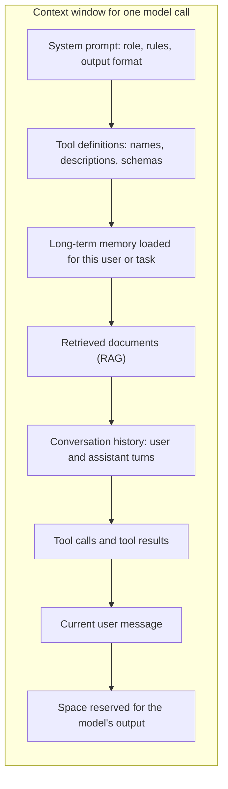
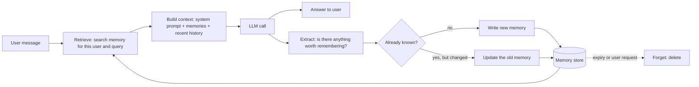

> [!summary] An LLM remembers nothing between calls. Everything it "knows" in a step is what you put in the context window for that step. Context engineering is choosing that content well, and memory is the storage outside the window that you choose from.

## Why this matters

Long-running agents rarely fail because the model is weak. They fail because the window fills up with old tool output, the model loses the goal, and cost climbs with every step. Interviewers ask "how does your agent remember things?" and "what do you do when the conversation gets too long?" and expect concrete strategies with trade-offs. Every real LLM app has to manage context.

## The idea in plain words

Think of a computer. **RAM** is small, fast, and it is the only thing the processor can work on directly. The **disk** is large and permanent, but data has to be loaded into RAM before it can be used.

- The **context window** is the model's RAM. It is the model's only working memory. Anything that is not in the window does not exist for the model in that step.
- **Long-term memory** is the disk: a database, a vector store, or files. It survives between conversations, but it must be loaded into the window to matter.
- **Context engineering** is the job of the operating system: deciding, at every step, what gets loaded into RAM and what gets moved out.

A **token** is a word-piece, the unit the window is measured in (see [How LLMs Work](/blog/how-llms-work)). The model has no hidden memory of your earlier calls. When a chat app seems to "remember", it is because the app sent the earlier messages again.

Prompt engineering asks "how do I word this instruction?". Context engineering asks the wider question: "of everything I could show the model right now, what should be in the window?".

## How it works

### What fills a context window



In an agent, the part that grows fastest is almost always **tool results**: file contents, search results, SQL rows, logs. A chat history grows by a few hundred tokens per turn. One careless tool result can add tens of thousands.

### Context rot and lost in the middle

A bigger window does not mean the model uses all of it equally well. Two effects, in plain words:

- **Lost in the middle**: research has found that models tend to use information at the start and end of a long context better than information buried in the middle.
- **Context rot**: as the input gets longer, answer quality tends to drop, even when the window is far from full. Irrelevant or near-duplicate text distracts the model, old wrong attempts get repeated, and stale facts contradict fresh ones.

How strong these effects are depends on the model and the task, and newer models handle long inputs better than older ones. The practical rule holds anyway: treat the window as a budget, not a bucket. More context costs more, runs slower, and can make answers worse. Aim for the smallest set of high-value tokens.

### Short-term memory: managing one conversation

**Short-term memory** is the message history of the current thread. Four standard strategies:

| Strategy | How it works | Good | Bad |
|---|---|---|---|
| Sliding window | Keep the last N messages or turns | Trivial, predictable | Forgets early facts completely |
| Token-based trimming | Keep as many recent messages as fit a token budget | Precise control of size and cost | Same forgetting; must not cut a turn in half |
| Summarization (also called compaction) | Replace old turns with an LLM-written summary; keep recent turns word for word | Keeps the gist of a long session | Extra LLM call; summaries lose detail and can introduce errors |
| Clearing old tool results | Replace old tool outputs with a short stub such as "result removed, call the tool again if needed" | Removes the largest items first; cheap | The model may need to repeat a tool call |

Real systems combine them: clear old tool results first, summarise when the history passes a threshold, and always keep the system prompt and the last few turns intact.

> [!warning] Never split a tool call from its result. If the assistant message with the tool call is kept but the matching tool message is dropped (or the reverse), most APIs reject the request. Trim at turn boundaries.

### Long-term memory: across conversations

**Long-term memory** is information kept outside the window and across threads. A common way to sort it borrows three terms from psychology:

| Type | What it holds | Example | Usual storage |
|---|---|---|---|
| **Semantic** | Facts | "User works in Gurugram. Prefers Python." | Key-value profile, or facts in a vector store |
| **Episodic** | Past events and experiences | "Last week the user asked for a churn report and rejected the first chart." | Vector store of past interactions; also used as few-shot examples |
| **Procedural** | How to do things: rules and instructions | "Always show SQL before running it." | The system prompt, or an instructions file the agent can edit |

Three storage shapes cover most systems:

- **Key-value / profile**: one JSON document per user that is updated in place. Small, always loaded, easy to inspect and delete.
- **Vector store**: many small memory items, embedded and searched by meaning (see [Embeddings and Vector Databases](/blog/embeddings-and-vector-databases)). Scales to large histories, but retrieval can miss or return stale items.
- **Files / scratchpad notes**: the agent writes plain-text notes such as a to-do list or a progress file, and reads them back later. Simple and surprisingly effective for long tasks, because notes survive compaction.

### The write, retrieve, update, forget cycle



- **Write**: decide what is worth keeping. Either "in the hot path" (the agent calls a `save_memory` tool during the conversation) or "in the background" (a separate job reads the transcript afterwards). Hot path is immediate but adds latency and tool clutter; background is cheaper per turn but delayed.
- **Retrieve**: load the profile every time, and search the larger store by similarity to the current message. Retrieve few items.
- **Update**: new information must replace old information. Without this, the store ends up holding both "lives in Delhi" and "lives in Gurugram".
- **Forget**: expire items by age, remove ones that are never retrieved, and delete on user request.

Most memory bugs are update and forget bugs, not write bugs.

### Memory in LangGraph terms

LangGraph (see [LangChain and LangGraph](/blog/langchain-and-langgraph)) separates the two kinds cleanly:

| LangGraph piece | Scope | Memory kind |
|---|---|---|
| **Checkpointer** | One thread (`thread_id`) | Short-term: the state and message history of this conversation |
| **Store** | Across threads, organised by namespace such as `("users", user_id)` | Long-term: facts and preferences that outlive a conversation |

The store interface is small: `store.put(namespace, key, value)`, `store.get(namespace, key)` and `store.search(namespace)`. You pass it at compile time with `builder.compile(checkpointer=..., store=...)`. `InMemoryStore` is for tests; use a database-backed store in production.

### Sub-agents as context isolation

A **sub-agent** is a separate agent loop with its own fresh context window. The main agent gives it a task; the sub-agent may read twenty files and burn a large number of tokens; it returns only a short summary. The main agent's window stays clean. This is the main practical reason for multi-agent designs: not "teamwork", but keeping messy exploration out of the main context. The cost is more total tokens, and the risk that the summary drops something important. See [Multi-Agent Systems and Human-in-the-Loop](/blog/multi-agent-and-human-in-the-loop).

### Prompt caching and stable prefixes

Many providers offer **prompt caching**: if the start of your prompt is identical to a recent request, that part is processed at a lower price and faster. The cache works on the **prefix**, meaning the text from the very beginning up to the first difference. So the order of your context matters:

- Put stable content first: system prompt, tool definitions, fixed examples.
- Put changing content last: retrieved documents, the latest messages.
- Do not put a timestamp or a request id at the top of the system prompt. One changed character early on breaks the cache for everything after it.
- Append to history instead of rewriting it. Each compaction or trim that rewrites early messages resets the cache, so compact rarely and in large steps.

The rules and prices differ by provider, so check their documentation. More in [Cost, Latency and Reliability](/blog/cost-latency-and-reliability).

### Memory products as a category

Tools such as Mem0, Zep and Letta package the cycle above as a library or service. In general terms they do some mix of: extracting facts from conversations with an LLM, storing them in a vector store or a knowledge graph (sometimes with time information, so newer facts win), merging duplicates, and returning relevant memories through an API. Letta grew out of the MemGPT research project, in which the agent manages its own memory through tool calls, like an operating system paging data in and out. You do not need one of these to start. A profile document plus a small vector store goes a long way, and building it yourself teaches you what the products automate. Features change quickly, so read their docs before comparing them.

## Code you should be able to write

### Trim history to a token budget

The token count here is an **estimate** (about four characters per token for English text). For exact numbers use the tokenizer for your model, for example the `tiktoken` library for OpenAI models, or the `usage` field the API returns. The `tiktoken` version was not run for this post, so it is not shown.

```python
def count_tokens(messages: list[dict]) -> int:
    """ESTIMATE: about 4 characters per token for English, plus 4 per message."""
    return sum(4 + len(m.get("content") or "") // 4 for m in messages)


def trim_to_budget(messages: list[dict], budget: int) -> list[dict]:
    """Keep the system prompt, then as many of the newest turns as fit."""
    system = [m for m in messages if m["role"] == "system"]
    rest = [m for m in messages if m["role"] != "system"]
    kept: list[dict] = []
    used = count_tokens(system)
    for m in reversed(rest):                       # walk from newest to oldest
        cost = count_tokens([m])
        if used + cost > budget:
            break
        kept.append(m)
        used += cost
    kept.reverse()
    while kept and kept[0]["role"] != "user":      # never start on a tool result
        kept.pop(0)                                # or a half-finished turn
    return system + kept
```

### A summarizing buffer

Recent turns stay word for word. When the buffer passes its budget, older turns are folded into a running summary. The summarizer is passed in as a function, so you can test the class with a fake.

```python
import os
from dataclasses import dataclass, field
from typing import Callable

from openai import OpenAI

client = OpenAI(base_url=os.getenv("LLM_BASE_URL"), api_key=os.environ["LLM_API_KEY"])
MODEL = os.environ["LLM_MODEL"]


def llm_summarize(previous: str, old: list[dict]) -> str:
    text = "\n".join(f"{m['role']}: {m.get('content') or ''}" for m in old)
    prompt = ("Update the summary with the new messages. Keep decisions, names, numbers "
              "and open questions. Drop small talk. Under 150 words.\n\n"
              f"Current summary:\n{previous or '(none)'}\n\nNew messages:\n{text}")
    resp = client.chat.completions.create(
        model=MODEL, messages=[{"role": "user", "content": prompt}])
    return resp.choices[0].message.content or previous


@dataclass
class SummaryBuffer:
    summarize: Callable[[str, list[dict]], str] = llm_summarize
    max_tokens: int = 2000
    keep_recent: int = 6
    summary: str = ""
    recent: list[dict] = field(default_factory=list)

    def add(self, message: dict) -> None:
        self.recent.append(message)
        if count_tokens(self.recent) > self.max_tokens and len(self.recent) > self.keep_recent:
            cut = len(self.recent) - self.keep_recent
            while cut < len(self.recent) and self.recent[cut]["role"] != "user":
                cut += 1                           # cut only at the start of a turn
            old, self.recent = self.recent[:cut], self.recent[cut:]
            if old:
                self.summary = self.summarize(self.summary, old)

    def as_messages(self, system_prompt: str) -> list[dict]:
        out = [{"role": "system", "content": system_prompt}]
        if self.summary:
            out.append({"role": "user",
                        "content": f"Summary of the earlier conversation:\n{self.summary}"})
        return out + self.recent
```

### A tiny long-term fact store with retrieval

One namespace per user, one fact per key. Writing to an existing key overwrites it, which is the "update" step. `toy_embed` is a stand-in so the example runs offline; in a real app call your embedding model (`EMBED_MODEL`) and store the vectors in pgvector.

```python
import math
import re
import time
from dataclasses import dataclass
from typing import Callable


def toy_embed(text: str, dims: int = 256) -> list[float]:
    """Stand-in for a real embedding model: counts words into buckets."""
    vec = [0.0] * dims
    for word in re.findall(r"[a-z0-9]+", text.lower()):
        vec[sum(word.encode()) % dims] += 1.0
    return vec


def cosine(a: list[float], b: list[float]) -> float:
    dot = sum(x * y for x, y in zip(a, b))
    norm = math.sqrt(sum(x * x for x in a)) * math.sqrt(sum(y * y for y in b))
    return dot / norm if norm else 0.0


@dataclass
class Fact:
    text: str
    vector: list[float]
    updated_at: float


class FactStore:
    def __init__(self, embed: Callable[[str], list[float]] = toy_embed) -> None:
        self.embed = embed
        self.facts: dict[str, dict[str, Fact]] = {}      # user_id -> key -> Fact

    def write(self, user_id: str, key: str, text: str) -> None:
        self.facts.setdefault(user_id, {})[key] = Fact(text, self.embed(text), time.time())

    def forget(self, user_id: str, key: str | None = None) -> None:
        if key is None:
            self.facts.pop(user_id, None)                # "delete all my data"
        else:
            self.facts.get(user_id, {}).pop(key, None)

    def search(self, user_id: str, query: str, k: int = 3, min_score: float = 0.2) -> list[str]:
        q = self.embed(query)
        scored = [(cosine(q, f.vector), f.text) for f in self.facts.get(user_id, {}).values()]
        scored.sort(reverse=True)
        return [text for score, text in scored[:k] if score >= min_score]


store = FactStore()
store.write("u1", "language", "The user prefers answers in Hindi")
store.write("u1", "language", "The user prefers answers in English")   # update, not a duplicate
store.write("u1", "stack", "The user works with FastAPI and Postgres")
print(store.search("u1", "which language should answers be in"))
# ['The user prefers answers in English']
```

Every read and write takes a `user_id`. That one argument is what stops one user's memories reaching another user.

## In production

- **Measure the window.** Log input tokens per step, split by part (system, tools, history, tool results). You cannot manage what you do not see. See [Observability and Tracing](/blog/observability-and-tracing).
- **Cap tool output at the source.** Truncate, paginate, or return a file path and a preview instead of the full content. This is the cheapest fix with the largest effect.
- **Summaries drift.** A summary of a summary of a summary loses facts and can invent them. Keep exact values (ids, numbers, decisions) in structured state or in notes, not only in prose summaries.
- **Compaction and caching pull against each other.** Rewriting history shrinks the prompt but breaks the cached prefix. Compact in big, rare steps.
- **Wrong memories are worse than no memories.** A stale or mistaken "fact" gets injected into every future conversation. Store the source and date with each memory, prefer explicit user statements over model guesses, and let users see and correct what is stored.
- **Memory is an attack surface.** If an attacker can get text saved as a memory (through a document or a web page), it becomes a prompt injection that repeats in every later session. Do not write memories from untrusted tool output without checks. See [Guardrails and Security](/blog/guardrails-and-security).
- **Privacy.** Long-term memory is stored personal data. Keep it separated per user (and per tenant), store only what the feature needs, avoid saving sensitive categories such as health or financial details unless the product truly requires it, set retention periods, encrypt at rest, and support "show me what you know" and "delete it". Remember that data sent to a hosted model or memory service leaves your system, so check the provider's data-use terms and the privacy laws that apply to your users.
- **Evaluate memory on its own.** Test cases such as "user changes a preference in session 2; is the new value used in session 3?" catch update bugs that ordinary answer-quality evals miss. See [Evals: Measuring LLM Apps](/blog/evals).

## Interview questions

**Q: Do LLMs have memory?**
No. Each call is independent, and the model only sees what is in the context window for that call. Apps create the feeling of memory by re-sending earlier messages (short-term) or by storing information outside and loading it back in (long-term).

**Q: What is context engineering, and how is it different from prompt engineering?**
Prompt engineering is about wording the instructions. Context engineering is about choosing everything that goes into the window at each step: instructions, tools, history, retrieved documents, memories and tool results, plus what to leave out. It matters most in agents, where the context changes on every step.

**Q: What is "lost in the middle" or context rot?**
Models tend to use information at the start and end of a long context better than the middle, and answer quality tends to fall as the input grows and fills with irrelevant text. The size of the effect depends on the model, but it means a large window is not a reason to fill it.

**Q: The conversation is too long for the window. What are your options?**
Keep only recent messages (sliding window or token-based trimming), summarise older turns into a running summary, clear or shorten old tool results, or move details into external notes or a store and retrieve them when needed. In practice, combine them and always keep the system prompt and the last few turns.

**Q: What are the trade-offs of summarisation versus trimming?**
Trimming is free and exact but forgets everything outside the window. Summarisation keeps the gist but costs an extra LLM call, loses detail, can add errors, and rewrites the prompt prefix, which breaks prompt caching.

**Q: Explain semantic, episodic and procedural memory for an agent.**
Semantic memory is facts, such as user preferences. Episodic memory is records of past events or interactions, often used as examples. Procedural memory is instructions on how to behave, usually living in the system prompt. They differ in how they are stored and when they are loaded.

**Q: In LangGraph, what is the difference between a checkpointer and a store?**
A checkpointer saves the graph state for one thread, so it is short-term memory for one conversation. A store holds data across threads under namespaces such as a user id, so it is long-term memory that any conversation with that user can read.

**Q: When would you use a vector store for memory versus a profile document?**
Use a profile (key-value) for a small set of stable facts that should always be loaded and are easy to update in place. Use a vector store when there are many memories and only a few are relevant to each request. Many systems use both.

**Q: Why do sub-agents help with context?**
Each sub-agent has its own window. It can do noisy work, such as reading many files, and return only a short result, so the main agent's context stays small and focused. The trade-off is higher total token use and possible loss of detail in the hand-off.

**Q: How does prompt caching affect how you lay out the context?**
Caching matches on the prefix, so stable parts (system prompt, tools) go first and changing parts go last. Avoid dynamic values near the top, and append to history instead of rewriting it, because any early change invalidates the cache after that point.

**Q: Your agent gets slower and less accurate after about 30 steps. How do you investigate?**
Check token counts per step and what is taking the space; it is usually tool results. Look in traces for repeated calls and old failed attempts still in the history. Then cap tool output, clear old results, add compaction at a threshold, or push exploration into a sub-agent, and confirm with an eval on long tasks.

**Q: A user says "I told you I moved cities, why do you still use the old one?". What went wrong?**
An update failure. The new fact was probably added next to the old one, and retrieval returned the old one. Fix it by keying facts so new values overwrite old ones, storing timestamps and preferring the newest, and adding a de-duplication step on write.

**Q: What privacy issues come with long-term memory?**
It stores personal data, so you need per-user isolation, data minimisation, retention limits, encryption, and ways for users to view and delete their data. There is also a security angle: memories written from untrusted content can carry prompt injections into future sessions.


## Go deeper

- [Effective context engineering for AI agents (Anthropic)](https://www.anthropic.com/research/effective-context-engineering-for-ai-agents): the clearest overview of compaction, note-taking and sub-agents.
- [Context engineering for agents (LangChain blog)](https://www.langchain.com/blog/context-engineering-for-agents): a simple four-part frame: write, select, compress, isolate.
- [Memory overview (LangGraph docs)](https://docs.langchain.com/oss/python/langgraph/memory): short-term versus long-term memory and the semantic, episodic, procedural split.
- [Context Rot (Chroma research)](https://research.trychroma.com/context-rot): experiments on how longer inputs affect answer quality.
- [Lost in the Middle: How Language Models Use Long Contexts](https://arxiv.org/abs/2307.03172): the paper behind the phrase.
- [MemGPT: Towards LLMs as Operating Systems](https://arxiv.org/abs/2310.08560): the RAM-and-disk idea taken seriously; the origin of Letta.
- [LLM Powered Autonomous Agents (Lilian Weng)](https://lilianweng.github.io/posts/2023-06-23-agent/): the memory section is a good map of the field.
