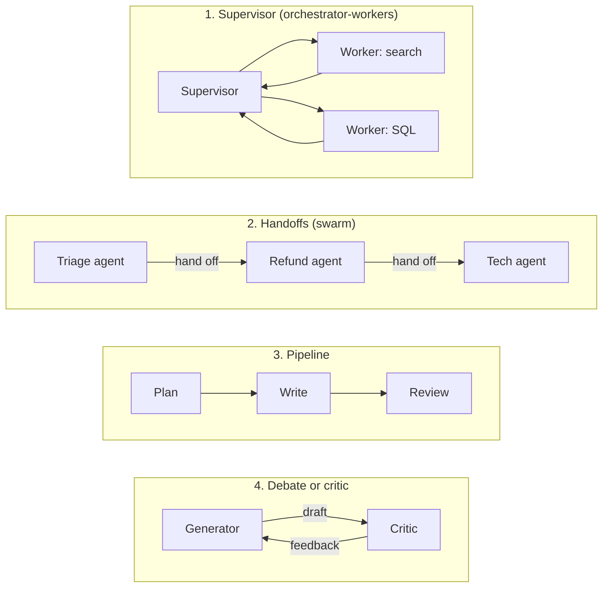
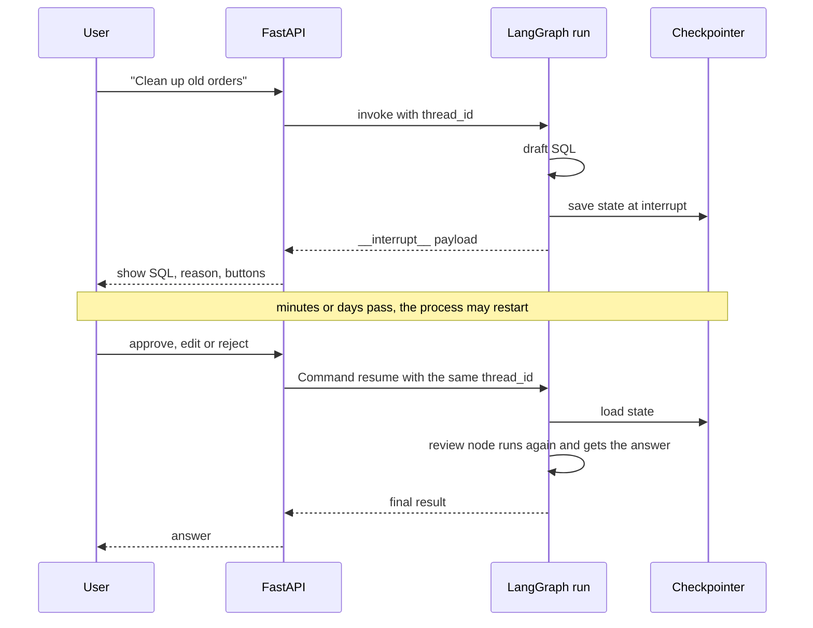

> [!summary] Use more than one agent only when one agent's context or speed is the real bottleneck. Put a human in the loop whenever an action is costly, irreversible or uncertain: pause the run, save its state, and resume when the person answers.

## Why this matters

"Should this be multi-agent?" is a standard system-design question, and the mature answer is usually "not yet". Human approval is the opposite: almost every production agent that writes to a database, sends email or spends money has it, and interviewers expect you to explain how a run can pause for hours and continue. Project 2 is built on that mechanism.

## The idea in plain words

**Multi-agent** is like going from one engineer to a small team. A team can work in parallel and each person keeps their own notes. A team also needs briefings, hand-offs and status reports, and things get lost between people. If the work fits in one head, a team is slower and more expensive than one person.

**Human-in-the-loop** (HITL) is like a bank teller and a manager. The teller prepares the large transfer, then stops and calls the manager. The manager sees the form, signs it, changes the amount, or refuses. Only then does the money move. The important part is that the teller's form is saved while everyone waits.

## How it works

### When one agent is not enough

There are three honest reasons to split:

1. **Context isolation.** A sub-task needs to read 50 files to produce a 10-line answer. Run it in a separate agent with a fresh context window and bring back only the 10 lines. The main agent's context stays clean (see [Memory and Context Engineering](/blog/memory-and-context-engineering)).
2. **Specialization.** Different steps need different instructions, tools or models: a cheap model to triage, a strong model to write SQL. Fewer tools per agent also means better tool choice.
3. **Parallelism.** Independent sub-tasks (research five companies) can run at the same time.

### When it is overkill (most of the time)

- **Cost.** Every agent re-reads its own prompt and tools and produces its own reasoning. Multi-agent runs commonly use several times the tokens of a single agent for the same task.
- **Coordination failures.** Each hand-off is a lossy summary. Agents act on different assumptions and their outputs do not fit together.
- **Harder debugging.** A wrong answer may come from any agent or from any hand-off.

The field openly disagrees here. One camp (Anthropic's write-up of its research system) reports that an orchestrator with parallel sub-agents works well for broad, read-heavy research. Another camp (Cognition's "Don't Build Multi-Agents") argues that agents making decisions in parallel without shared context produce conflicting work, and that a single agent with good context management is more reliable. Both agree on the practical rule of thumb: parallel sub-agents are safe for **reading** tasks and risky for **writing** tasks, where decisions must be consistent. Start with one agent, measure, and split only at a proven bottleneck.

### The four patterns



| Pattern | How control moves | Good for | Main risk |
|---|---|---|---|
| **Supervisor / orchestrator-workers** | a lead agent splits the task, calls workers (often as tools), merges results | research, broad questions | supervisor becomes a bottleneck; token cost |
| **Handoffs / swarm** | the active agent transfers the whole conversation to a peer | customer support with clear departments | ping-pong between agents |
| **Pipeline** | fixed order, each stage's output is the next stage's input | predictable workflows | an early mistake flows downstream |
| **Debate / critic** | one agent produces, another checks, repeat | quality-sensitive output, code review | endless loops; the critic approves everything |

A pipeline with fixed steps is really a workflow, not an agent system, and that is often exactly what you want.

### How agents share state

- **Shared state**: all agents read and write one object (in LangGraph, the graph state). Simple and nothing is lost, but every agent sees everything, so contexts grow and agents can overwrite each other.
- **Message passing**: each agent has a private context and they exchange messages. Clean isolation, but anything not in the message is gone.

The pattern that works is: **brief in, condensed result out**. Give a sub-agent a brief with the goal, the output format, the tools to use, the limits and what is already known. Take back a short structured result (findings plus references to files or rows), not its whole transcript.

### Failure modes

| Failure | What it looks like | Fix |
|---|---|---|
| Lost context | the worker does not know a constraint the user gave earlier | write complete briefs; pass key facts explicitly |
| Duplicated work | two workers run the same search | the supervisor assigns non-overlapping scopes |
| Loops | agents hand off or critique forever | step and hand-off limits, a "done" condition in code |
| Conflicting decisions | two writers pick different conventions | one writer, or decide first and then fan out |
| Runaway cost | sub-agents spawn sub-agents | budgets per run, depth limit of one |

### Human-in-the-loop: why

- **Irreversible or costly actions**: deleting rows, sending email, paying, merging code.
- **Low confidence**: the question is ambiguous or the agent's own score is low.
- **Compliance**: some decisions legally need a named person to approve.

### HITL patterns

| Pattern | The human | Example |
|---|---|---|
| Approve / reject | says yes or no to a proposed action | "Run this SQL?" |
| Edit | changes the proposed action, then it runs | fixes a date filter in the SQL |
| Clarify | answers a question the agent asked | "By revenue do you mean gross or net?" |
| Review after the fact | checks samples later; nothing is blocked | weekly audit of auto-approved queries |

### How it works technically

A web request cannot stay open while someone is at lunch. So the run must **pause**, its state must be **persisted** outside the process, and a later request must **resume** it. This is called **durable execution**.

In LangGraph the pieces are:

- a **checkpointer** saves the graph state after every step, keyed by a `thread_id`;
- `interrupt(payload)` inside a node stops the run and hands `payload` to the caller;
- `graph.invoke(Command(resume=value), config)` with the same `thread_id` continues, and `interrupt()` returns `value`.



> [!warning] The node re-runs from its first line
> On resume LangGraph does not continue from the middle of the function. It runs the interrupted node again from the top, and this time `interrupt()` returns the human's answer. Any code before `interrupt()` runs twice. Keep side effects (the database write, the email) in a later node, or make them idempotent, meaning safe to repeat.

### UI, thresholds and audit

- **Show what will happen and why.** The exact action (the SQL, the recipient, the diff), a plain-language summary, the reason for asking, and what happens on reject. An "Approve?" button with no detail trains people to click yes.
- **Make edit easy.** Editing a nearly right action is faster than rejecting and re-prompting.
- **Decide when to ask with a rule in code, not in the prompt.** For example: always ask for writes; ask for reads when confidence is below a threshold; never ask for cheap read-only actions. A model's self-reported confidence is poorly calibrated, so combine it with hard signals (did the SQL parse, how many rows, which tables) and tune the threshold on your eval set ([Evals: Measuring LLM Apps](/blog/evals)).
- **Avoid approval fatigue.** If people approve 99 percent of requests, they stop reading. Ask less often and make each request count.
- **Audit log.** For every decision store who, when, what was proposed, what was approved or edited, and the result. This is your compliance record and your best eval data.

## Code you should be able to write

Verified by running on `langgraph` **1.2.21** (November 2026). No LLM or API key is needed: the "LLM" node is hard-coded so you can see the mechanics.

```python
"""hitl.py: approve, edit or reject a risky action with interrupt + Command(resume=...)."""
from typing import Literal, TypedDict

from langgraph.checkpoint.memory import InMemorySaver
from langgraph.graph import END, START, StateGraph
from langgraph.types import Command, interrupt


class State(TypedDict, total=False):
    question: str
    sql: str
    confidence: float
    decision: str
    result: str


def draft_sql(state: State) -> dict:
    # A real node calls the LLM here. Hard-coded so the example runs offline.
    return {"sql": "DELETE FROM orders WHERE created_at < '2020-01-01'", "confidence": 0.62}


def human_review(state: State) -> Command[Literal["execute", "rejected"]]:
    # interrupt() pauses the run. Its argument is what your UI shows the human.
    answer = interrupt({
        "action": "run_sql",
        "sql": state["sql"],
        "why": f"write query, confidence {state['confidence']:.2f}",
        "options": ["approve", "edit", "reject"],
    })
    if answer["type"] == "approve":
        return Command(goto="execute", update={"decision": "approved"})
    if answer["type"] == "edit":
        return Command(goto="execute", update={"sql": answer["sql"], "decision": "edited"})
    return Command(goto="rejected", update={"decision": "rejected"})


def execute(state: State) -> dict:
    return {"result": f"executed: {state['sql']}"}  # the side effect lives AFTER the interrupt


def rejected(state: State) -> dict:
    return {"result": "nothing was run"}


builder = StateGraph(State)
for name, fn in [("draft_sql", draft_sql), ("human_review", human_review),
                 ("execute", execute), ("rejected", rejected)]:
    builder.add_node(name, fn)
builder.add_edge(START, "draft_sql")
builder.add_edge("draft_sql", "human_review")
builder.add_edge("execute", END)
builder.add_edge("rejected", END)
graph = builder.compile(checkpointer=InMemorySaver())  # without a checkpointer you cannot resume
```

Running it: the first call pauses, the second call resumes.

```python
from langgraph.types import Command

from hitl import graph

config = {"configurable": {"thread_id": "ticket-42"}}  # the key to the saved run

paused = graph.invoke({"question": "clean up old orders"}, config)
print("PAUSED WITH:", paused["__interrupt__"][0].value)
print("NEXT NODE:  ", graph.get_state(config).next)

# ...minutes or days later, possibly in another process, the human answers:
human_answer = {"type": "edit", "sql": "SELECT count(*) FROM orders WHERE created_at < '2020-01-01'"}
final = graph.invoke(Command(resume=human_answer), config)
print("DECISION:   ", final["decision"])
print("RESULT:     ", final["result"])
```

Actual output:

```text
PAUSED WITH: {'action': 'run_sql', 'sql': "DELETE FROM orders WHERE created_at < '2020-01-01'", 'why': 'write query, confidence 0.62', 'options': ['approve', 'edit', 'reject']}
NEXT NODE:   ('human_review',)
DECISION:    edited
RESULT:      executed: SELECT count(*) FROM orders WHERE created_at < '2020-01-01'
```

Things to notice:

- The first `invoke` returns normally. The pause shows up as the `__interrupt__` key, not as an exception.
- `Command(goto=..., update=...)` lets one node both change state and choose the next node, so no conditional edge is needed.
- `InMemorySaver` loses everything when the process exits. In a real service use a database checkpointer (the SQLite or Postgres savers, shipped as separate packages) so a resume works after a restart or on another server.
- Without a checkpointer the pause still surfaces, but resuming raises `RuntimeError: Cannot use Command(resume=...) without checkpointer`.

In FastAPI this becomes two endpoints: `POST /runs` starts a run and returns either the answer or the interrupt payload plus the `thread_id`, and `POST /runs/{thread_id}/resume` takes the human's decision and calls `graph.invoke(Command(resume=...))`.

## In production

- **Validate the human's input too.** An edited SQL string goes through the same checks as a generated one (read-only user, allow-listed tables, row limit). Approval is not a security boundary.
- **The world moves while you wait.** A plan approved on Friday may be wrong on Monday. Re-check preconditions in the execute node and add an expiry to pending approvals.
- **Authorize the resume.** Check that the person resuming owns the thread or holds the approver role. A `thread_id` is not a password.
- **Double clicks and retries.** Two resume requests can arrive for one interrupt. Make the execute step idempotent, or lock the thread.
- **Several interrupts.** A node may call `interrupt()` more than once, and parallel branches can pause together. Give each request an ID in its payload so the UI answers the right one.
- **Timeouts and escalation.** Decide what happens when nobody answers: remind, escalate, or cancel safely.
- **For multi-agent: trace everything.** One trace per run with a span per agent and per hand-off ([Observability and Tracing](/blog/observability-and-tracing)). Without it you cannot tell which agent caused a bad answer.
- **Evaluate the whole system and each agent.** Also measure cost per task; a multi-agent version that scores slightly higher at several times the cost is often the wrong trade ([Cost, Latency and Reliability](/blog/cost-latency-and-reliability)).

## Interview questions

**Q: When would you use multiple agents instead of one?**
When one agent's context window or speed is the proven bottleneck. The three reasons are context isolation, specialization (different tools, prompts or models per step) and parallelism for independent sub-tasks. If none of these applies, one agent with good tools is cheaper and easier to debug.

**Q: What are the downsides of multi-agent systems?**
Higher token cost, because every agent carries its own prompt and reasoning. Information is lost at each hand-off. Agents can make conflicting decisions, duplicate work or loop. Debugging is harder because a failure can come from any agent or any hand-off.

**Q: Explain the supervisor pattern and the handoff pattern.**
In the supervisor pattern a lead agent splits the task, calls workers and merges their results, so control always returns to the lead. In the handoff pattern the active agent transfers the conversation to a peer who then owns it. Supervisor fits research-like tasks; handoffs fit routing between departments.

**Q: Why are parallel sub-agents safer for reading than for writing?**
Reading tasks are independent: five agents can search five topics and the results are merged afterwards. Writing tasks contain implicit decisions such as naming or style. Agents that cannot see each other's decisions produce pieces that do not fit together.

**Q: How should you pass work to a sub-agent?**
With a self-contained brief: the goal, what is already known, the constraints, the tools to use and the exact output format. Ask for a short structured result, not the transcript. The sub-agent knows nothing that is not in the brief.

**Q: What is human-in-the-loop and when is it needed?**
A point where the agent stops and a person approves, edits, answers or reviews. It is needed for irreversible or costly actions, when confidence is low or the request is ambiguous, and when rules require a named approver.

**Q: How does an agent wait hours for approval without holding a connection open?**
With durable execution. The framework saves the full run state to a store through a checkpointer, returns the pending request to the caller and ends the request. Later a new request with the same thread ID loads the state and continues from the paused step.

**Q: How do `interrupt` and `Command(resume=...)` work in LangGraph?**
`interrupt(payload)` inside a node saves state and returns the payload to the caller under `__interrupt__`. Calling the graph again with `Command(resume=value)` and the same `thread_id` re-runs that node from its start, and this time `interrupt` returns `value`. A checkpointer is required to resume.

**Q: After resume, an email was sent twice. Why?**
The email was sent in the same node before the `interrupt()` call. On resume the node runs again from the first line, so the send repeats. Move side effects to a node after the interrupt, or make them idempotent with a deduplication key.

**Q: How do you decide when to ask the human?**
With a policy in code. Always ask for writes and other risky action types. For the rest, compare a risk or confidence score against a threshold tuned on labelled examples. Do not rely only on the model's self-reported confidence; add hard checks such as schema validation and row counts.

**Q: What should the approval screen show?**
The exact action that will run, a plain summary of its effect, why the agent is asking, and options to approve, edit or reject. Vague prompts cause blind approvals. Too many prompts cause approval fatigue, which is equally unsafe.

**Q: What goes in the audit log?**
Run ID, user, the proposed action, the reason for the interrupt, who decided, when, what the final action was after edits, and the outcome. It serves compliance, incident review and future evals.

**Q: Design approval for a text-to-SQL agent.**
Generate SQL, validate it, and classify it as read or write. Run cheap reads automatically on a read-only connection; interrupt for writes and for low-confidence reads, showing the SQL, an explanation and an estimated row count. Persist state in Postgres, resume through an authenticated endpoint, re-validate edited SQL, and log every decision.


## Go deeper

- [Building effective agents (Anthropic)](https://www.anthropic.com/engineering/building-effective-agents) - the clearest case for starting simple; defines orchestrator-workers and evaluator-optimizer.
- [LangGraph interrupts](https://docs.langchain.com/oss/python/langgraph/interrupts) - the official guide to `interrupt`, `Command(resume=...)` and the re-run rule.
- [How we built our multi-agent research system (Anthropic)](https://www.anthropic.com/engineering/multi-agent-research-system) - the "it works" side: orchestrator plus parallel sub-agents, with costs stated openly.
- [Don't Build Multi-Agents (Cognition)](https://cognition.ai/blog/dont-build-multi-agents) - the sceptical side: share context, avoid parallel decision makers.
- [How and when to build multi-agent systems (LangChain)](https://blog.langchain.com/how-and-when-to-build-multi-agent-systems) - a short piece that reconciles the two posts above.
