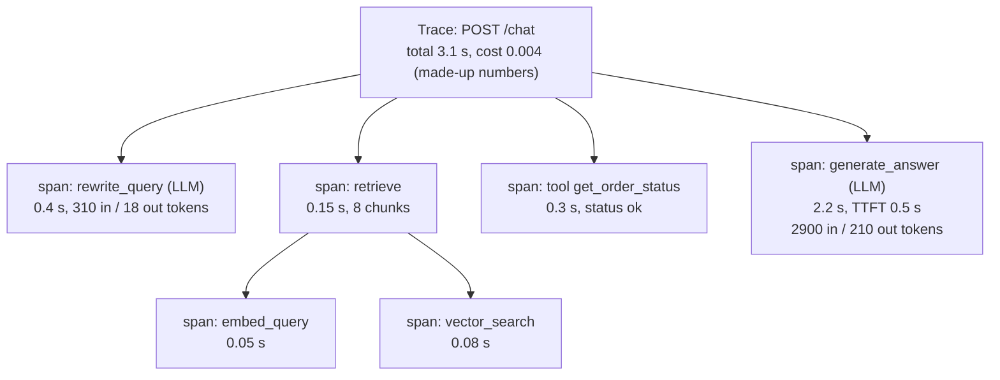
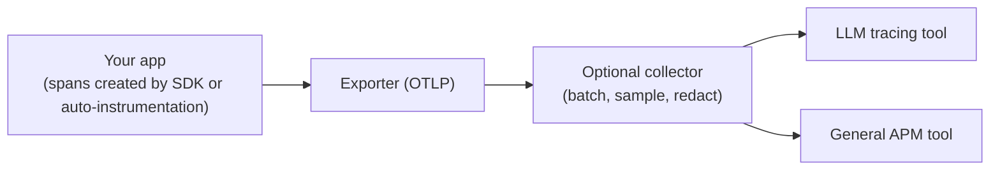
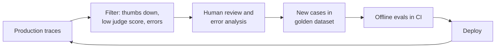

> [!summary] Observability means you can answer "what did my app do, and why?" from saved data, without guessing. For LLM apps the key tool is the trace: a step-by-step record of one request, with the inputs, outputs, tokens, cost and time of every step.

## Why this matters

An LLM app fails quietly. It does not crash; it returns a confident wrong answer with HTTP 200. Without traces you cannot tell whether retrieval found the wrong chunks, the prompt was built badly, or the model ignored good context. In interviews, "a user says the answer was wrong, how do you debug it?" is a standard question, and the expected answer starts with "I open the trace".

## The idea in plain words

Think of a courier parcel. When it arrives late, you do not guess. You open the tracking page and see every stop: picked up 09:10, reached the hub 13:40, stuck at customs for two days, out for delivery. You know at once which stop caused the delay.

A **trace** is the tracking page for one request to your app. Each stop is a **span**: one step with a start time, an end time, and notes about what happened there. "Retrieve chunks" is a span. "Call the LLM" is a span. "Run the SQL tool" is a span.

Classic software has three kinds of saved data, often called the three pillars:

| Signal | What it is | Question it answers | LLM app example |
|---|---|---|---|
| **Logs** | Timestamped text lines or JSON events | "What happened at this moment?" | `rate limit hit, retrying in 2s` |
| **Metrics** | Numbers added up over time | "How is the system doing overall?" | p95 latency, cost per hour, error rate |
| **Traces** | A tree of timed steps for one request | "What happened to this one request, step by step?" | retrieval 120 ms, LLM 2.4 s, tool 300 ms |

For normal web services, metrics come first. For LLM apps, traces come first, because the most common bug is "bad answer", and only a trace shows you the exact prompt and the exact output at every step.

## How it works

### A trace is a tree of spans

Each span has an id, the id of its parent, a name, a start and end time, and a bag of key-value **attributes**. All spans of one request share one **trace id**. The span with no parent is the **root span**.



Read it like the tracking page: the answer took 3.1 seconds, and 2.2 of them were the final LLM call. If the answer was wrong, you click the `retrieve` span and look at the 8 chunks.

Tracing tools use slightly different words for the same things:

| Word | Meaning |
|---|---|
| Trace | One request, end to end |
| Span (or observation, run) | One step inside it |
| Generation | A span that is an LLM call, with model, tokens and cost |
| Session (or thread) | Several traces that belong to one conversation |
| Score (or feedback) | A grade attached to a trace: thumbs up, judge verdict, eval result |

### What to record

| Group | Fields | Why |
|---|---|---|
| Content | Full input messages, full output, retrieved chunk ids and text, tool arguments and results | You cannot debug a bad answer without the exact prompt |
| Model | Model name, temperature, max tokens, other parameters | "It got worse" is often "someone changed the model" |
| Usage | Input tokens, output tokens, cached tokens, cost | Cost per request and per user |
| Time | Latency per span, **TTFT** (time to first token, the wait before streaming starts) | TTFT is what the user feels; total time is what you pay for |
| Errors | Exception type and message, retries, finish reason (for example `length` means the output was cut off) | Silent truncation looks like a bad answer |
| Identity | User id, session id, request id | Find all traces for one complaint |
| Version | Prompt version, app version or git commit, environment (dev or prod) | Compare before and after a change |

> [!tip] Record the prompt version on every LLM span. When a score drops, the first question is "what changed?", and without versions you cannot answer it.

### OpenTelemetry in plain words

**OpenTelemetry** (short: OTel) is an open standard and a set of libraries for producing traces, metrics and logs. It is not a product you look at. It is the common plug shape. Your code creates spans with the OTel SDK, an **exporter** sends them over a protocol called **OTLP**, and any backend that speaks OTLP can receive them. So you can switch tracing vendors without rewriting your instrumentation.



OTel also defines **semantic conventions**: agreed names for attributes, so every tool understands the same data. The **GenAI semantic conventions** are the set for LLM calls. Examples of attribute names: `gen_ai.operation.name`, `gen_ai.request.model`, `gen_ai.response.model`, `gen_ai.usage.input_tokens`, `gen_ai.usage.output_tokens`. There are also conventions for tool calls and agent steps. They are newer than the HTTP and database conventions and some names have changed between releases, so check the current spec before you hard-code attribute names.

**Auto-instrumentation** means a library patches your LLM client or framework so spans are created without you writing them. Manual instrumentation means you add spans yourself, as in the code below. Most apps use both: automatic for LLM calls, manual for their own steps.

### Tools, by category

| Category | Examples | Notes |
|---|---|---|
| LLM tracing and eval platforms | Langfuse (open source, can self-host), LangSmith (from the LangChain team), Arize Phoenix (open source), Braintrust, W&B Weave | SDK or OTel based; show traces, prompts, scores, datasets |
| Proxy or gateway loggers | Helicone, LiteLLM proxy, OpenRouter | You change the base URL; every LLM call is logged. Fast to set up, but sees only LLM calls, not retrieval or your own steps |
| General APM | Datadog, Grafana stack, Honeycomb, Sentry | Good for infra metrics and alerts; many now accept GenAI spans |
| OTel instrumentation libraries | OpenInference, OpenLLMetry | Produce spans from common LLM SDKs and frameworks; send to any backend |

Feature lists change quickly. Pick one, learn the ideas, and the ideas transfer.

### Dashboards and alerts worth having

A **percentile** tells you about the slow tail: **p50** is the median request, **p95** means 95% of requests were faster than this. Averages hide the slow tail, so use percentiles.

| Chart | Why | Alert when |
|---|---|---|
| p50 and p95 latency, and TTFT | Speed as users feel it | p95 stays above your target for 10 minutes |
| Cost per request and cost per day | Catch a prompt that doubled in size, or abuse | Daily cost passes a budget line |
| Error rate, split by type (429, timeout, validation failure) | Provider trouble against your own bugs | Error rate above a few percent |
| Tokens in and out per request | Context growth in agents | Sudden jump after a deploy |
| Eval scores over time (online judge scores, thumbs up rate) | Quality drift | Drop compared with last week |
| Tool calls and steps per agent run | Loops | Runs hitting the step limit |

### Debugging a bad answer from a trace

A user of a RAG app reports: "It told me refunds take 60 days, the policy says 30."

1. **Find the trace.** Search by user id, session id and time.
2. **Read the root span.** What exactly did the user ask? Was the question clear?
3. **Open the retrieval span.** Is the chunk with "30 days" in the results? If not, it is a retrieval problem: chunking, embedding, filters, or query rewriting (see [Advanced RAG](/blog/advanced-rag)).
4. **Open the LLM span.** Read the full prompt as the model saw it. Is the right chunk there? Is it buried under 20 others? Is an old policy document also in the context?
5. **Read the output and the finish reason.** If the right chunk was present and the answer still says 60, it is a generation problem: prompt wording, conflicting sources, or the model.
6. **Check tool spans and errors.** Did a tool fail and the model carry on with a guess?
7. **Check versions.** Which prompt version and model produced this? Did it start after a deploy?
8. **Save it.** Add the question to your golden dataset so the bug cannot come back unseen.

### Traces feed evals

Tracing and evals are two halves of one loop (see [Evals: Measuring LLM Apps](/blog/evals)).



Scores can be attached to traces in three ways: user feedback (thumbs), an LLM judge running on a sample of live traces (**online evals**), and human review queues. Bad traces become test cases. That is how the dataset grows from real failures.

## Code you should be able to write

### A tiny tracer that writes spans to JSONL

This is about 35 lines and shows the whole idea. `contextvars` holds "the current trace and parent" safely, even in async code.

```python
import contextvars, functools, json, time, uuid
from contextlib import contextmanager
from typing import Any, Callable, Iterator

TRACE_FILE = "traces.jsonl"
_trace_id: contextvars.ContextVar[str | None] = contextvars.ContextVar("trace_id", default=None)
_parent_id: contextvars.ContextVar[str | None] = contextvars.ContextVar("parent_id", default=None)


@contextmanager
def span(name: str, **attrs: Any) -> Iterator[dict[str, Any]]:
    """Record one step. Nested spans share a trace_id and point at their parent."""
    trace_id = _trace_id.get() or uuid.uuid4().hex
    record: dict[str, Any] = {
        "trace_id": trace_id, "span_id": uuid.uuid4().hex[:8],
        "parent_id": _parent_id.get(), "name": name, "attrs": attrs, "error": None,
    }
    t1, t2 = _trace_id.set(trace_id), _parent_id.set(record["span_id"])
    start = time.perf_counter()
    try:
        yield record                      # the caller can add attrs while it runs
    except Exception as exc:
        record["error"] = f"{type(exc).__name__}: {exc}"
        raise
    finally:
        record["latency_ms"] = round((time.perf_counter() - start) * 1000, 1)
        _parent_id.reset(t2), _trace_id.reset(t1)
        with open(TRACE_FILE, "a") as f:
            f.write(json.dumps(record, default=str) + "\n")


def traced(fn: Callable[..., Any]) -> Callable[..., Any]:
    """Decorator form: the span is named after the function."""
    @functools.wraps(fn)
    def wrapper(*args: Any, **kwargs: Any) -> Any:
        with span(fn.__name__, input={"args": args, "kwargs": kwargs}) as rec:
            result = fn(*args, **kwargs)
            rec["attrs"]["output"] = result
            return result
    return wrapper
```

Using it:

```python
@traced
def retrieve(question: str) -> list[str]:
    return ["refund-policy.md#2", "faq.md#7"]

@traced
def answer(question: str) -> str:
    chunks = retrieve(question)
    with span("llm", model="demo-model", prompt_version="v3") as rec:
        text = "Refunds are accepted within 30 days."      # the real LLM call goes here
        rec["attrs"] |= {"input_tokens": 812, "output_tokens": 9, "output": text}
    return text

answer("What is the refund window?")
```

Running it writes three lines to `traces.jsonl` (shortened here). Children finish first, so they are written first; all three share one `trace_id`, and `retrieve` and `llm` point at `answer` as their parent:

```text
{"trace_id": "73c2...", "span_id": "689080a4", "parent_id": "239d4889", "name": "retrieve", ..., "latency_ms": 0.0}
{"trace_id": "73c2...", "span_id": "28fdd025", "parent_id": "239d4889", "name": "llm", "attrs": {"model": "demo-model", "prompt_version": "v3", "input_tokens": 812, ...}}
{"trace_id": "73c2...", "span_id": "239d4889", "parent_id": null, "name": "answer", ..., "latency_ms": 0.2}
```

The decorator above is for sync functions. For `async def` functions, write a second wrapper that does `result = await fn(...)` inside the same `with span(...)`.

### The same thing with Langfuse

This sketch is for the **Langfuse Python SDK v5** (the API below, `get_client`, `@observe`, `start_as_current_observation` and `propagate_attributes`, is the OpenTelemetry-based design that started in v3; v2 code looks different). It reads `LANGFUSE_PUBLIC_KEY`, `LANGFUSE_SECRET_KEY` and `LANGFUSE_BASE_URL` from the environment (older versions named the last one `LANGFUSE_HOST`; check the docs for your version).

```python
import os
from langfuse import get_client, observe, propagate_attributes
from langfuse.openai import OpenAI      # drop-in wrapper: each call becomes a "generation"

langfuse = get_client()
client = OpenAI(base_url=os.getenv("LLM_BASE_URL"), api_key=os.environ["LLM_API_KEY"])
MODEL = os.environ["LLM_MODEL"]


@observe(as_type="retriever")           # input and output are captured automatically
def retrieve(question: str) -> list[str]:
    return ["Refunds are accepted within 30 days of delivery."]


@observe()                              # the outermost @observe becomes the trace root
def answer(question: str, user_id: str, session_id: str) -> str:
    with propagate_attributes(user_id=user_id, session_id=session_id, tags=["prompt-v3"]):
        context = "\n".join(retrieve(question))
        resp = client.chat.completions.create(   # model, tokens and latency are recorded
            model=MODEL,
            messages=[{"role": "user", "content": f"Context:\n{context}\n\nQuestion: {question}"}],
        )
        return resp.choices[0].message.content or ""


print(answer("What is the refund window?", user_id="u_42", session_id="s_7"))
langfuse.flush()                        # short scripts must flush before they exit
```

If you need a span that is not a function, use the context manager form: `with langfuse.start_as_current_observation(as_type="generation", name="draft", model=MODEL) as gen:` and then `gen.update(output=..., usage_details={"input_tokens": 5, "output_tokens": 50})`.

## In production

- **PII in traces.** Traces hold full prompts and outputs, so they hold whatever users typed: names, phone numbers, account details. Treat the trace store like a database of user data. Redact before sending (most SDKs accept a masking function; see the redactor in [Guardrails and Security](/blog/guardrails-and-security)), limit who can read traces, set a retention period, and decide whether data may leave your region. Self-hosting an open source tool is a common answer when data must stay in-house.
- **Sampling.** Recording everything is fine at small scale and is what you want while building. At high volume, keep all traces with errors or bad feedback and a percentage of the rest. Deciding after the request finishes is called **tail sampling**; it is more useful than random sampling up front because you keep the interesting ones.
- **Never let tracing break the request.** Export in the background in batches. If the tracing backend is down, the user must still get an answer. Remember to flush on shutdown, or the last spans are lost.
- **Streaming.** With streaming, the span must stay open until the last token. Record TTFT separately. Some providers send token usage only in the final chunk, and some need an option turned on for that.
- **Cost is an estimate.** Tools compute cost from token counts and a price table. If the price table is out of date, or the model name is a custom one, the cost is wrong or missing. Reconcile against the provider's bill now and then.
- **Size.** Full prompts with 20 chunks are large. Storing chunk ids plus a short preview is sometimes enough; but while debugging quality, full text is worth the storage.
- **One trace across services.** If the API puts a job on a queue and a worker runs the agent, pass the trace id along with the job so both halves appear as one trace. This is called **context propagation**.
- **Agents need it most.** A 15-step agent run cannot be understood from the final message. The trace shows the loop: which tool, which arguments, what came back, and where it went wrong.

> [!warning] A dashboard nobody opens is not observability. The habit that matters is reading real traces every week. Twenty traces read carefully teach you more than any chart.

## Interview questions

**Q: What is the difference between logs, metrics and traces?**
Logs are single events with a timestamp. Metrics are numbers added up over time, such as p95 latency or error rate. Traces follow one request through all its steps, as a tree of timed spans. Metrics tell you that something is wrong, traces tell you where, and logs give the detail.

**Q: What are a trace and a span in an LLM app?**
A trace is the full record of one user request. A span is one step inside it: a retrieval, an LLM call, a tool call. Spans have a parent, a start and end time, and attributes such as model, tokens and cost. LLM-call spans are often called generations.

**Q: What would you record for every LLM call?**
The full input messages and output, the model name and parameters, input and output tokens, cost, latency and time to first token, errors and finish reason, the prompt version, and user and session ids. With those I can reproduce the call, explain its cost, and find it from a complaint.

**Q: What is OpenTelemetry and why use it for LLM apps?**
It is a vendor-neutral standard and SDK for producing traces, metrics and logs, sent over a protocol called OTLP. The GenAI semantic conventions define standard attribute names for model calls and token usage. Using it means the instrumentation is not tied to one vendor and LLM spans can sit in the same trace as HTTP and database spans.

**Q: A user says the answer was wrong. Walk me through debugging it.**
I find the trace by user and time. I check the retrieval span first: was the right chunk retrieved? If not, it is a retrieval problem. If yes, I read the exact prompt the model received and the output, to see if the context was noisy, conflicting or cut off. I check tool errors and which prompt and model version ran. Then I add the case to the golden set and fix the step that failed.

**Q: Why are averages a poor way to report latency?**
Latency has a long tail: most requests are fast and a few are very slow. The average hides those. p50 shows the normal case and p95 or p99 shows what the unlucky users get, which is where the complaints come from.

**Q: What is TTFT and why track it apart from total latency?**
Time to first token is the wait between sending the request and the first streamed token. With streaming, it decides how fast the app feels. Total latency depends mostly on how many output tokens are generated. They have different causes, so they need different fixes.

**Q: How do you handle personal data in traces?**
I assume traces contain personal data, because they contain user text. I redact obvious PII before export, restrict access, set retention, and choose self-hosting or a region that meets the data rules. For very sensitive apps I may store only metadata and ids by default and capture full content for a sample.

**Q: How do you trace an agent that runs for many steps, partly in a background worker?**
Each loop step, LLM call and tool call is a span under one root. The trace id is passed with the queued job so the worker's spans join the same trace. I also record the step count and stop reason, and group runs of one conversation under a session id.

**Q: How do tracing and evals connect?**
Traces are the raw material for evals. I filter production traces by bad feedback, low judge scores or errors, review them, and turn the failures into golden-set cases. In the other direction, eval and judge scores are attached to traces, so I can chart quality over time and jump from a low score to the exact trace.

**Q: Would you trace 100% of requests?**
While building and at low volume, yes. At high volume, I keep every trace with an error or negative feedback and sample the rest, to control cost and storage. Metrics such as token counts and latency should still be recorded for every request.

**Q: A proxy logger or an SDK-based tracer: which would you choose?**
A proxy is the fastest start: change the base URL and every LLM call is logged. But it only sees LLM calls. An SDK or OTel tracer also sees retrieval, tools and my own logic as one tree, which is what I need to debug RAG and agents. For anything beyond a single-call app I would use the SDK approach.


## Go deeper

- [Langfuse docs: instrumentation](https://langfuse.com/docs/observability/sdk/instrumentation) - the current Python SDK API for `@observe`, context managers and attributes.
- [OpenTelemetry: semantic conventions for generative AI](https://opentelemetry.io/docs/specs/semconv/gen-ai/) - the standard attribute names; check here before hard-coding them.
- [OpenTelemetry: traces concept page](https://opentelemetry.io/docs/concepts/signals/traces/) - spans, context and propagation explained without any vendor.
- [Hamel Husain: Your AI product needs evals](https://hamel.dev/blog/posts/evals/) - why looking at traces is the base of all quality work.
- [Arize Phoenix docs](https://arize.com/docs/phoenix) - an open source tracer you can run locally in a notebook.
- [LangSmith observability docs](https://docs.smith.langchain.com/observability) - useful if you build with LangGraph, since tracing is nearly automatic there.
