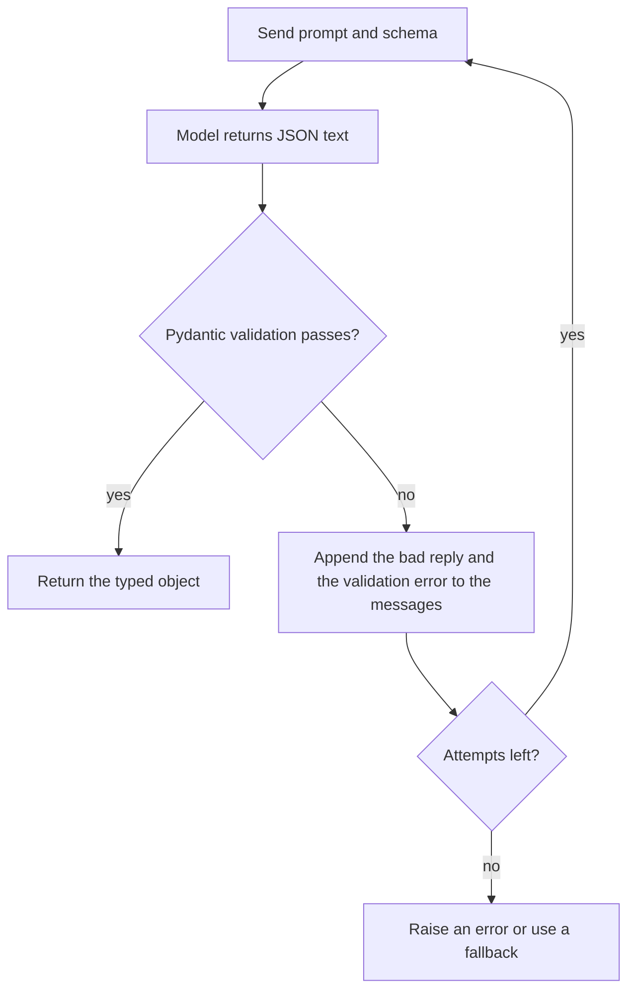
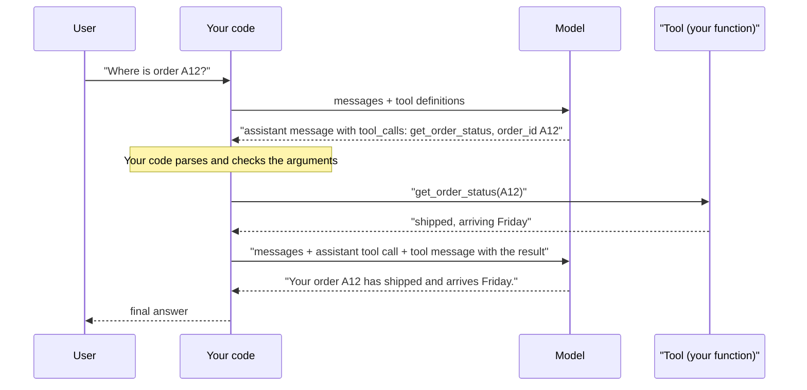

> [!summary] Structured outputs make the model reply in a shape your code can trust. Tool calling lets the model ask your code to do something. Together they turn a text generator into a part of a real program.

## Why this matters

A chatbot can reply in free text. A program cannot use free text: it needs fields, types and values it can check. Every serious LLM feature (extraction, routing, RAG grading, agents) depends on getting validated data out of the model and on letting the model call your functions. "Explain how tool calling works" and "how do you guarantee valid JSON?" are standard interview questions, and many candidates wrongly say the model runs the tool.

## The idea in plain words

**Structured output** is a form instead of a blank page. If you ask a customer to "write to us about your order", you get a story. If you give them a form with boxes for order ID, date and amount, you get data you can put in a database. A schema is that form.

**Tool calling** is a restaurant. The waiter (the model) talks to the guest and decides what is needed, but never cooks. The waiter writes an order slip ("pizza, no onions") and hands it to the kitchen (your code). The kitchen cooks and passes the plate back. The waiter then serves it with a few words. The model only ever writes the order slip.

## How it works

### Why free text is useless to programs

Ask a model for an invoice total and you may get "The total is ₹4,500", "4500.00", or "Sure! Based on the invoice, it comes to 4.5k". All are fine for a person. None is safe for `float()`. You could write regex for each case, but the next reply will find a new way to break it. You want the model to fill in a fixed shape.

### Three levels of structure

| Level | How you ask | What is guaranteed | When to use |
|---|---|---|---|
| 1. Prompt only | "Reply in JSON with keys ..." in the prompt | Nothing. May add text around it, break the syntax, skip keys | Quick tests only |
| 2. **JSON mode** | `response_format={"type": "json_object"}` | Valid JSON syntax. Not your keys or types | Works on almost every provider; pair with validation |
| 3. **Schema-constrained structured outputs** | `response_format` with a JSON Schema and `strict: true` | Output matches your schema: keys, types, enums | Best choice when your provider and model support it |

Level 3 works by **constrained decoding**. Recall from [How LLMs Work](/blog/how-llms-work) that the model picks each token from a list of probabilities. At each step, the server removes every token that would break the schema, so the model can only pick a valid one. It is not asking nicely; invalid output cannot be produced.

Even level 3 has limits. It guarantees the shape, not the truth: the model can still put a wrong date in a perfectly valid date field. Output can still be cut off by `max_tokens`. The model can refuse. And strict mode supports only part of JSON Schema (for example, every field must be listed as required and extra keys must be disallowed). So you validate at every level.

### Pydantic models as the schema

**Pydantic** is the Python library for defining data shapes as classes and checking data against them. One class does three jobs:

1. It produces the JSON Schema you send to the model (`Model.model_json_schema()`).
2. It parses and validates the model's reply (`Model.model_validate_json(text)`).
3. It gives the rest of your code a typed object.

Use `Field(description=...)` on fields. The descriptions go into the schema, and the model reads them as instructions. Use `Literal[...]` or an `Enum` when only a few values are allowed.

### The validate-and-retry loop

When validation fails, do not give up and do not just call again blindly. Send the error back. The model is good at fixing its own mistake when told exactly what was wrong.



Keep the retry count small (2 or 3). If a call still fails after that, the schema or the prompt is the problem, not luck.

### Tool calling, step by step

A **tool** (also called a function) is a function in your code that you describe to the model. The most important fact: **the model does not run the tool**. It cannot. It only outputs text. With tool calling, that text is a structured request saying "please call this function with these arguments".



The steps:

1. You send the messages plus a `tools` list. Each tool has a name, a description and a JSON Schema for its arguments.
2. The model decides. Either it answers in plain text, or it returns an assistant message with `tool_calls`. Each call has an `id`, a function `name`, and `arguments` as a **JSON string**. In this case `finish_reason` is `"tool_calls"`.
3. Your code parses the arguments, validates them, and runs the real function.
4. You append two things to the messages: the assistant message that contained the tool calls, and one message with role `tool` for each call, carrying the same `tool_call_id` and the result as a string.
5. You call the model again. It now sees the result and writes the final answer, or asks for another tool.

Every tool use therefore costs at least two model calls. The tool definitions are sent on every call and count as input tokens.

### Designing tool schemas

The model chooses tools by reading their names and descriptions, the way a new developer reads API docs. Bad docs give bad calls.

```json
{
  "type": "function",
  "function": {
    "name": "get_order_status",
    "description": "Look up the current status of one order. Use when the user asks where an order is.",
    "parameters": {
      "type": "object",
      "properties": {
        "order_id": {"type": "string", "description": "Order ID, e.g. A12"}
      },
      "required": ["order_id"]
    }
  }
}
```

| Rule | Why |
|---|---|
| Clear verb-noun names: `search_orders`, not `helper2` | The name is the first hint the model uses |
| Description says what it does, when to use it, and when not to | Stops the wrong tool being picked |
| Few required arguments; sensible defaults for the rest | Fewer ways to get the call wrong |
| Enums for fixed choices | The model cannot invent a value |
| Describe formats: "date as YYYY-MM-DD" | Removes guessing |
| Return short, relevant results | Tool results fill the context window |
| Few tools, with no overlap | Many similar tools confuse the choice |

### Parallel tool calls

One assistant message can hold several tool calls, for example the weather in two cities. This is **parallel tool calling**. You must return one `tool` message for each `tool_call_id` before the next model call; missing one gives a 400 error. You may run the calls at the same time in your code if they are independent. Some providers let you turn this off with `parallel_tool_calls=False`.

### tool_choice

| Value | Meaning |
|---|---|
| `"auto"` (default) | The model decides whether to call a tool |
| `"none"` | The model must answer in text |
| `"required"` | The model must call at least one tool |
| `{"type": "function", "function": {"name": "..."}}` | The model must call this tool |

Forcing one tool is also an old way to get structured output: define a tool whose arguments are your schema.

### Errors from tools

Tools fail: bad arguments, record not found, timeout. Do not let the exception crash the loop. Catch it and return the error **as the text of the tool message**, for example `Error: no order with ID A99`. The model reads it and can recover: fix the argument, try another tool, or tell the user. Write error messages for the model the way you would for a developer: what went wrong and what to try.

### The agent loop

Put the round trip above in a `while` loop: call the model, run the tools it asks for, send the results back, repeat until it answers without a tool call. That loop is an **agent**. There is no more magic in it than that. Planning, memory and safety are built around this loop: see [Agent Fundamentals](/blog/agent-fundamentals).

### How this relates to MCP

Here you write the tool schemas and the functions inside your own app. The **Model Context Protocol (MCP)** is a standard way to put tools in a separate server so that any MCP-aware app can discover and call them. The model still sees the same thing: a name, a description, a JSON Schema, and it still only returns a tool call. MCP changes where tools live and how they are shared, not how the model uses them. See [MCP: The Model Context Protocol](/blog/mcp-model-context-protocol).

## Code you should be able to write

Extraction with JSON mode, Pydantic validation and retry. This version works on nearly every OpenAI-compatible provider.

```python
import json
import os
from typing import Literal

from openai import OpenAI
from openai.types.chat import ChatCompletionMessageParam
from pydantic import BaseModel, Field, ValidationError

client = OpenAI(base_url=os.getenv("LLM_BASE_URL"), api_key=os.environ["LLM_API_KEY"])
MODEL = os.environ["LLM_MODEL"]


class Ticket(BaseModel):
    category: Literal["billing", "technical", "account", "other"]
    urgency: int = Field(ge=1, le=5, description="1 = can wait, 5 = service is down")
    summary: str = Field(max_length=200, description="One sentence, plain words")
    order_id: str | None = Field(default=None, description="Order ID if mentioned, else null")


def extract_ticket(text: str, max_attempts: int = 3) -> Ticket:
    schema = json.dumps(Ticket.model_json_schema())
    messages: list[ChatCompletionMessageParam] = [
        {"role": "system", "content": f"Extract the ticket as JSON matching this schema:\n{schema}"},
        {"role": "user", "content": text},
    ]
    last_error: ValidationError | None = None
    for _ in range(max_attempts):
        resp = client.chat.completions.create(
            model=MODEL,
            messages=messages,
            response_format={"type": "json_object"},  # JSON mode: valid syntax only
            temperature=0,
        )
        raw = resp.choices[0].message.content or ""
        try:
            return Ticket.model_validate_json(raw)
        except ValidationError as exc:
            last_error = exc
            messages.append({"role": "assistant", "content": raw})
            messages.append({"role": "user", "content": f"That JSON failed validation:\n{exc}\nReturn corrected JSON only."})
    raise RuntimeError(f"No valid Ticket after {max_attempts} attempts: {last_error}")
```

If your provider supports schema-constrained output, the SDK can send the schema and parse the reply for you. It reuses `client`, `MODEL` and `Ticket` from above.

```python
def extract_ticket_strict(text: str) -> Ticket:
    completion = client.chat.completions.parse(
        model=MODEL,
        messages=[
            {"role": "system", "content": "Extract the support ticket."},
            {"role": "user", "content": text},
        ],
        response_format=Ticket,  # the SDK turns the Pydantic class into a strict JSON Schema
    )
    message = completion.choices[0].message
    if message.refusal:  # the model declined to answer
        raise RuntimeError(f"Model refused: {message.refusal}")
    if message.parsed is None:
        raise RuntimeError("No parsed output")
    return message.parsed
```

Now tools. First, two tools with Pydantic argument models and a registry. The data is fake so you can run it.

```python
from typing import Any, Callable


class OrderStatusArgs(BaseModel):
    order_id: str = Field(description="Order ID, e.g. A12")


class SearchPolicyArgs(BaseModel):
    topic: Literal["refund", "shipping", "warranty"] = Field(description="Policy area to look up")


def get_order_status(args: OrderStatusArgs) -> str:
    orders = {"A12": "shipped, arriving Friday", "B77": "processing"}
    if args.order_id not in orders:
        raise ValueError(f"No order with ID {args.order_id}. Ask the user to check the ID.")
    return orders[args.order_id]


def search_policy(args: SearchPolicyArgs) -> str:
    policies = {"refund": "Refunds within 30 days.", "shipping": "Ships in 2 days.", "warranty": "1 year."}
    return policies[args.topic]


REGISTRY: dict[str, tuple[type[BaseModel], Callable[[Any], str], str]] = {
    "get_order_status": (OrderStatusArgs, get_order_status, "Look up the current status of one order by its ID."),
    "search_policy": (SearchPolicyArgs, search_policy, "Get the company policy text for one topic."),
}

TOOLS: list[Any] = [
    {"type": "function", "function": {"name": name, "description": desc, "parameters": model.model_json_schema()}}
    for name, (model, _, desc) in REGISTRY.items()
]


def run_tool(name: str, raw_args: str) -> str:
    """Never raises: errors go back to the model as text."""
    try:
        args_model, func, _ = REGISTRY[name]
        return func(args_model.model_validate_json(raw_args))
    except KeyError:
        return f"Error: unknown tool {name}"
    except Exception as exc:  # ValidationError, ValueError, timeouts, ...
        return f"Error: {exc}"
```

Then the complete loop. This is the core of every agent.

```python
def answer(question: str, max_steps: int = 5) -> str:
    messages: list[Any] = [
        {"role": "system", "content": "You are a support assistant. Use the tools to look things up. Do not guess."},
        {"role": "user", "content": question},
    ]
    for _ in range(max_steps):
        resp = client.chat.completions.create(
            model=MODEL,
            messages=messages,
            tools=TOOLS,
            tool_choice="auto",
        )
        msg = resp.choices[0].message
        if not msg.tool_calls:  # no tool wanted: this is the final answer
            return msg.content or ""
        messages.append(msg)  # the assistant turn that holds the tool calls
        for call in msg.tool_calls:  # may be more than one (parallel calls)
            if call.type != "function":
                continue
            result = run_tool(call.function.name, call.function.arguments)
            messages.append({"role": "tool", "tool_call_id": call.id, "content": result})
    return "Stopped: too many tool steps."


if __name__ == "__main__":
    print(answer("Where is order A12, and what is your refund policy?"))
```

Things to notice: `arguments` is a string that you must parse; the assistant message goes back before the tool messages; each tool message carries the matching `tool_call_id`; and `max_steps` stops a loop that never ends.

## In production

- **Validate tool arguments like user input.** The model can send wrong types, made-up IDs or harmful values. Tool calls are how prompt injection becomes real damage. Check permissions in the tool, not in the prompt. See [Guardrails and Security](/blog/guardrails-and-security).
- **Split read tools from write tools.** Reading is safe to retry. For actions that change things (refund, delete, send), require confirmation or human approval: see [Multi-Agent Systems and Human-in-the-Loop](/blog/multi-agent-and-human-in-the-loop).
- **Always cap the loop** with a step limit and a time limit.
- **Keep tool results small.** Return the ten useful fields, not the whole API response. Cut long outputs and say that you cut them.
- **Check `finish_reason`.** If it is `length`, the JSON or the tool arguments were cut off and will not parse.
- **Field order matters.** The model fills fields in schema order. Put a `reasoning` field before the `answer` field, not after, if you want the reasoning to shape the answer.
- **Keep schemas simple.** Flat beats deeply nested. Optional fields and unions are where models make most mistakes.
- **Provider support differs.** JSON mode is common. Strict schemas, parallel calls and `tool_choice="required"` are not available everywhere, and small local models call tools less reliably. Test on your real provider.
- **Tool definitions cost tokens on every call.** Thirty tools with long descriptions can cost more than the conversation. Offer only the tools the current step needs.
- **Log every tool call**: name, arguments, result, duration. This is the first place you look when an agent misbehaves. See [Observability and Tracing](/blog/observability-and-tracing).

## Interview questions

**Q: When a model "calls a tool", what actually happens?**
The model outputs a structured message naming a function and its arguments. It runs nothing. Your code reads that message, runs the function, and sends the result back in a `tool` message. Then the model is called again to continue.

**Q: JSON mode vs structured outputs?**
JSON mode guarantees only that the reply is valid JSON syntax. Structured outputs with a strict schema constrain generation so the reply matches your keys, types and enums. Neither guarantees the values are correct, so you still validate.

**Q: How can a provider guarantee schema-valid output?**
By constrained decoding. At each generation step the server blocks every token that would break the schema, so only valid continuations can be sampled. It is enforced in the sampling step, not by the prompt.

**Q: If the schema is enforced, why still use Pydantic?**
The schema checks shape, not meaning. Pydantic can check business rules (ranges, formats, cross-field logic), gives typed objects to your code, catches cut-off or refused replies, and keeps your code working on providers without strict mode.

**Q: The model returned invalid JSON. What do you do?**
Catch the validation error, append the bad reply and the exact error to the messages, and ask for a corrected version. Limit this to two or three attempts. If it still fails often, simplify the schema, improve field descriptions or move to strict structured outputs.

**Q: How do you design a good tool?**
Give it a clear name and a description that says when to use it. Keep required arguments few, use enums for fixed choices, and describe formats. Return short, useful results and clear error messages. Avoid tools that overlap.

**Q: What are parallel tool calls and what must you take care of?**
The model returns several tool calls in one message. You must answer every one with a `tool` message carrying its `tool_call_id` before calling the model again. You can run independent calls at the same time, but watch for calls that depend on each other or change the same data.

**Q: A tool throws an exception. How should the system behave?**
Catch it and return a short error text as the tool result. The model can then retry with fixed arguments, choose another path, or explain the problem to the user. Crashing the loop throws away that chance.

**Q: The model keeps calling the wrong tool. How do you debug it?**
Read the logged tool calls and the exact tool definitions sent. Usually two tools have descriptions that overlap, or a description does not say when to use it. Rewrite the descriptions, merge or remove tools, add an example in the system prompt, and test again on a set of sample questions.

**Q: What does tool_choice do?**
It controls whether the model may, must not, or must call a tool, and can force one named tool. Use `auto` normally, `required` when a step must produce an action, and a forced tool when you want a fixed structured result.

**Q: How is an agent related to tool calling?**
An agent is tool calling in a loop: call the model, run the requested tools, feed back the results, repeat until there is a final answer or a limit is hit. Frameworks add state, memory and control around that same loop.

**Q: How does MCP relate to tool calling?**
MCP is a protocol for serving tools from a separate process so that many clients can use them. The client lists the server's tools and passes them to the model as ordinary tool definitions. The model's side is unchanged.

**Q: Why put the reasoning field before the answer field in a schema?**
The model generates fields in order, one token at a time. Reasoning written first can inform the answer. If the answer comes first, the reasoning is only an excuse written afterwards.


## Go deeper

- [OpenAI: Function calling guide](https://developers.openai.com/api/docs/guides/function-calling): the reference for the request and response shapes.
- [OpenAI: Structured outputs guide](https://developers.openai.com/api/docs/guides/structured-outputs): strict schemas, supported schema features, refusals.
- [Anthropic: Writing effective tools for agents](https://www.anthropic.com/engineering/writing-tools-for-agents): the best practical advice on tool names, descriptions and results.
- [Anthropic: Building effective agents](https://www.anthropic.com/engineering/building-effective-agents): how tool calling grows into workflows and agents.
- [Pydantic: Models](https://docs.pydantic.dev/latest/concepts/models/): validation, `model_validate_json` and `model_json_schema`.
- [Instructor](https://python.useinstructor.com/): a small library built around the validate-and-retry pattern; read it after writing your own.
- [Model Context Protocol](https://modelcontextprotocol.io/): the standard for sharing tools between apps.
