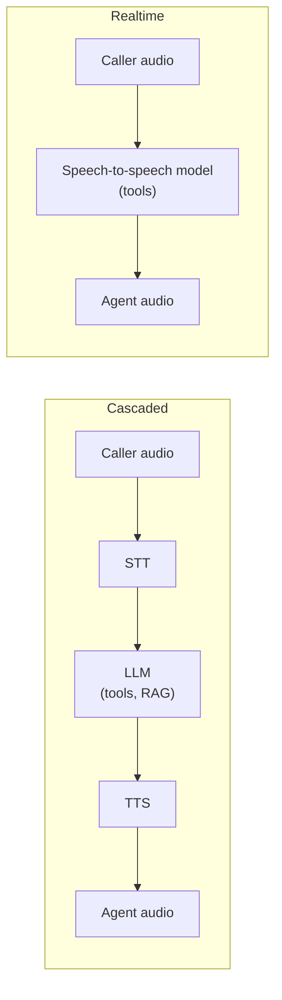
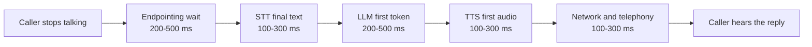
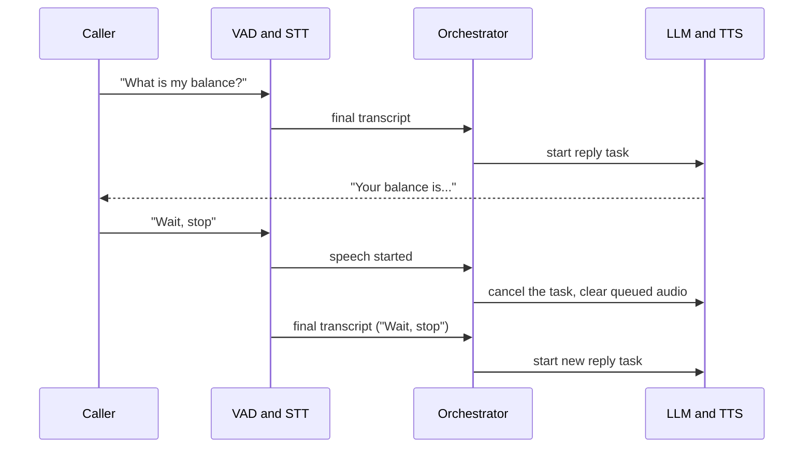

> [!summary] A voice agent listens, thinks and speaks. Most are built as a pipeline of speech-to-text, an LLM and text-to-speech, with everything streaming so the reply starts in about a second. The hard parts are latency and turn-taking, not the LLM.

## Why this matters

Voice agents are replacing IVR menus ("press 1 for billing") in call centres. Most AI engineers only know chat. If you can talk about SIP, codecs, 8 kHz audio and barge-in, you stand out in an interview, and this post covers what you need.

## The idea in plain words

Picture a human interpreter on a phone call. They hear a sentence, understand it, think of a reply and say it. They also do things we never notice: they know when you have finished speaking, they stop at once if you cut in, and they say "mm-hm" so you know they are still there.

A voice agent has to do all of this with software. The words are the easy part. The timing is the hard part. A correct answer that comes after three seconds of silence feels broken.

## How it works

### Two architectures

**Cascaded pipeline**: three models in a chain.

- **STT** (speech-to-text, also called ASR): audio in, text out.
- **LLM**: text in, text out. This is where your prompts, tools and RAG live.
- **TTS** (text-to-speech): text in, audio out.

**Speech-to-speech** (also called realtime or voice-native models): one model takes audio in and gives audio out.



| | Cascaded (STT -> LLM -> TTS) | Speech-to-speech |
|---|---|---|
| Latency | More stages to add up; fine when every stage streams | Fewer hops, often lower |
| Control | Pick and swap each part; any LLM | One provider's model and voices |
| Debugging | Text at every step: easy to log, test and guardrail | Harder: you must transcribe to inspect |
| Tone and emotion | Lost at STT (text has no tone) | Model hears and produces tone |
| Tool calling, long prompts | As good as the text LLM you choose | Supported; check quality for your case |
| Cost | Three bills, each tunable | One bill, usually priced on audio tokens |
| Typical use today | Most production phone agents | Growing; strong for natural, expressive talk |

Neither is "the winner". Many teams start cascaded because it is easier to control and to evaluate, and test realtime models as they improve. Some mix them: a realtime model for listening and speaking, a text LLM for the hard reasoning.

### The latency budget

In human conversation the gap between turns is short, often a few hundred milliseconds. A common target for agents is a **voice-to-voice latency** (end of the caller's speech to the first sound of the reply) of about one second or less. Much above 1.5 seconds, callers start saying "hello?".



> [!warning] Every number in this diagram is a typical rule of thumb, not a benchmark. Real values depend on the models, regions and network. Measure your own.

Two lessons from the diagram:

1. No single stage is the problem. The budget is used up by the sum, so you shave every stage.
2. Total LLM generation time hardly matters. What matters is **TTFT** (time to first token), because speech can start as soon as the first sentence exists.

### Streaming at every stage

Nothing waits for anything to finish.

- **STT** sends partial transcripts while the caller is still talking, then a final one.
- **LLM** streams tokens. You cut the stream into sentences or clauses.
- **TTS** starts speaking the first sentence while the LLM writes the second.
- **Audio out** is sent in small chunks as it is produced.

### Turn-taking

- **VAD** (voice activity detection): a small, fast model that says "speech" or "not speech" for each slice of audio.
- **Endpointing / turn detection**: deciding the caller has finished their turn. The simple way is "N milliseconds of silence after speech". The problem: people pause mid-sentence ("my number is... 98..."). A short wait interrupts them. A long wait feels slow. Newer systems add a small model that looks at the words or the audio to judge whether the thought is complete.
- **Barge-in** (interruption): the caller speaks while the agent is talking. The agent must stop speaking at once, throw away audio it has queued, and listen. It must also remember what it actually said before the cut, not what it had planned to say.
- **Backchannels**: small sounds like "mm-hm", "okay", "right". When the caller makes them, they are not interruptions and the agent should keep talking. Telling a backchannel from a real interruption is a known hard problem.



### Audio basics

- **Sample rate**: how many times per second the sound wave is measured. The phone network uses 8,000 Hz (8 kHz, "narrowband"). Wideband voice is 16 kHz. TTS often produces 24 kHz or more.
- **PCM**: raw, uncompressed samples. "16-bit PCM" means each sample is a 16-bit number.
- **mu-law** and **A-law** (G.711): the classic telephone codecs. They squeeze each sample into 8 bits. mu-law is used mainly in North America and Japan, A-law in most other countries.
- **Frames / chunks**: audio is sent in small slices, commonly 20 ms. At 8 kHz mu-law, one 20 ms frame is 160 samples and 160 bytes. At 16 kHz 16-bit PCM it is 320 samples and 640 bytes.

Speech models are mostly trained on 16 kHz or better. Phone audio is 8 kHz and compressed, so STT makes more mistakes on calls, most of all on names, numbers and email addresses. Choose an STT model that supports telephony audio, and convert sample rates with care.

### Transport: how audio reaches your agent

| Transport | What it is | Use it when |
|---|---|---|
| **WebRTC** | Browser and mobile real-time media over UDP, with built-in echo cancellation, jitter handling and packet-loss recovery | The user talks from an app or web page |
| **WebSockets** | A two-way TCP connection carrying audio chunks | Server-to-server links, such as telephony media streams or a provider's streaming API |
| **Telephony (SIP / PSTN)** | **SIP** sets up calls, RTP carries the audio, the **PSTN** is the public phone network | The user dials a phone number |

For phone calls, the usual pattern is: the telephony platform answers the call and forks the audio to your server as a **media stream** over a WebSocket (commonly base64-encoded 8 kHz mu-law frames in JSON messages). Your server sends audio back the same way. Some frameworks and model providers can also connect straight to a SIP trunk. WebSockets run on TCP, so a lost packet delays everything behind it. That is fine between servers on good networks, and it is why WebRTC is preferred for users on shaky mobile data.

### Tool calling mid-conversation

Tools work the same as in chat (see [Structured Outputs and Tool Calling](/blog/structured-outputs-and-tool-calling)), but silence is expensive. If a lookup takes two seconds, the caller hears dead air. The fix is **filler speech**: the agent says "Let me check that for you" while the tool runs. Keep tools fast, set short timeouts, and tell the caller if something failed instead of going quiet.

### The hard frontier: group calls

Everything above assumes one caller and one agent. In a meeting or conference call, a voice agent faces three unsolved-in-general problems:

- **Speaker diarization**: working out "who spoke when". It is easier when each person has a separate audio track, and hard when everyone is mixed into one phone line.
- **Deciding when to speak**: in a one-to-one call, silence means "your turn". In a group, silence usually means someone else is about to talk. The agent must judge whether it is being asked anything at all.
- **Addressing**: is "can you check that?" aimed at the agent or at a colleague? Many products dodge this with a wake word or the agent's name.

If an interviewer asks about this, say plainly that it is an open problem and describe the trade-off: an agent that speaks too freely is annoying, and one that waits for its name is safe but less helpful.

### Frameworks

You rarely build the plumbing yourself. As of late 2026 the common choices are:

- **LiveKit Agents**: an open-source framework (Python and Node.js) on top of LiveKit's WebRTC infrastructure. Agents join a "room" as participants. It supports STT-LLM-TTS pipelines and realtime models, turn detection, interruptions and SIP telephony.
- **Pipecat**: an open-source Python framework for voice and multimodal pipelines. You wire processors into a pipeline and pick a transport. It works with many providers.
- **Provider realtime APIs**: speech-to-speech models offered directly by model providers, such as the OpenAI Realtime API and the Gemini Live API, reached over WebRTC, WebSocket or SIP depending on the provider.
- **Managed voice-agent platforms**: hosted products that bundle telephony, models and orchestration. Faster to launch, less control.

The names change quickly. Learn the ideas (VAD, endpointing, barge-in, streaming) and you can pick up any of them.

## Code you should be able to write

A streaming voice pipeline is a set of small async workers joined by queues. This skeleton uses stubs instead of real models, so it runs with only the standard library. It was run to check the output shown below.

Part 1: the three stub models. Audio frames are faked: a non-empty frame is a spoken word, an empty frame is silence.

```python
import asyncio
from collections.abc import AsyncIterator

FRAME_S = 0.02          # one audio frame = 20 ms
END_SILENCE_FRAMES = 5  # this much silence = "the user finished their turn"

Event = tuple[str, str]  # ("speech_start", "") or ("final", transcript)


async def stt(audio_in: asyncio.Queue[bytes], events: asyncio.Queue[Event]) -> None:
    """Stub STT + VAD. A non-empty frame is speech, an empty frame is silence."""
    words: list[str] = []
    silence = 0
    while True:
        frame = await audio_in.get()
        if frame:
            if not words:
                await events.put(("speech_start", ""))
            words.append(frame.decode())
            silence = 0
        elif words:
            silence += 1
            if silence >= END_SILENCE_FRAMES:  # endpointing
                await events.put(("final", " ".join(words)))
                words, silence = [], 0


async def llm_stream(text: str) -> AsyncIterator[str]:
    """Stub LLM: streams a reply token by token."""
    reply = f"You said: {text}. Here is a long answer. It has three sentences."
    for token in reply.split(" "):
        await asyncio.sleep(0.03)
        yield token + " "


async def tts_stream(sentence: str) -> AsyncIterator[bytes]:
    """Stub TTS: turns one sentence into a few audio chunks."""
    for word in sentence.split():
        await asyncio.sleep(0.03)
        yield word.encode()
```

Part 2: the core. `respond` is one agent turn. `conductor` starts a turn on each final transcript and cancels it on barge-in.

```python
async def respond(text: str, audio_out: asyncio.Queue[bytes]) -> None:
    """One agent turn: LLM tokens -> sentences -> TTS chunks -> speaker queue."""
    sentence = ""
    async for token in llm_stream(text):
        sentence += token
        if sentence.rstrip().endswith((".", "?", "!")):  # speak sentence by sentence
            async for chunk in tts_stream(sentence):
                await audio_out.put(chunk)
            sentence = ""


async def conductor(events: asyncio.Queue[Event], audio_out: asyncio.Queue[bytes]) -> None:
    """Starts a reply on each final transcript. Cancels it when the user barges in."""
    reply: asyncio.Task[None] | None = None
    while True:
        kind, text = await events.get()
        if kind == "speech_start" and reply and not reply.done():
            reply.cancel()                  # stop the LLM and the TTS
            while not audio_out.empty():    # throw away audio not played yet
                audio_out.get_nowait()
            print("  [barge-in: reply cancelled]")
        elif kind == "final":
            print(f"USER : {text}")
            reply = asyncio.create_task(respond(text, audio_out))
```

Part 3: a fake speaker, a fake caller who interrupts, and `main`.

```python
async def speaker(audio_out: asyncio.Queue[bytes]) -> None:
    """Stub audio output: 'plays' each chunk."""
    while True:
        chunk = await audio_out.get()
        print(f"AGENT: {chunk.decode()}")
        await asyncio.sleep(0.03)  # playing audio takes real time


async def fake_caller(audio_in: asyncio.Queue[bytes]) -> None:
    """Stub microphone: a script of frames. b'' means a silent frame."""
    script = [b"what", b"is", b"my", b"balance"] + [b""] * 25
    script += [b"stop", b"cancel", b"that"] + [b""] * 60  # spoken while the agent talks
    for frame in script:
        await audio_in.put(frame)
        await asyncio.sleep(FRAME_S)


async def main() -> None:
    audio_in: asyncio.Queue[bytes] = asyncio.Queue()
    events: asyncio.Queue[Event] = asyncio.Queue()
    audio_out: asyncio.Queue[bytes] = asyncio.Queue()
    workers = [
        asyncio.create_task(stt(audio_in, events)),
        asyncio.create_task(conductor(events, audio_out)),
        asyncio.create_task(speaker(audio_out)),
    ]
    await fake_caller(audio_in)  # the call lasts as long as the caller's script
    for worker in workers:
        worker.cancel()


if __name__ == "__main__":
    asyncio.run(main())
```

Output (shortened): the first reply is cut off after one sentence, then a full new reply plays.

```
USER : what is my balance
AGENT: You
AGENT: said:
...
AGENT: balance.
  [barge-in: reply cancelled]
USER : stop cancel that
AGENT: You
...
AGENT: sentences.
```

What to notice: `reply.cancel()` raises `CancelledError` inside `respond` at its next `await`, which stops both the LLM stream and the TTS stream. Clearing `audio_out` matters just as much, or the agent keeps talking from its buffer.

## In production

- **Echo.** If the agent's own voice leaks back into the microphone, VAD fires and the agent interrupts itself. WebRTC has echo cancellation built in. On raw telephony streams you may need to handle it.
- **False barge-ins.** A cough, background noise or "mm-hm" should not stop the agent. Common fixes: require a minimum length of speech or a few recognised words before cancelling.
- **Track what was heard.** After a barge-in, cut the assistant message in the chat history down to the part that was actually played. If not, the LLM believes it said things the caller never heard.
- **Write for the ear.** Prompt the LLM for short sentences, no Markdown, no bullet lists, and numbers written the way they are spoken. Read back important values ("I heard 9-8-7, is that right?").
- **Names, numbers, emails** are where 8 kHz STT fails most. Use confirmation, keyword boosting if the STT supports it, or DTMF (keypad tones) for digits.
- **Keep everything close.** Put STT, LLM and TTS in the same region as the media server. Every cross-region hop adds delay.
- **Speculate.** Some systems start the LLM on a partial transcript and discard the work if the caller keeps talking. This trades cost for speed.
- **Fall back to a human.** Offer transfer to a person on repeated failure, anger or a direct request.
- **Legal and safety.** Recording consent, telling callers they are speaking with an AI, and handling payment or health data follow local law. Treat the transcript as untrusted input, as in [Guardrails and Security](/blog/guardrails-and-security).

**Evaluation.** Measure these, not just "it sounded fine":

- **Latency**: voice-to-voice p50 and **p95** (the value that 95% of turns beat), plus each stage on its own.
- **WER** (word error rate) for STT: (substitutions + deletions + insertions) divided by the number of words in the correct transcript. Test on real call audio, not clean studio audio.
- **Interruption handling**: how fast the agent stops after barge-in, the rate of false interruptions, and how often the agent cut off the caller.
- **Task success**: did the call achieve its goal (booking made, question answered) without a human? Score transcripts with rubrics and an LLM judge, as in [Evals: Measuring LLM Apps](/blog/evals).
- **Simulated callers**: scripted or LLM-driven test calls with noise, accents and interruptions, run on every change.

**Cost.** Voice is billed per minute or per unit at every layer: STT per minute of audio, LLM per token, TTS per character or per minute, telephony per minute, and sometimes a platform fee. Realtime models usually charge for audio tokens in and out. The LLM is often not the biggest line. Add all layers into one cost per minute, multiply by the average call length, and compare with the cost of a human-handled call. Prices change often, so check each provider's pricing page.

## Interview questions

**Q: What are the two main architectures for a voice agent?**
A cascaded pipeline of STT, LLM and TTS, or a single speech-to-speech model. Cascaded gives control, easy logging and free choice of each part. Speech-to-speech has fewer hops and keeps tone of voice, but is harder to inspect and ties you to one provider.

**Q: What latency should a voice agent target, and where does the time go?**
As a rule of thumb, about one second or less from the end of the caller's speech to the first audio of the reply. The time is spread across endpointing, STT, LLM time to first token, TTS time to first audio, and network. No single stage dominates, so you optimise all of them and stream everything.

**Q: What is VAD, and how is it different from turn detection?**
VAD only says whether a slice of audio contains speech. Turn detection decides whether the speaker has finished their turn. The simplest turn detector is VAD plus a silence timer; better ones also look at the words or the sound to see if the thought is complete.

**Q: What is barge-in and how do you implement it?**
It is the caller interrupting the agent. When speech is detected during playback, I cancel the running LLM and TTS tasks, clear any queued audio, tell the transport to stop playback, and trim the chat history to what was actually spoken. Then I process the new speech as a normal turn.

**Q: The agent keeps cutting callers off mid-sentence. How do you fix it?**
The endpointing is too eager. I would lengthen the silence threshold, or add a turn-detection model that checks whether the sentence looks complete. I would then measure both the cut-off rate and the latency, because a longer wait makes every reply slower.

**Q: The agent keeps stopping for no reason while it speaks. Why?**
Probably false barge-ins: echo of its own voice, background noise, or backchannels like "okay". I would check echo cancellation, raise the VAD threshold, and require a minimum amount of real speech before cancelling.

**Q: Why is phone audio harder for STT than app audio?**
The phone network carries 8 kHz narrowband audio compressed with G.711, while most models are trained on 16 kHz or better. Less of the sound survives, so letters, digits and names are easily confused. I would use a telephony-tuned model and confirm critical values.

**Q: WebRTC or WebSockets?**
WebRTC for end users on browsers and phones, because it runs over UDP and handles packet loss, jitter and echo. WebSockets for server-to-server audio, such as a telephony media stream, where the network is reliable and simplicity wins.

**Q: How do you handle a slow tool call during a voice conversation?**
Say a short filler line first, such as "one moment while I check", then run the tool with a tight timeout. If it fails, say so and offer another path. Never leave silence longer than a second or two.

**Q: Why stream the LLM output into TTS sentence by sentence?**
TTS needs enough text to sound natural, but waiting for the full answer wastes seconds. A sentence or clause is the smallest unit that still sounds right, so the first sentence plays while the rest is being written.

**Q: How would you evaluate a voice agent?**
Latency p50 and p95 per stage and end to end, WER on real call recordings, interruption metrics, and task success scored from transcripts. I would run simulated calls on every change and review a sample of real calls by ear.

**Q: What makes a voice agent in a group call hard?**
It must know who is speaking (diarization), whether it is being addressed, and when it is appropriate to talk. Silence no longer means "your turn". This is still an open problem, so most products use a wake word or reply only when named.

**Q: How do you estimate the cost of a voice agent?**
Add per-minute costs for telephony, STT, TTS and any platform, plus LLM tokens per turn times turns per minute. Multiply by the average call length. I would not quote prices from memory because they change; I would build a small calculator from the current pricing pages.


## Go deeper

- [Voice AI and Voice Agents: An Illustrated Primer](https://voiceaiandvoiceagents.com/) - the best single read on production voice agents, by people who build Pipecat.
- [LiveKit Agents docs](https://docs.livekit.io/agents/) - framework docs covering pipelines, turn detection and telephony.
- [Pipecat docs](https://docs.pipecat.ai/) - open-source pipeline framework; read the core concepts.
- [OpenAI Realtime API over WebSocket](https://developers.openai.com/api/docs/guides/realtime-websocket) - what a speech-to-speech API looks like on the wire.
- [Twilio Media Streams WebSocket messages](https://www.twilio.com/docs/voice/media-streams/websocket-messages) - a concrete example of telephony audio (8 kHz mu-law, base64) over a WebSocket.
- [Python asyncio tasks](https://docs.python.org/3/library/asyncio-task.html) - task creation and cancellation, used in the code above.
